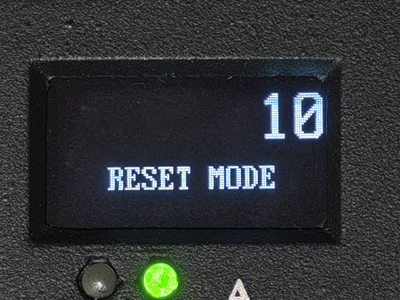
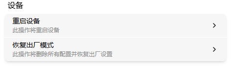
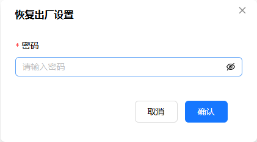

# 恢复出厂设置

把 FlexKVM 恢复到出厂状态。

> 入口：设置 → 维护 → 设备 → **恢复出厂模式**（卡片描述：此操作将删除所有配置并恢复出厂设置）

**会清除**：账号、密码、2FA 密钥、WiFi 配置、静态 IP 与证书等网络配置、自定义设置。

**不会清除**：审计日志（硬件和软件重置都保留）、固件版本（不会降级）。

> 需要连日志一起清？用 SSH 的 `reset all` 命令。

重置完成后设备**自动重启**。过程中 OLED 显示 **RESET**，🟢 状态灯和 🔴 警告灯同时快闪。

## 操作前

重置后设备相当于一台新机器，动手前记录这些信息：

- [ ] 网络配置：静态 IP / DHCP 设置、WiFi 名称与密码、AP 热点参数
- [ ] 登录方式：管理员用户名；开了 2FA 的确认备用码还能用
- [ ] 远程接入（如用到）：Tailscale、HTTPS 证书与域名、SSH 端口与密钥
- [ ] 要留存的日志：系统日志、审计日志（`reset all` 会连审计一起清，要留先在 设置 → 维护 里下载）
- [ ] 当前固件版本号（报障、回滚时要用）

> 设备在异地、又只靠 WiFi 接入时，先确认现场有人能插网线或用按键进入配网模式，再执行重置。

## 操作后

1. 设备自动重启，OLED 显示 IP 或 `NO NETWORK !`
2. WiFi 配置已清空：插网线，或长按按键 A 1~3 秒进入[配网模式](../network/provision.md)重新配网
3. 浏览器打开设备 IP，[重新创建管理员账号](../security/account/login.md)（用户名 4~32 位），按需重新绑定 2FA
4. 按操作前的记录恢复静态 IP、Tailscale、证书等配置

## 硬件重置

进不了 Web 界面时用。用卡针按住**恢复出厂按键**，约 1 秒后 OLED 显示倒计时（从 14 开始）；继续按住到归零（共约 15 秒），OLED 显示 RESET 后松开 → 设备自动重启。**中途松开即取消**，不清除数据。

> 需物理接触设备，无法远程操作。详见[物理按键](../interaction/button.md)。

## 软件重置

点"恢复出厂模式"卡片 → 输入密码确认 → 设备自动重启。

## SSH 重置

SSH 登录后执行：

| 命令 | 效果 |
|------|------|
| `reset` | 恢复出厂，**保留**审计日志（推荐） |
| `reset all` | 深度恢复，**清除全部**（含审计日志） |

确认操作后设备自动重启。

---

[:octicons-arrow-left-24: 返回用户指南](../index.md)
