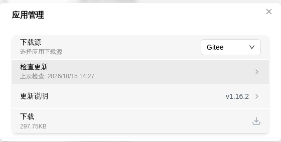
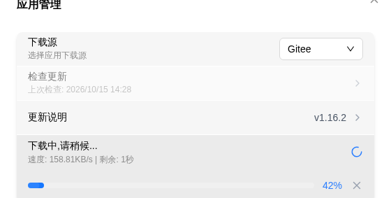
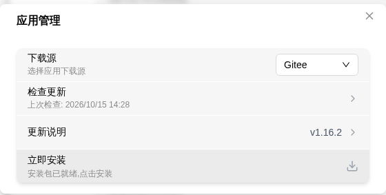
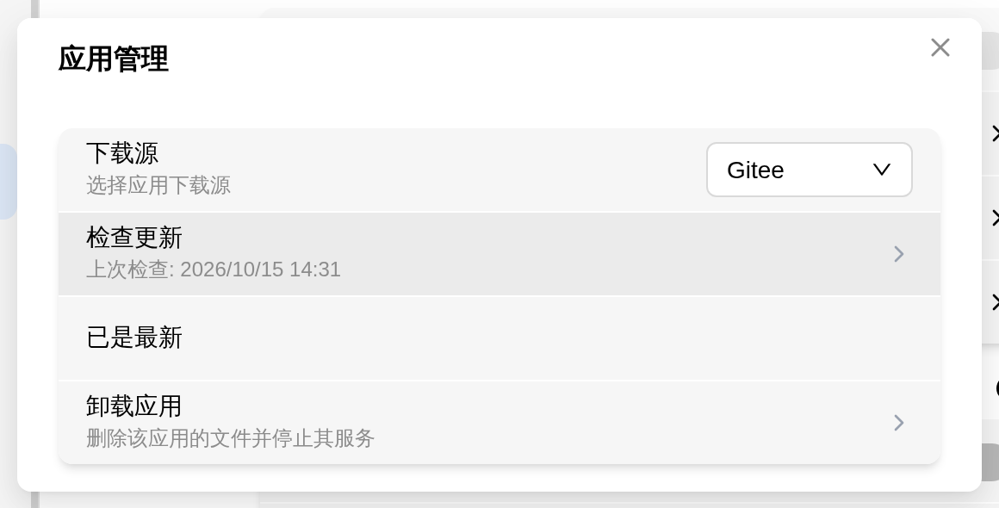

# App Management

On FlexKVM, **Tailscale**, **ZeroTier** and **frp Tunneling** are installed as *apps* — each can be downloaded, updated and uninstalled independently. [Online Upgrade](upgrade-online.md) handles system firmware, App Management handles these apps, and the two don't affect each other.

> Where: Settings → App → open the **App Management** row at the bottom of an app card

The **App Management** row is **per card**: whichever card you open, that's the app you're managing. The card also mirrors the app's current state in its status text, e.g. "App Management (Up to date)" or "App Management (Not installed)".

> **WireGuard is not one of them**: it lives in the kernel and ships with the firmware, so there is no app package to download and no **App Management** row on its card — it upgrades together with the system firmware.

## Download Source

Choose where to download app packages from:

- **Gitee** — Default source, faster for users in China
- **GitHub** — International users

> There are only these two sources. If a package isn't found on one, try the other.
>
> Switching the download source clears already-downloaded packages — check for updates again afterwards.

## Check for Updates

Click **Check for Updates** and the system fetches that app's latest version info from the current source; the last check time appears below the row. **Downloading or installing without checking first does nothing useful** — the version, size and checksum all come from this step.

> **Verify**:
>
> - Update available → the row shows "Update available" plus a **Changelog** entry you can open
> - No update → shows "Up to date"
> - Not checked yet, or the last check failed → shows 'Click "Check for Updates" to see app status'

## App Status

| Status | Meaning |
|--------|---------|
| Not installed | The app isn't installed on this device; you can download and install it directly |
| Update available | A newer remote version exists — read the **Changelog** before downloading |
| Up to date | The installed version is the latest |
| Incompatible with current firmware | The new version requires newer firmware; the row shows "Requires firmware X or above" and the download button is grayed out |
| Versions not comparable | The local or remote version format can't be compared; the button becomes **Install Anyway** with the hint "Local or remote version format cannot be compared; you can overwrite-install the current version" |
| Not checked | Not checked yet, or the last check failed |

## Download & Install

1. Click **Download** — progress, speed and remaining time are shown (e.g. "Speed: 158.81KB/s | Remaining: 1s"); cancel anytime

   

2. When the download finishes the package is verified automatically (shows "Verifying package integrity..."); once verified the button becomes **Install Now** with the hint "Package downloaded, click to install"

   

3. Click **Install Now** — the app is installed and its service restarts automatically

> **Verify**: after installation the card status becomes "Up to date" and the toggle row shows the new version number.

- App updates do **not require a device reboot**, and a failed install automatically rolls back to the previous version
- Only one update task can run at a time: clicking again while downloading or installing shows "Another update task is running, try again later"
- Installation can't be cancelled midway (a download can) — once it starts, it runs through to a successful swap or a rollback

## Uninstall

When the app is installed, the modal gains an **Uninstall** row at the very bottom (hint: "Delete the app files and stop its service"):

Clicking it asks for confirmation first:

> Uninstalling deletes the app files and stops its service. You can reinstall it later. Continue?

After confirming, it shows "Uninstalling, please wait..." and then "App uninstalled". It **cannot be cancelled** — once started, it runs until the files are gone or it fails.

- Uninstalling flips that app's toggle back **off** and stops its service
- **Your configuration is not deleted with it**: login state, network and tunnel config all live outside the app directory; after reinstalling, just enable it again
- Afterwards the card returns to the "App not installed" shape — to use it again, follow the download & install flow above

## Update Failed?

| Symptom | Possible cause | Try this |
|---------|----------------|----------|
| Check failed | Network issue or source unavailable | Switch download source, or retry later |
| Download failed | Unstable network | Switch download source and download again |
| Package checksum mismatch | Corrupted package | Download again |
| Not enough storage | Storage full | Free up space and retry |
| Incompatible with current firmware | Firmware too old | [Run an online upgrade](upgrade-online.md) first |
| "Another update task is running" | A check/download/install task is already running | Wait for it to finish, or cancel the download |
| No **Uninstall** row | The app isn't currently installed | Nothing to uninstall; check that the card doesn't say "App not installed" |

---

[:octicons-arrow-left-24: Back to User Guide](../index.md)
