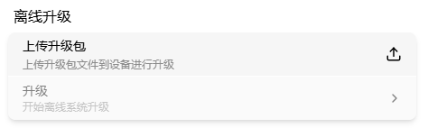
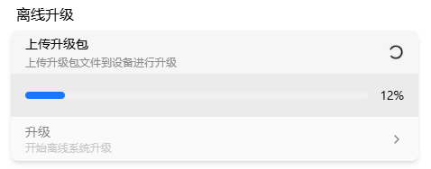
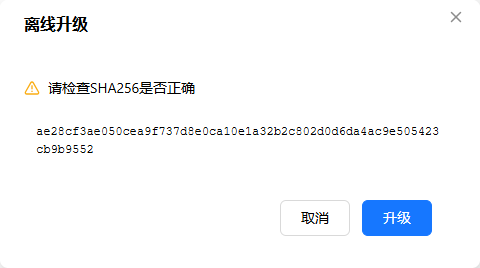
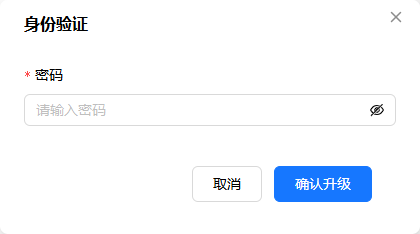
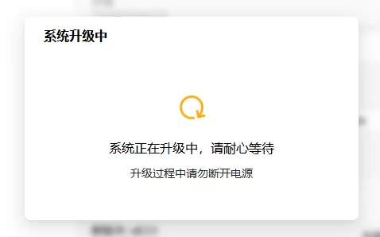
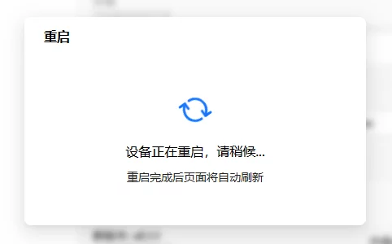

# Offline Upgrade

You can upgrade firmware even without internet access — download the firmware package on your computer and upload that local file straight to the device; no TF card involved.

> Where: Settings → Upgrade → Offline Upgrade

## Before You Start

- [ ] Power the device from a dedicated power adapter — do not rely only on USB power from the target host. Power loss during upgrade can brick the device
- [ ] Note the current firmware version (Settings → System → About), needed for rollback decisions and support tickets
- [ ] Make sure the target version is higher than the current one: downgrades and same-version overwrites are not supported
- [ ] Do not touch power, USB device identity, or network settings while upgrading

## Download Firmware Package

Download the OTA image file (`.tar` format) from either source on your computer:

| Source | URL | Best for |
|--------|-----|----------|
| GitCode | [gitcode.com/chutuotek/flexkvm/releases](https://gitcode.com/chutuotek/flexkvm/releases) | Faster for users in China |
| Gitee | [gitee.com/chutuotek/flexkvm/releases](https://gitee.com/chutuotek/flexkvm/releases) | Users in China, faster |
| GitHub | [github.com/chutuotek/flexkvm/releases](https://github.com/chutuotek/flexkvm/releases) | International users |

On the releases page, find the target version and download the `.tar` firmware package (e.g., `flexkvm-v0.2.0.tar`).

## Upload Image

Click **Upload Upgrade Package** → select the `.tar` firmware package on your computer.

> **Verify**: After upload, verification passes and the upgrade card becomes active (no longer grayed out).

## Upgrade

Click Upgrade - a dialog shows the image SHA-256 checksum, which you can compare against the value published on the firmware releases page (if the releases page doesn't publish one, go straight to the next step) - enter password (with 2FA enabled, also enter verification code):

After verification, upgrade begins:

> **Verify**: During upgrade, the OLED shows an upgrade icon and 🔴 Warning LED fast-blinks. When complete, the device auto-reboots and OLED shows the IP again.

Upgrade success:

> OTA only upgrades to a higher version — downgrades and same-version overwrites are not supported. ⚠️ Keep power stable during upgrade; power loss may cause upgrade failure.

> Power loss mid-upgrade, or the device won't boot afterwards → the [Flash Image](./flash.md) page is still being written, so [submit feedback](../../community/feedback/index.en.md) directly with the serial number.

---

[:octicons-arrow-left-24: Back to User Guide](../index.md)
