# Storage Management

FlexKVM offers three kinds of storage source: the **TF card** (MicroSD inside the device), **NFS** and **SMB** (network shares on a NAS or a server). All three support file management, and all three can expose media or an image to the target as a virtual USB drive or virtual CD-ROM. The two most common scenarios: sharing an ISO image as a virtual CD-ROM for remote OS installation, and transferring files between a storage source and the target.

> Where: **Mirror** in the menu bar

## Storage Sources

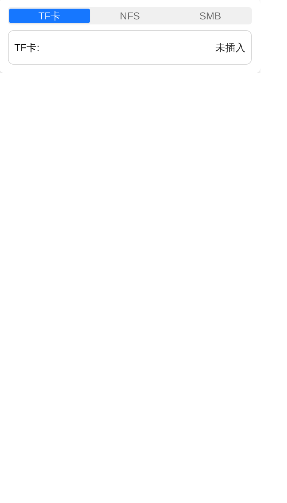

A three-way switcher at the top of the panel toggles between **TF Card / NFS / SMB**:

| Segment | Description |
|---------|-------------|
| **TF Card** | The local TF card; see the sections below |
| **NFS** | An NFSv4 network share; mount it first |
| **SMB** | An SMB (CIFS) network share; mount it first |

> **Switching segments only switches the view**: NFS and SMB stay mounted independently, so content is still there when you come back, and the two can be **mounted at the same time** without displacing each other.

> **Only one share exists at a time**: the target sees a single USB mass-storage device, so whichever segment starts a share, the others show **Sharing from \<source\>** and hide their entry.

## TF Card Requirements

| Item | Requirement |
|------|-------------|
| Card type | MicroSD (TF) card |
| Capacity | No hard limit |
| Filesystem | FAT32 / exFAT / ext4 / NTFS (exFAT recommended — no 4GB limit) |

## Installation

The TF card slot is on the side of the device, below the power LED. Insert with metal contacts facing the power LED — push until you hear a click.

> **Verify**: After insertion, the OLED storage icon shows connected. No change? Re-insert or check if the card is working.

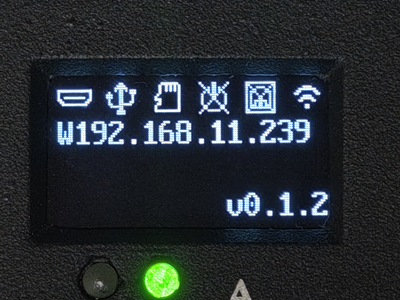

## Disk Image Menu

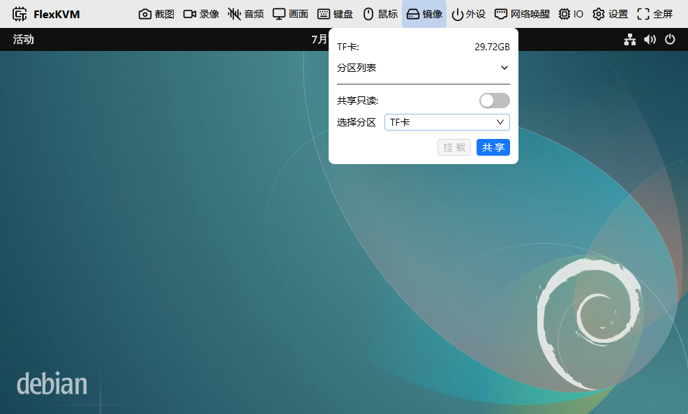

| Icon | Meaning |
|------|---------|
|  | Any storage source available, idle |
|  | No storage source (no TF card, no network storage mounted) |
|  | File upload in progress |
|  | File download in progress |
|  | Currently shared to host via USB / exporting image |

> When only network storage is available the icon becomes a cloud — storage in that case really is a network drive.

Five operations:

### Full Disk Sharing

Share the entire TF card as a USB drive — the host can see all partitions.

Select the TF card → click **Share**.

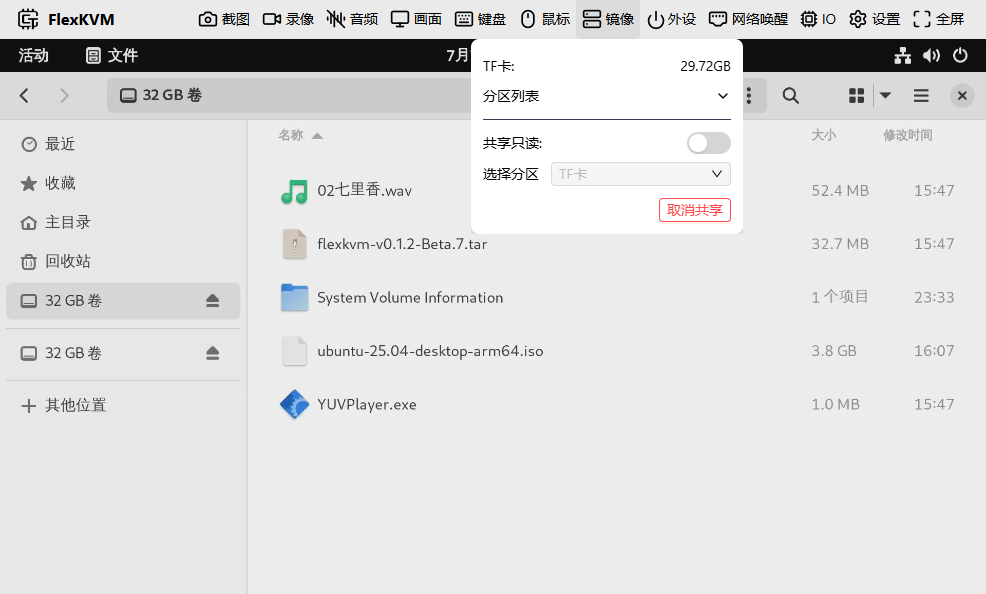

> Enable read-only to prevent the host from writing.

### Partition Sharing

Share only a specific partition — other partitions are invisible to the host.

Select a partition → click **Share**.

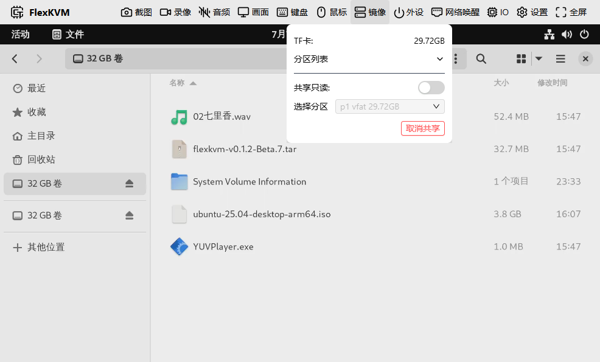

### Partition Mounting

Mount a partition to browse and manage files on FlexKVM.

Select partition → click **Mount** → file list, partition size, upload/unmount buttons appear.

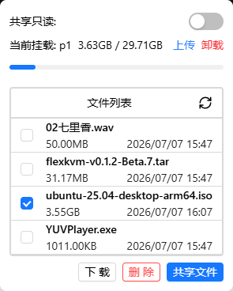

> The partition must use a supported filesystem (FAT32 / exFAT / ext4 / NTFS). When mounting fails, handle it by cause: for an NTFS card with a dirty bit or hibernation file, unmount and repair it on a PC first; otherwise try **Check / Repair** first.

**Uploads / downloads can be cancelled anytime**: click **Cancel** during a transfer — uploads stop sending and wait for the device to clean up; downloads discard the incomplete file. Cancellation shows "Cancelled" instead of a failure error; failures are reported with their specific cause.

### Partition Check & Repair

**Check** below the menu runs a filesystem consistency check on the selected partition; **Repair** also attempts to fix the problems found. Both require the partition to be unmounted and not shared, and repair may delete damaged files or directory entries — back up important data first.

| Result | Meaning |
|--------|---------|
| Filesystem is healthy, no problems found | Nothing to do |
| Problems found; click "Repair" to try fixing them | Issues detected, repair recommended |
| Filesystem repaired | Repair complete |
| Problems remain that cannot be fixed automatically; back up and reformat | Manual intervention needed |
| This filesystem type is not supported for checking | No check for this partition (NTFS supports mounting only, not check/repair) |
| Partition not found | The partition is gone; refresh the partition list and retry |
| Check timed out; the filesystem may be badly damaged | Check did not finish in time; the filesystem may be badly damaged |
| Checking tool missing on the device | No checking tool available for this partition |
| Check failed | Other failure reasons |

### Single File Sharing

Mount a partition first → check a `.img` or `.iso` file → click **Share File**. The host will recognize it as a virtual CD-ROM.

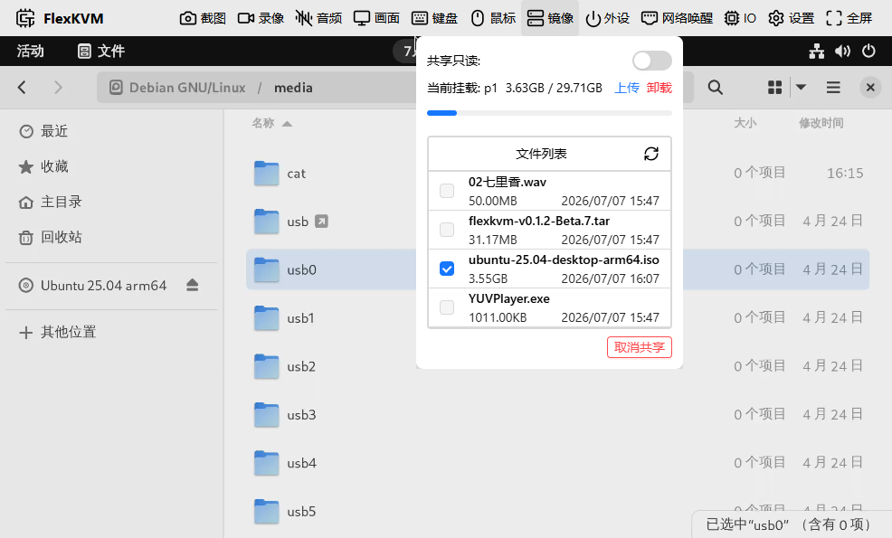

> Files larger than 4GB are supported, but must be `.img` or `.iso` format.

### Safe Removal

| Current state | What to do |
|---------------|------------|
| Single file sharing | Unshare → Unmount partition → Remove card |
| Full disk / partition sharing | Unshare → Remove card |
| Mounted but not sharing | Unmount partition → Remove card |
| Inserted but no operation | Remove directly |

## Network Storage (NFS / SMB)

Use a directory on a NAS, a server or another computer as if it were local storage: browse, upload, download, and share an image from it to the target.

### Scope

| Item | Support |
|------|---------|
| NFS | **NFSv4 only** |
| SMB | SMB 3.0 (CIFS) |
| File listing | The **root** of the mount only — no subfolders |
| Shareable | A single regular file of at least 512 bytes |

> **No NFSv3**: v3 needs an extra port lookup against the server that this device cannot do reliably. Use NFSv4 — just enable v4 on the server.

### Mount NFS

Switch to the **NFS** segment, fill in two fields and click **Mount**:

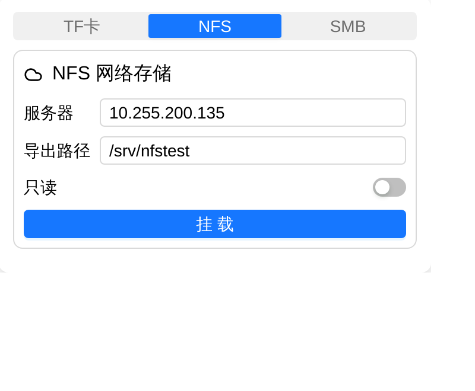

| Field | What to enter |
|-------|---------------|
| Server | Hostname or IP, e.g. `10.255.200.135` |
| Export | The **absolute path** the server exports, e.g. `/srv/nfstest` |
| Read-only | When on, read access only |

> A hostname is resolved to IPv4 once on the device; if resolution fails the mount fails immediately rather than waiting forever.

### Mount SMB

Switch to the **SMB** segment:

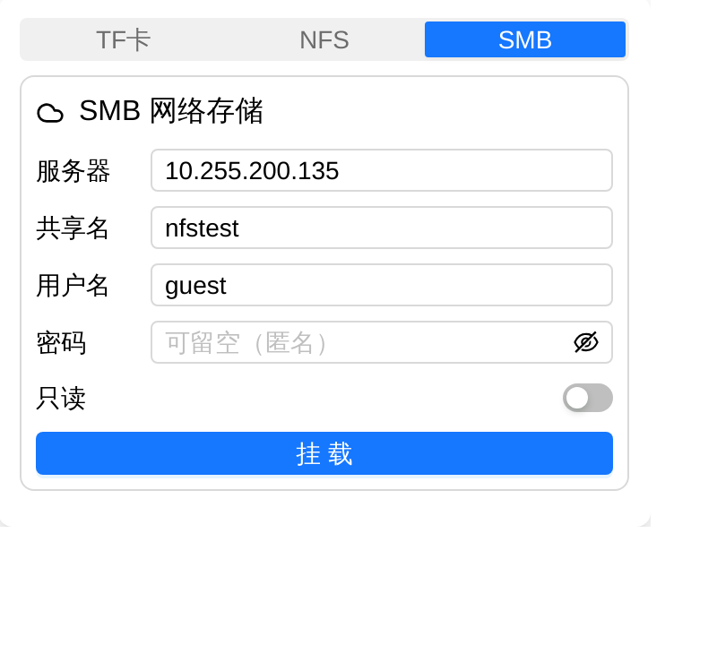

| Field | What to enter |
|-------|---------------|
| Server | Hostname or IP |
| Share | A **single share name** (not a path), e.g. `share` |
| Username | `guest` for anonymous |
| Password | Leave blank when there is none |
| Read-only | When on, read access only |

> **The share name must not contain `/`**: it would be parsed as a subdirectory and silently change the meaning, so the dialog rejects it.

> **Username and password must not contain commas**: SMB mount options are comma-separated, so one comma can turn the rest into new options (for instance silently making the mount read-only). Rejected on input.

### After mounting

Once mounted, the panel shows the source string, capacity and the file list:

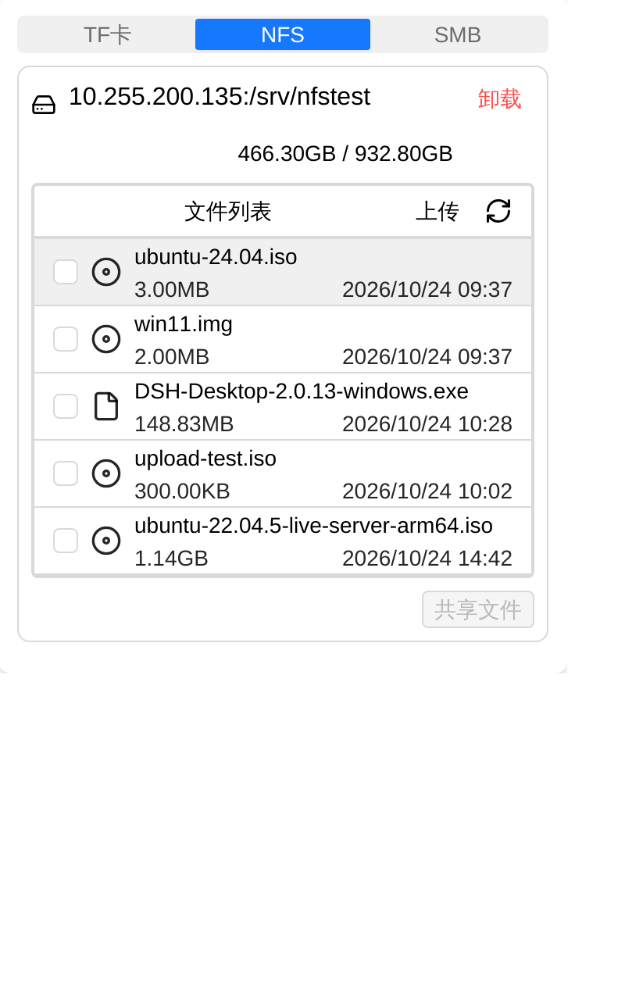

| Action | Description |
|--------|-------------|
| Upload | **Upload** in the list header, same position as on the TF segment |
| Download | Select a file, then click **Download** |
| Delete | Select a file, then click **Delete**; asks for confirmation |
| Refresh | The refresh icon in the list header; files added externally appear only after a refresh |
| Unmount | **Unmount** at the top right of the card |

> **The list does not update by itself**: files added or removed on the server appear only after a refresh.

> **Restored on boot**: the mount configuration is persisted and re-mounted automatically after a reboot (in the background — it does not delay startup).

> **Mounting is asynchronous**: clicking **Mount** is acknowledged immediately and the result is pushed later. An unreachable server can take a dozen seconds to fail; the UI also has a 30-second fallback that checks once more, so it never sits at "Mounting" forever.

### Sharing an image from network storage

Select a file → click **Share file**. The target sees it as a virtual CD-ROM.

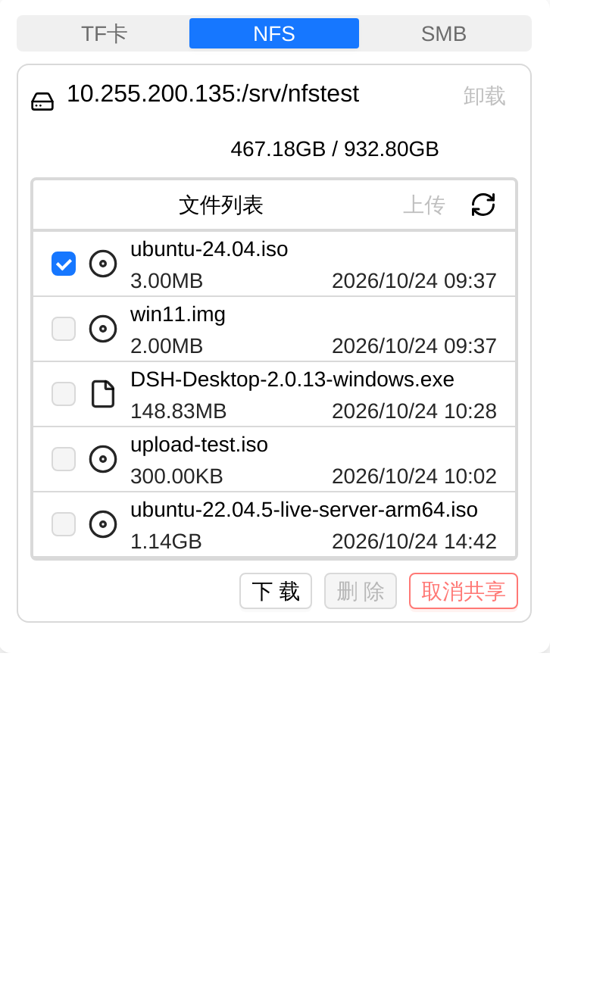

> **Read-only by default**: writing back into a network share is not the intended use, and an accidental write would pollute remote data.

> **Only a single file in the mount root**: subdirectories are not supported, and files under 512 bytes are rejected (the target cannot use media that small).

### One share state across all three segments

While sharing, the segment that started it shows **Stop sharing**; the others show **Sharing from \<source\>** with upload, delete and unmount greyed out:

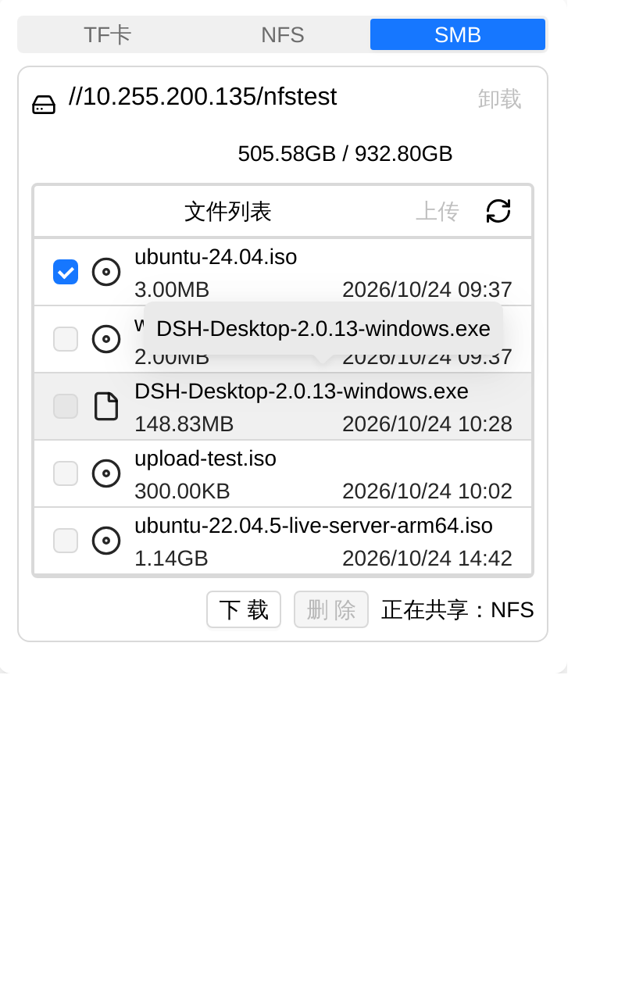

> **No unmount while sharing**: unmounting yanks the medium out from under a reading target, which then sees the device vanish.

> **No file changes while sharing**: uploads and deletions are rejected. Downloads are unaffected.

---

## FAQ

**TF card not detected?** → Check the filesystem. FAT32, exFAT, ext4 and NTFS are supported, with exFAT the most compatible; try **Check / Repair** on a partition that won't open, and only reformat as exFAT on a PC if that fails.

**Shared CD-ROM not recognized by host?** → Make sure the file is `.img` or `.iso`. Other formats can't be shared as a virtual CD-ROM.

**Upload interrupted?** → Refresh the page and re-upload. Resume is not currently supported. Cancellations and failures are reported separately — a cancellation is not an error.

**OS install failed halfway?** → Did you toggle mouse, keyboard, or audio during installation? These actions cause a brief virtual CD-ROM disconnect.

**NFS/SMB mount failed?** → Only two messages exist: `This mount point is already in use` means the source is still mounted (or an external mount left it behind) — unmount first; anything else is a generic "Mount failed", so check the network: is the server up, are the address and share spelled right, does the server firewall allow NFS port 2049 or SMB port 445. Specific errnos are only in the device log.

**New files in network storage not visible?** → Click the refresh icon in the list header. The device does not watch remote changes.

**Clicked Share and nothing happened?** → If the share failed, a specific reason appears; if it succeeded, the button updates once the state frame arrives. "Unknown error 525" means the file is smaller than 512 bytes.

**Unmount says it is sharing?** → Click **Stop sharing** first, then unmount.

---

[:octicons-arrow-left-24: Back to User Guide](../index.md)
