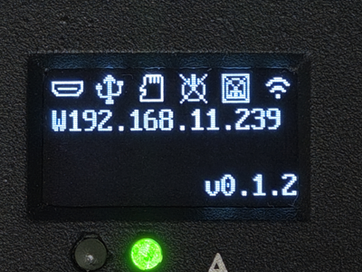
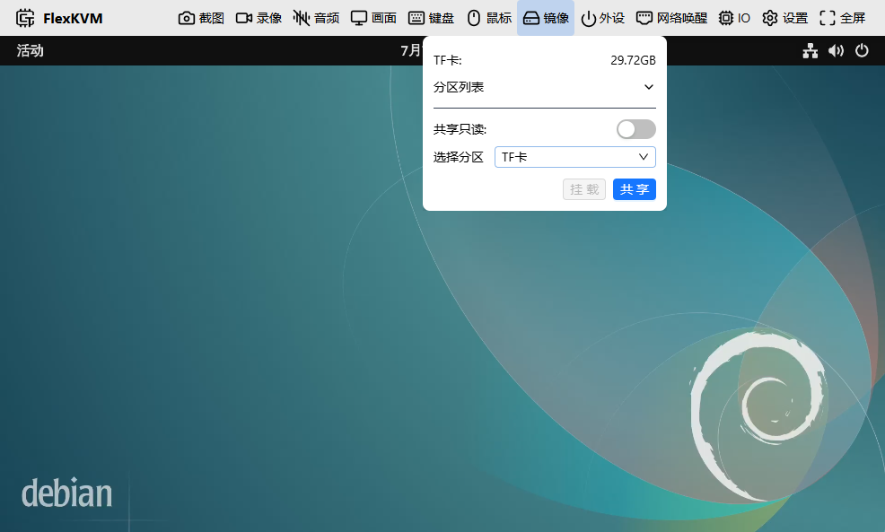
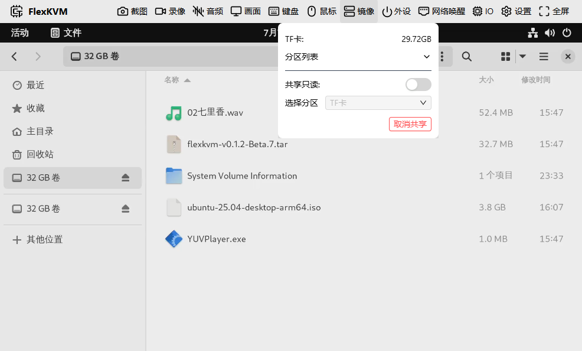
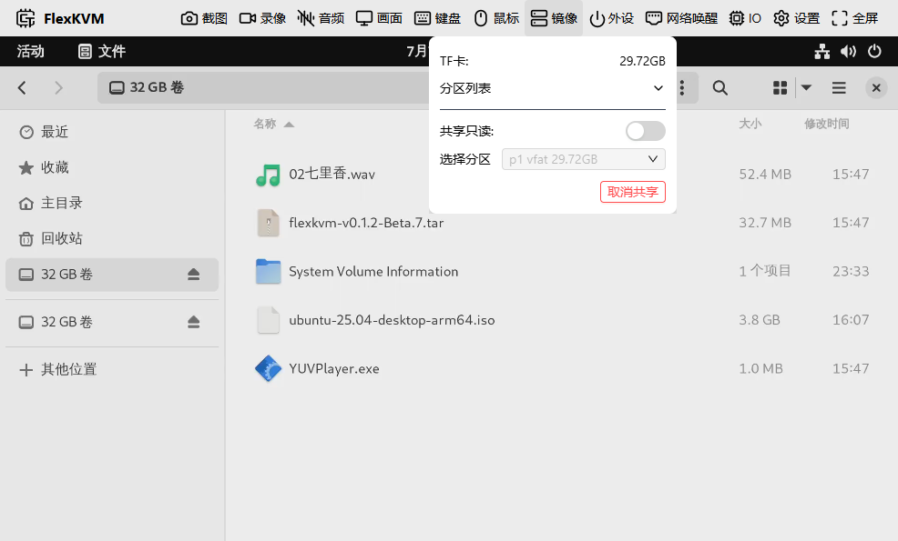
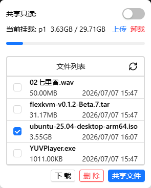
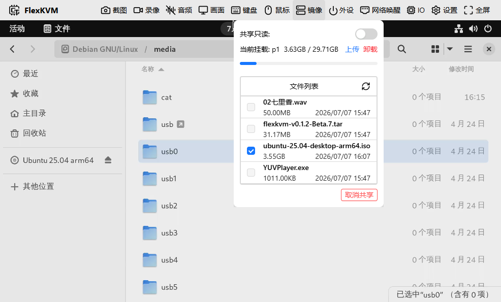

# 存储管理

FlexKVM 通过 TF 卡（MicroSD）扩展本地存储，支持文件管理、虚拟光驱和 USB 导出。最常用的两个场景：把 ISO 镜像共享为虚拟光驱给主机重装系统、在 TF 卡和主机之间传文件。

> 入口：菜单栏中的**镜像**

## TF 卡要求

| 项目 | 要求 |
|------|------|
| 卡类型 | MicroSD（TF）卡 |
| 容量 | 无硬性上限 |
| 文件系统 | FAT32 / exFAT / ext4 / NTFS（exFAT 推荐，无 4GB 限制） |

## 安装

TF 卡槽在设备侧面，电源灯下方。金属触点朝向电源灯，推进去听到咔嗒声就行。

> **验证**：插好后 OLED 存储图标显示已连接。没变化？重新插拔试试，或检查卡是否正常。

## 镜像菜单

| 图标 | 含义 |
|------|------|
|  | TF 卡已插入，空闲 |
|  | TF 卡没插 |
|  | 文件上传中 |
|  | 文件下载中 |
|  | 正通过 USB 共享给主机 / 导出镜像中 |

五种用法：

### 整盘共享

把整张 TF 卡作为 U 盘共享给主机，主机能看所有分区。

选中 TF 卡 → 点**共享**。

> 开启只读后主机只能读不能写。

### 分区共享

只共享 TF 卡的某个分区，其他分区主机看不到。

选目标分区 → 点**共享**。

### 分区挂载

挂载分区后可以在 FlexKVM 上浏览和管理文件。

选分区 → 点**挂载** → 出现文件列表、分区大小、上传/卸载按钮。

> 分区格式需要是设备支持的类型（FAT32 / exFAT / ext4 / NTFS）。挂载失败时按失败原因处理：带脏位或休眠文件的 NTFS 卡先在电脑上卸载并修复，其余情况可先点**检查/修复**。

**上传 / 下载可随时取消**：传输进行中点**取消**中止——上传中止发送并等待设备清理，下载丢弃未完成的文件。取消后提示"已取消"，与失败分开显示，失败时按原因提示。

### 分区体检与修复

菜单下方的**检查**对所选分区做文件系统一致性检查，**修复**在检查基础上尝试修复损坏项。两者都需要分区未挂载、未共享，且修复可能删除损坏的文件或目录项——执行前先备份重要数据。

| 结果 | 含义 |
|------|------|
| 文件系统正常，未发现问题 | 无需处理 |
| 文件系统存在问题，可点击"修复"尝试修复 | 检出问题，建议修复 |
| 文件系统已修复 | 修复完成 |
| 仍有问题无法自动修复，建议备份数据后重新格式化 | 需要人工介入 |
| 该文件系统类型不支持检查 | 该分区不做体检（NTFS 仅支持挂载，不提供检查/修复） |
| 找不到该分区 | 分区已不在，刷新分区列表后重试 |
| 检查超时，文件系统可能损坏严重 | 检查未在时限内完成，文件系统可能损坏严重 |
| 设备缺少检查工具 | 该分区缺少对应的检查工具 |
| 检查失败 | 其他失败原因 |

### 单文件共享

先挂载分区 → 勾选一个 `.img` 或 `.iso` 文件 → 点**共享文件**。主机会把它识别为虚拟光驱。

> 支持大于 4GB 的文件，但格式必须是 `.img` 或 `.iso`。

### 安全移除

| 当前状态 | 怎么做 |
|---------|------|
| 单文件共享中 | 取消共享 → 卸载分区 → 拔卡 |
| 整盘/分区共享中 | 取消共享 → 拔卡 |
| 已挂载但没共享 | 卸载分区 → 拔卡 |
| 插着但没操作 | 直接拔 |

---

## 常见问题

**TF 卡没反应？** → 检查文件系统。FAT32、exFAT、ext4 和 NTFS 都支持，exFAT 兼容性最好；打不开的分区先点**检查/修复**，仍不行再在电脑上转成 exFAT。

**共享的光驱主机不认？** → 确认文件是 `.img` 或 `.iso`。其他格式不能作为光驱共享。

**上传断了？** → 刷新页面重传。暂不支持断点续传。取消和失败分开提示，取消不是错误。

**系统装到一半失败了？** → 安装过程中是不是开关过鼠标、键盘或音频？这些操作让虚拟光驱短暂断开。

---

[:octicons-arrow-left-24: 返回用户指南](../index.md)
