# 存储管理

FlexKVM 有三类存储源：**TF 卡**（设备内的 MicroSD）、**NFS** 与 **SMB**（局域网或 NAS 上的网络共享）。三类都支持文件管理，也都能把介质或镜像共享给被控机当虚拟 U 盘 / 虚拟光驱——最常用的两个场景：把 ISO 镜像共享为虚拟光驱给主机重装系统、在存储源和被控机之间传文件。

> 入口：菜单栏中的**镜像**

## 存储源

面板顶部用三段切换器在 **TF卡 / NFS / SMB** 之间切换：

| 段 | 说明 |
|----|------|
| **TF卡** | 本机 TF 卡，见下文各节 |
| **NFS** | NFSv4 网络共享，需先挂载 |
| **SMB** | SMB（CIFS）网络共享，需先挂载 |

> **切段只切视图**：NFS 与 SMB 各自独立挂着，切回来内容还在；两者可以**同时挂载**，互不挤占。

> **同一时刻只有一个共享**：被控机侧的 USB 大容量设备只有一个，所以无论哪一段发起共享，其它段都会显示**正在共享：<来源>** 并收起入口。

## TF 卡要求

| 项目 | 要求 |
|------|------|
| 卡类型 | MicroSD（TF）卡 |
| 容量 | 无硬性上限 |
| 文件系统 | FAT32 / exFAT / ext4 / NTFS（exFAT 推荐，无 4GB 限制） |

## 安装

TF 卡槽在设备侧面，电源灯下方。金属触点朝向电源灯，推进去听到咔嗒声就行。

> **验证**：插好后 OLED 存储图标显示已连接。没变化？重新插拔试试，或检查卡是否正常。

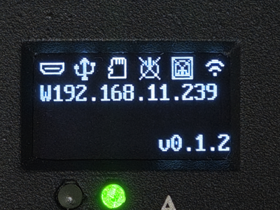

## 镜像菜单

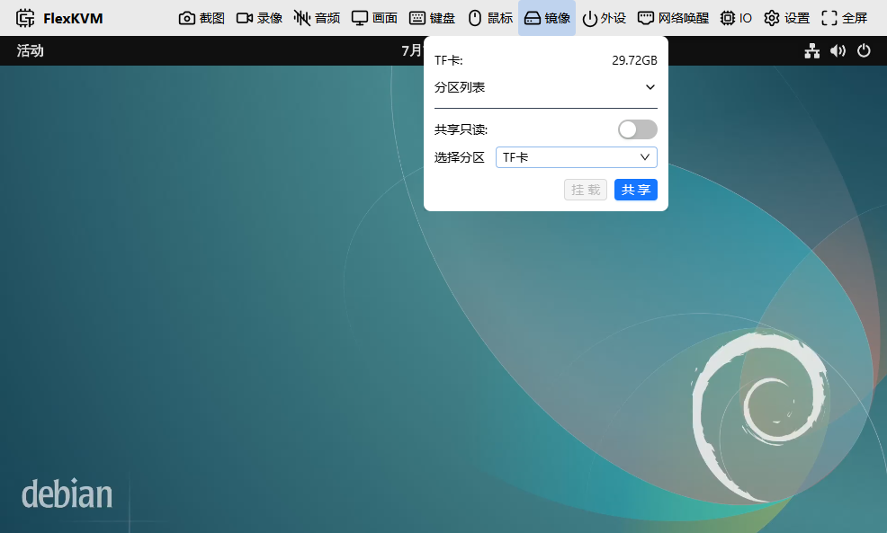

| 图标 | 含义 |
|------|------|
|  | 任一存储源可用，空闲 |
|  | 无可用存储源（没插 TF 卡，也没挂网络存储） |
|  | 文件上传中 |
|  | 文件下载中 |
|  | 正通过 USB 共享给主机 / 导出镜像中 |

> 只有网络存储可用时，图标改用云朵样式——此时存东西的实际形态是网络盘。

五种用法：

### 整盘共享

把整张 TF 卡作为 U 盘共享给主机，主机能看所有分区。

选中 TF 卡 → 点**共享**。

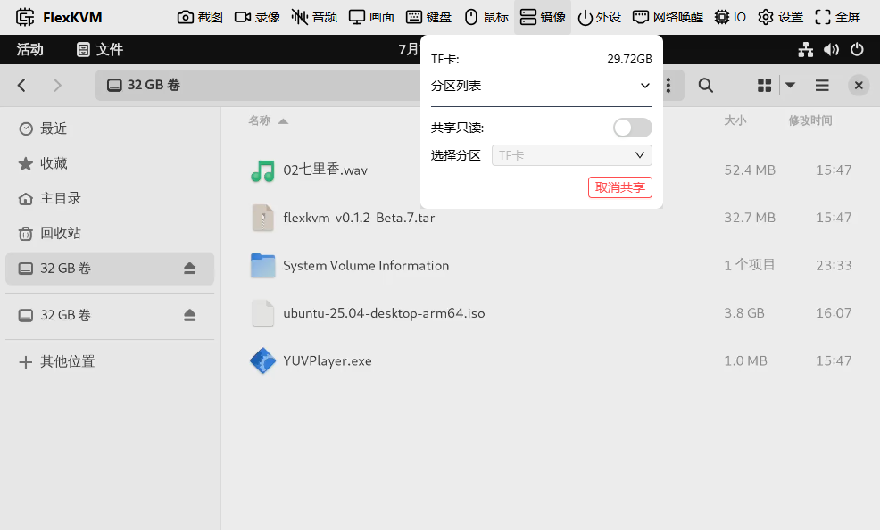

> 开启只读后主机只能读不能写。

### 分区共享

只共享 TF 卡的某个分区，其他分区主机看不到。

选目标分区 → 点**共享**。

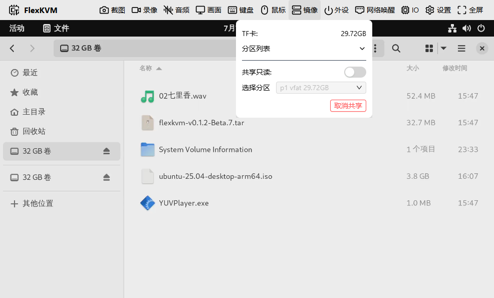

### 分区挂载

挂载分区后可以在 FlexKVM 上浏览和管理文件。

选分区 → 点**挂载** → 出现文件列表、分区大小、上传/卸载按钮。

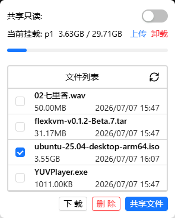

> 分区格式需要是设备支持的类型（FAT32 / exFAT / ext4 / NTFS）。挂载失败时按失败原因处理：带脏位或休眠文件的 NTFS 卡先在电脑上卸载并修复，其余情况可先点**检查/修复**。

**上传 / 下载可随时取消**：传输进行中点**取消**中止——上传中止发送并等待设备清理，下载丢弃未完成的文件。取消后提示"已取消"，与失败分开显示，失败时按原因提示。

### 分区体检与修复

菜单下方的**检查**对所选分区做文件系统一致性检查，**修复**在检查基础上尝试修复损坏项。两者都需要分区未挂载、未共享，且修复可能删除损坏的文件或目录项——执行前先备份重要数据。

| 结果 | 含义 |
|------|------|
| 文件系统正常，未发现问题 | 无需处理 |
| 文件系统存在问题，可点击"修复"尝试修复 | 检出问题，建议修复 |
| 文件系统已修复 | 修复完成 |
| 仍有问题无法自动修复，建议备份数据后重新格式化 | 需要人工介入 |
| 该文件系统类型不支持检查 | 该分区不做体检（NTFS 仅支持挂载，不提供检查/修复） |
| 找不到该分区 | 分区已不在，刷新分区列表后重试 |
| 检查超时，文件系统可能损坏严重 | 检查未在时限内完成，文件系统可能损坏严重 |
| 设备缺少检查工具 | 该分区缺少对应的检查工具 |
| 检查失败 | 其他失败原因 |

### 单文件共享

先挂载分区 → 勾选一个 `.img` 或 `.iso` 文件 → 点**共享文件**。主机会把它识别为虚拟光驱。

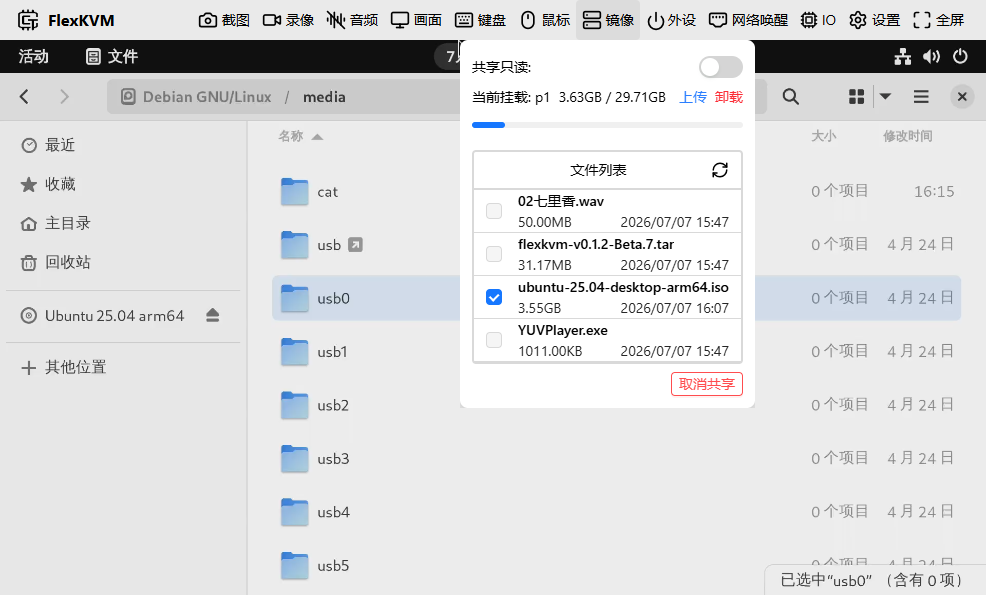

> 支持大于 4GB 的文件，但格式必须是 `.img` 或 `.iso`。

### 安全移除

| 当前状态 | 怎么做 |
|---------|------|
| 单文件共享中 | 取消共享 → 卸载分区 → 拔卡 |
| 整盘/分区共享中 | 取消共享 → 拔卡 |
| 已挂载但没共享 | 卸载分区 → 拔卡 |
| 插着但没操作 | 直接拔 |

## 网络存储（NFS / SMB）

把 NAS、服务器或另一台电脑上的目录当成本机存储用：直接浏览、上传、下载，也能把上面的镜像共享给被控机。

### 支持范围

| 项目 | 支持情况 |
|------|----------|
| NFS | **仅 NFSv4** |
| SMB | SMB 3.0（CIFS） |
| 文件列表 | 只列挂载点**根目录**一层，不支持子文件夹 |
| 分享形态 | 单个常规文件，且不小于 512 字节 |

> **不支持 NFSv3**：v3 需要额外向服务端动态查询端口，本设备上无法可靠完成。请使用 NFSv4，服务端开启 v4 即可。

### 挂载 NFS

切到 **NFS** 段，填两个字段后点**挂载**：

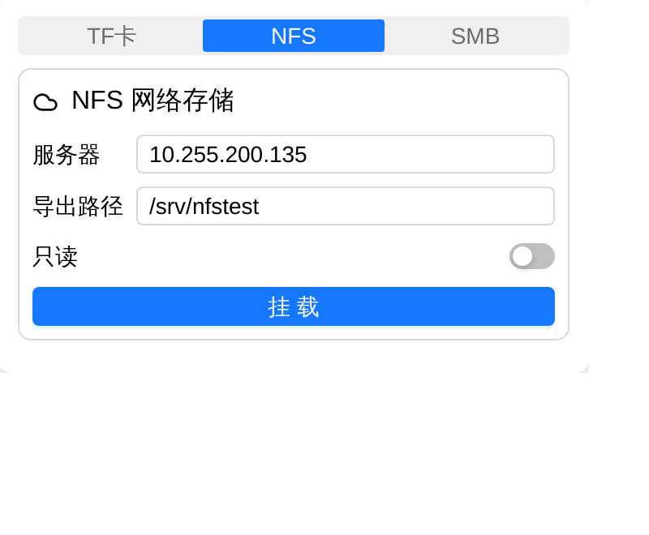

| 字段 | 填什么 |
|------|--------|
| 服务器 | 主机名或 IP，如 `10.255.200.135` |
| 导出路径 | 服务端导出目录的**绝对路径**，如 `/srv/nfstest` |
| 只读 | 开启后只能读不能写 |

> 服务器写主机名时由设备做一次 IPv4 解析；解析不到会直接失败，不会无限等。

### 挂载 SMB

切到 **SMB** 段：

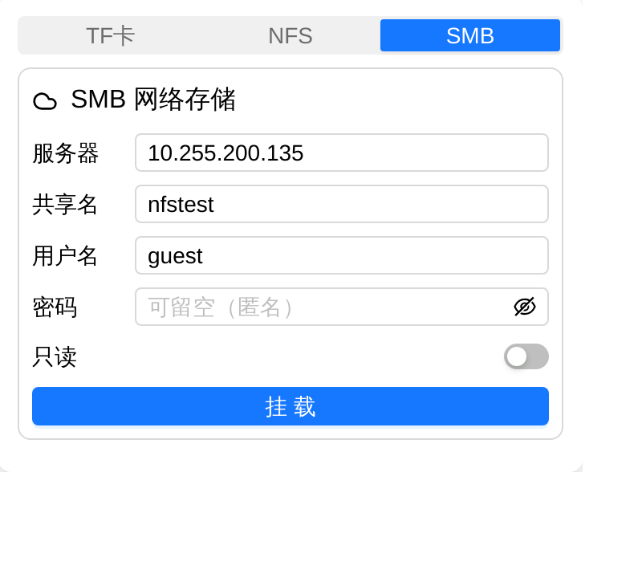

| 字段 | 填什么 |
|------|--------|
| 服务器 | 主机名或 IP |
| 共享名 | **单个共享名**（不是路径），如 `share` |
| 用户名 | 匿名访问填 `guest` |
| 密码 | 无密码留空 |
| 只读 | 开启后只能读不能写 |

> **共享名不能带 `/`**：那会让共享被解析成子目录，语义悄悄变掉，入口就会拒绝。

> **用户名和密码不能含逗号**：SMB 的挂载选项是逗号分隔串，一个逗号就能把后半段变成新选项（例如把挂载悄悄改成只读）。入口即拦。

### 挂载之后

挂载成功后显示源串、容量占用与文件列表：

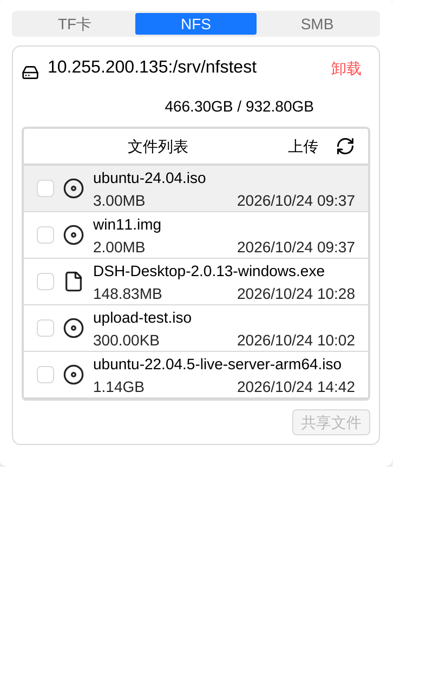

| 操作 | 说明 |
|------|------|
| 上传 | 列表标题栏**上传**，与 TF 段同位置 |
| 下载 | 勾选文件后点**下载** |
| 删除 | 勾选文件后点**删除**，需二次确认 |
| 刷新 | 列表标题栏的刷新图标；外部新增的文件要点一次刷新才可见 |
| 卸载 | 卡片右上角**卸载** |

> **列表不会自动更新**：在服务器上新增或删除的文件，需要点一次刷新才可见。

> **开机自动恢复**：挂载配置会持久化，设备重启后自动重新挂载（在后台执行，不阻塞启动）。

> **挂载是异步的**：点**挂载**后立即受理，结果随后推送。服务器连不上时最坏等十几秒才报错；界面另有 30 秒兜底，到点会主动确认一次，不会一直卡在「挂载中」。

### 共享网络存储上的镜像

勾选一个文件 → 点**共享文件**。被控机会把它识别为虚拟光驱。

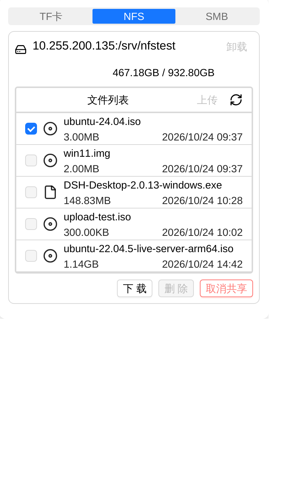

> **默认只读**：被控机写回网络共享不是预期用法，误写会污染远端数据。

> **只共享根目录下的单个文件**：不支持子目录；小于 512 字节的文件也会被拒绝（被控端无法识别这么小的介质）。

### 三段共用的共享状态

共享中，发起的那一段显示**取消共享**；其余段显示**正在共享：<来源>**，且上传、删除、卸载全部置灰：

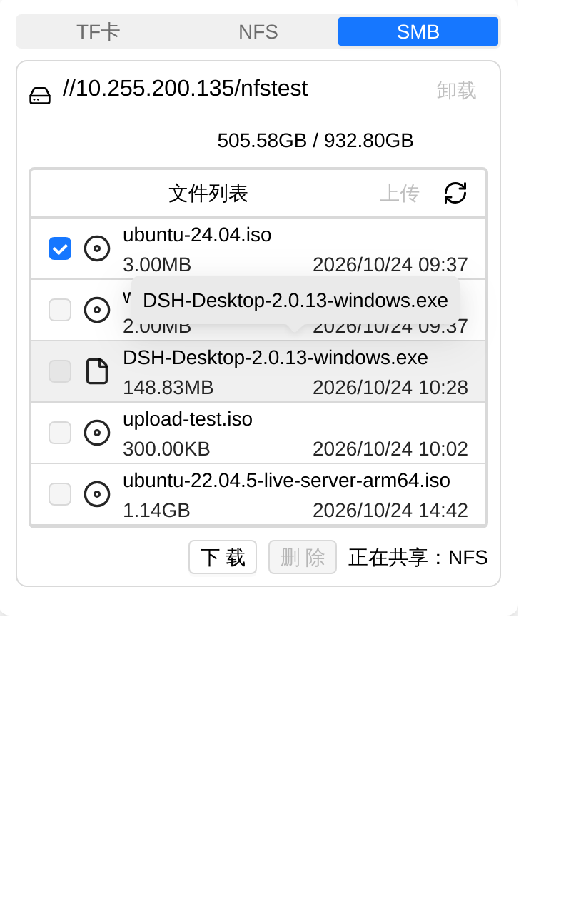

> **共享期间不能卸载**：卸载会把正在被控机读取的介质抽走，被控机会看到设备直接消失。

> **共享期间不能改文件**：上传与删除都会被拒绝。下载不受限制。

---

## 常见问题

**TF 卡没反应？** → 检查文件系统。FAT32、exFAT、ext4 和 NTFS 都支持，exFAT 兼容性最好；打不开的分区先点**检查/修复**，仍不行再在电脑上转成 exFAT。

**共享的光驱主机不认？** → 确认文件是 `.img` 或 `.iso`。其他格式不能作为光驱共享。

**上传断了？** → 刷新页面重传。暂不支持断点续传。取消和失败分开提示，取消不是错误。

**系统装到一半失败了？** → 安装过程中是不是开关过鼠标、键盘或音频？这些操作让虚拟光驱短暂断开。

**NFS/SMB 挂载失败？** → 提示里只有两类：`该挂载点已被占用` 表示这个源上一次挂载还在（或外部 mount 留下），先卸载再挂；其余统一为「挂载失败」，按网络排查——服务器是否开机、地址与共享名是否写对、服务端防火墙是否放行 NFS 的 2049 或 SMB 的 445 端口。具体 errno 只在设备日志里。

**网络存储里的新文件看不到？** → 点列表标题栏的刷新图标。设备不做远端变动感知，需要手动刷新一次。

**共享按钮点了没反应？** → 共享已成功但界面还没收到状态时，按钮不会立刻变化。若确定失败，会弹出具体原因；「Unknown error 525」表示文件小于 512 字节。

**卸载提示正在共享？** → 先**取消共享**再卸载。

---

[:octicons-arrow-left-24: 返回用户指南](../index.md)
