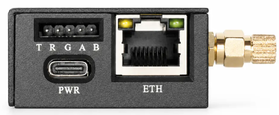
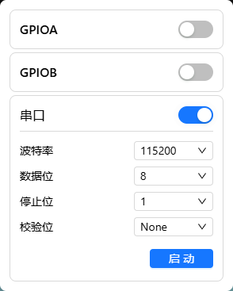
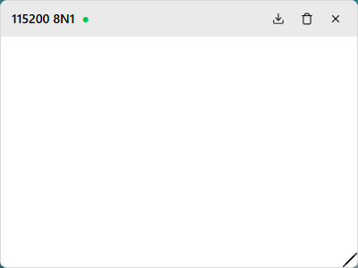

# UART Serial Terminal

Interact with target hosts (routers, embedded development boards, switches) via serial console.

> Where: **IO** in the menu bar → UART

> For embedded debugging, industrial control, and other specialized scenarios. Regular users typically don't need this.

## Before You Begin

| You need | Notes |
|----------|-------|
| FlexKVM | Completed [Quick Start](../../quick_start/index.md) wiring and network setup |
| 2.54mm Dupont wires (female) | At least 3 |
| Target host | Supports serial communication; parameters (baud rate, etc.) must be confirmed in advance |

## Pinout

UART uses 3 of the 5 pins on the expansion header (T / R / G), with letter labels beside each pin:



| Silkscreen | Pin | Description |
|:----------:|:---:|-------------|
| T | TXD | Data transmit → connect to target host **RX** |
| R | RXD | Data receive → connect to target host **TX** |
| G | GND | Ground — common ground with target host |

> UART cross-connect: FlexKVM TXD → target host RXD, FlexKVM RXD → target host TXD, GND interconnected. Only these three wires are needed.

## Wiring

```
FlexKVM                 Target Host
  TXD ───────────────→ RXD
  RXD ←─────────────── TXD
  GND ──────────────── GND
```

## Software Configuration

Menu bar → **IO** → **UART**.



### Communication Parameters

Set parameters after enabling UART. **Parameters must match the target host exactly**, otherwise you'll get garbled output or no communication:

| Parameter | Default | Common values |
|-----------|:-------:|---------------|
| Baud rate | 115200 | 9600, 19200, 38400, 57600, 115200, 230400, 1500000 |
| Data bits | 8 | 5/6/7/8 |
| Stop bits | 1 | 1/2 |
| Parity | None | None/Even/Odd |

> The default **115200 8N1** is the most common configuration for serial devices.

### Start & Disconnect

Set parameters → click Start → a terminal window opens for direct interaction with the device.



Terminal layout: top-left shows current serial configuration (e.g., `115200 8N1`), status indicator next to baud rate (🟢 connected / 🔴 disconnected), right side has open-in-new-window / export log / clear / close buttons.

### Ways to Open the Terminal

| Mode | Description |
|------|-------------|
| Floating window | Overlay inside the main UI, visible while you keep working; click "Open in new window" to move it to a standalone tab |
| New page | Standalone browser tab (`/terminal`) showing the terminal full page — good for a second screen or long-running monitoring |

The "start mode" remembers your last choice. If the browser blocks the popup, just open `/terminal` manually.

> Only one window can use the serial port at a time. Click Disconnect in the owning window to release it; while occupied the terminal shows "Serial in use by another window, waiting…".

> Parameters can't be changed while connected. Disconnect first if you need to change them.

### Disconnect Reasons

Disconnections now show the specific reason instead of a generic failure:

| Message | Meaning | What to do |
|---------|---------|------------|
| Serial in use by another window, waiting… | Another tab is using the port | Disconnect in the owning window, or close it |
| Serial is disabled, enable it on the main page | UART not started | Start it from the IO menu in the main UI |
| Main session lost, waiting to reconnect… | Main connection dropped briefly | Auto-reconnects, just wait |
| Session replaced by another login | Same account logged in elsewhere | Log in again |
| Serial disconnected | Closed by a "Disconnect" command | Start again when needed |
| Failed to open serial port | Device-side error or busy port | Check wiring and parameters, then start again |
| Serial device read error, connection closed | Serial device dropped offline | Check wiring and device state, then start again |
| Connection failed, auto-reconnect stopped | Repeated reconnect failures | Check the network and device state, then start again |

> Transient network drops reconnect automatically; auto-reconnect only stops after repeated failures, with a clear message.

---

## FAQ

**Garbled output?** → Parameters don't match the target host — baud rate mismatch is the most common cause. Verify the device's parameters and reconfigure.

**Can't connect?** → Confirm the target host's serial port is enabled and the wiring is correct (TXD→RXD, RXD←TXD, GND interconnected).

**No response to commands?** → Confirm the target host is in a state that accepts commands. Some devices only respond to serial input during specific phases.

---

[:octicons-arrow-left-24: Back to User Guide](../index.md)
