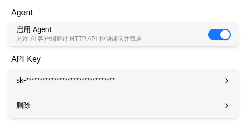
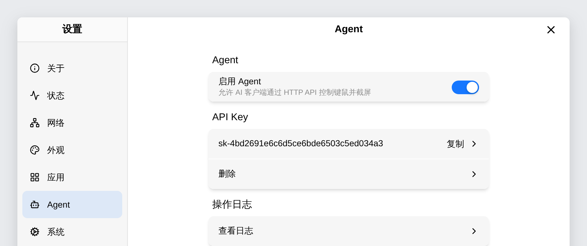
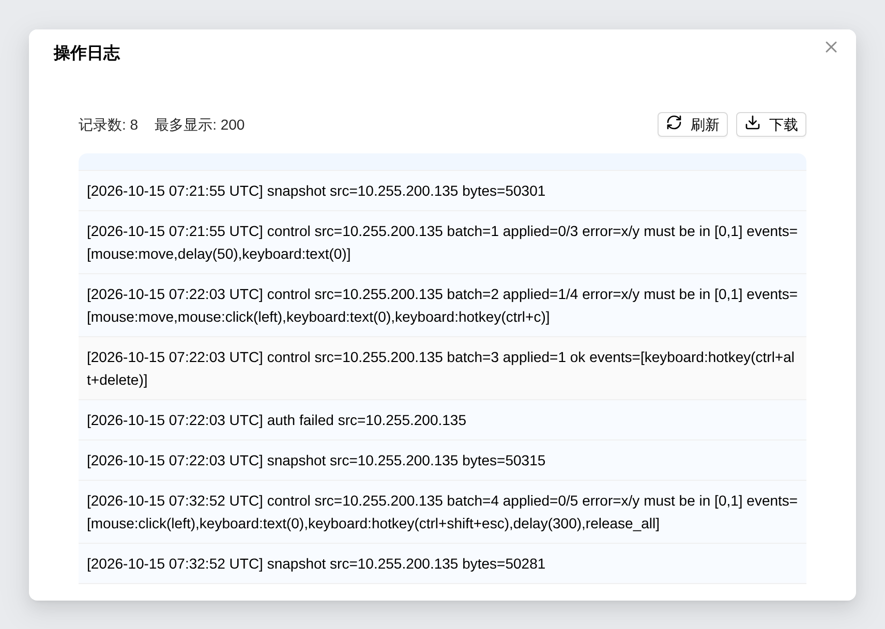

# AI Agent Control

Hand the device to an AI client: after enabling Agent and generating an API Key, AI clients such as OpenClaw, Claude Code, Codex, and DSH can control the keyboard/mouse and take screenshots through **Skill** or **MCP** — useful for automated inspection, batch configuration, and unattended operation.

> Where: Settings → Agent

## Enable Agent



| Action | Description |
|------|------|
| Enable Agent | AI clients can only call the interface when enabled |
| Generate | Create an API Key prefixed with `sk-` as the credential |
| Copy | Copy the current API Key |
| Delete | Invalidate the current API Key; issued keys stop working immediately |

> The API Key carries keyboard/mouse control privileges. Only configure it for trusted AI clients. If it leaks, delete and regenerate it immediately. Skill and MCP use the same API Key.

## Operation Log

The operation log records every call an AI client makes through the interface, for confirming that an automation flow ran as intended. Where: Settings → Agent → Operation Log → View log. Only administrators can view and download it.



The dialog header shows the current record count and the maximum number of records displayed at once (200). The list is ordered from oldest to newest.



| Action | Description |
|------|------|
| Refresh | Fetch the latest records again |
| Download | Save the complete log file locally as `agent-log-<timestamp>.log` |

Each record contains a UTC timestamp, the caller's IP address, and the operation type:

| Operation | Recorded content |
|------|------|
| `snapshot` | Screenshot, with the image byte size |
| `control` | Keyboard/mouse event batch, with batch id, applied count, result or rejection reason, and an event summary |
| `cancel` | Batch cancellation, with the requested batch id and the active batch id |
| `auth failed` | API Key verification failure |

The event summary expands each event, such as `mouse:click(left)`, `mouse:scroll(-3)`, `keyboard:hotkey(ctrl+alt+delete)`, `keyboard:text(12)`, `delay(300)`, and `release_all`. Batches rejected for invalid parameters, exceeded limits, or a busy Agent are recorded too, with the reason in an `error` field.

> `keyboard text` records only the character count (`text(12)`), never the input itself — text typed on the controlled device is often passwords and tokens.

The log file is capped at 256KB; once exceeded, the oldest records are trimmed. The operation log serves viewing and downloading only — it is stored separately from the [audit log](../security/audit.md) and the two do not share a quota. Downloading the log is itself written to the audit log.

## Two Ways to Connect

Agent supports Skill and MCP invocation. Both give the AI client the same "screenshot + keyboard/mouse control" ability — pick one, or use both:

| Method | What it is | Suitable clients |
|--------|-----------|------------------|
| **Skill** (recommended) | A folder of "instructions": drop it into the client's skills directory and the AI knows how to call the device | OpenClaw, Claude Code, Codex, and other clients supporting Agent Skills |
| **MCP** | The device's built-in standard tool interface: register the URL and key once in the client, and tools like screenshot and click appear automatically | Claude Code, Codex, DSH, and other MCP-capable clients |

- **Skill**: the repository ships execution rules, event references, examples, and troubleshooting — the AI "reads the manual" and operates.
- **MCP**: the industry-standard protocol (Model Context Protocol), ideal for environments already managing tools via MCP.

## Method 1: Skill (flexkvm-skill)

Official skill repository: <https://github.com/chutuotek/flexkvm-skill>

### 1. Install the Skill

Clone the repository into the client's skills directory (the directory name should stay `flexkvm-skill`):

=== "OpenClaw"

    ```bash
    git clone https://github.com/chutuotek/flexkvm-skill.git \
      ~/.openclaw/workspace/skills/flexkvm-skill
    ```

=== "Claude Code"

    ```bash
    git clone https://github.com/chutuotek/flexkvm-skill.git \
      ~/.claude/skills/flexkvm-skill
    ```

=== "Codex"

    ```bash
    git clone https://github.com/chutuotek/flexkvm-skill.git \
      ~/.codex/skills/flexkvm-skill
    ```

### 2. Set Environment Variables

The skill reads the device address and credentials from environment variables — both are required:

| Variable | Description |
|------|------|
| `FlexKVM_IP` | Device IP address |
| `FlexKVM_TOKEN` | API Key generated under Settings → Agent |

```bash
# Bash
export FlexKVM_IP="192.168.x.x"
export FlexKVM_TOKEN="sk-xxxxxxxxxxxxxxxxxxxxxxxxxxxxxxxx"
```

```powershell
# PowerShell (persisted as user-level variables)
[System.Environment]::SetEnvironmentVariable("FlexKVM_IP", "192.168.x.x", "User")
[System.Environment]::SetEnvironmentVariable("FlexKVM_TOKEN", "sk-xxxx...", "User")
```

> Restart the client or reopen the terminal after changing environment variables.

### 3. Use It

Just talk to the AI in plain language:

```text
Show me the target host's screen
Open Notepad, type hello, and save it to the desktop
Install setup.exe from the desktop, confirm each step with a screenshot
```

The skill includes screenshot, click/drag/scroll, text input, hotkeys, plus best practices (screenshot before acting, synchronous long-text input, `release_all` as the safety reset). See `SKILL.md` and `README.md` in the repository for details.

## Method 2: MCP Endpoint

The device ships a built-in MCP server that turns screenshot and keyboard/mouse control into standard "tools". Only three things are needed: the URL, the key, and the transport type:

| Item | Value |
|--------|------|
| Type | Streamable HTTP (MCP's standard network transport) |
| URL | `https://<device address>/api/v1/mcp` |
| Auth | `Authorization: Bearer <API Key>` |

Available tools: `state`, `screenshot`, `type_text`, `press_key`, `mouse_move` / `mouse_click` / `mouse_scroll` / `mouse_drag`, `mouse_down` / `mouse_up` / `key_down` / `key_up` / `release_all` (hold-type), and `control` (event batch). Fetch the tool list dynamically via `tools/list`.

=== "Claude Code"

    ```bash
    claude mcp add --transport http flexkvm \
      https://<device address>/api/v1/mcp \
      --header "Authorization: Bearer <API Key>"
    ```

    Add `--scope user` to make it available in all projects. Verify with `claude mcp list`.

=== "Codex"

    Edit `~/.codex/config.toml` (requires Codex CLI ≥ 0.44 with Streamable HTTP support):

    ```toml
    [mcp_servers.flexkvm]
    url = "https://<device address>/api/v1/mcp"
    bearer_token_env_var = "FlexKVM_TOKEN"
    ```

    And set the environment variable:

    ```bash
    export FlexKVM_TOKEN="sk-xxxxxxxxxxxxxxxxxxxxxxxxxxxxxxxx"
    ```

=== "DSH"

    Add a `dsh-mcp-client` plugin instance to the profile's `cordis.patch.yml` (or a file passed via `--patch`):

    ```yaml
    - id: mcp-flexkvm
      name: '@deepseek-ai/dsh-mcp-client'
      config:
        serverName: flexkvm
        transport: streamable-http
        url: https://<device address>/api/v1/mcp
        headers:
          Authorization: !!js '`Bearer ${process.env.FlexKVM_TOKEN}`'
    ```

    Tools are exposed to the agent as `mcp__flexkvm__<tool name>`.

=== "Other MCP clients"

    Any MCP client supporting Streamable HTTP transport with custom headers can connect — fill in the URL and auth header from the table above. Prefer environment variables over plaintext secrets in config files.

`claude mcp list` shows flexkvm as connected:

```bash
$ claude mcp list
Checking MCP server health…

flexkvm: https://<device-address>/api/v1/mcp (HTTP) - ✔ Connected
```

## HTTPS Certificate Note

The device uses a self-signed HTTPS certificate by default. If the client reports a TLS / `self-signed certificate` error, import the device CA certificate into the client machine's trust store (Settings → Security → HTTPS → Download CA Certificate) — see [HTTPS Certificate](../security/https.md). For quick debugging, `curl -k` skips verification (already built into the flexkvm-skill scripts).

## Working Alongside Users

| Agent | User online | Behavior |
|:---:|:---:|------|
| Off | Any | AI cannot control |
| On | No | AI actions take effect immediately |
| On | Yes | AI and the user share the same keyboard/mouse |

- AI and an online user share the same HID device — simultaneous input interferes, so stagger usage.
- Once Agent is enabled, `screenshot` works regardless of whether a user is online.
- Agent endpoints are fully disabled in provisioning mode (the MCP endpoint is hidden and requests return 404).

## Limits

The interface enforces fixed limits; exceeding them fails or truncates the request. Check these when planning an event batch:

| Item | Limit |
|------|-------|
| Events per `control` call | 32 |
| Total duration per `control` call | 60 seconds (then it times out) |
| `type_text` length per call | 512 characters |
| `delay` per call | 5000 ms |
| `mouse_drag` duration per call | 5000 ms |
| `mouse_scroll` dy per call | ±127 |
| Ordinary keys per `press_key` hotkey | 6 (HID report limit) |

- Only one `control` batch runs at a time; a new request while busy returns 503. A batch can be cancelled mid-run.
- `state` is assembled from several reads, not an atomic snapshot, so it can be slightly inconsistent in rare cases.

---

## FAQ

**Getting 401?** → The API Key is missing or wrong. Deleted the key? Generate a new one and update the client.

**Getting 403?** → Two possible meanings: ① Agent is disabled — turn it on under Settings → Agent; ② you reached the MCP endpoint over plain `http://` — MCP requires HTTPS (sending a long-lived Bearer key in plaintext is unsafe), so use `https://`.

**Getting 429?** → Too many failed auth attempts triggered a short rate limit. Wait about a minute and retry, and check that the key is correct.

**The AI says it has no such skill after installing?** → Make sure the repository is in the client's skills directory with `SKILL.md` inside, then restart the client; on OpenClaw check with `openclaw skills list`.

**MCP tools don't show up?** → Check status with `claude mcp list`; on DSH verify the patch file loads, that `serverName` hasn't been renamed, and that the **`FlexKVM_TOKEN` environment variable is set** (the config references it but won't create it); if both fail, see the next TLS item.

**TLS / certificate errors?** → The device uses a self-signed certificate — import the device CA into the system trust store (see "HTTPS Certificate Note" above).

**AI actions do nothing?** → First check the Limits section above; confirm the target host's keyboard/mouse works (e.g., typing is visible in the BIOS screen).

**Getting 404 from the endpoint in provisioning mode?** → Agent endpoints are fully disabled in provisioning mode and the MCP endpoint is hidden — this is expected.

---

[:octicons-arrow-left-24: Back to User Guide](../index.md)
