# Keyboard

Send text, shortcuts, and key combinations to the target host. FlexKVM emulates a standard USB keyboard, compatible with all operating systems.

> Where: **Keyboard** in the menu bar

## Keyboard Status

The keyboard icon in the menu bar reflects state:

| Icon | Meaning |
|------|---------|
|  | Connected |
|  | Not connected or disabled |

## Keyboard Menu

Click the keyboard icon to open the menu.

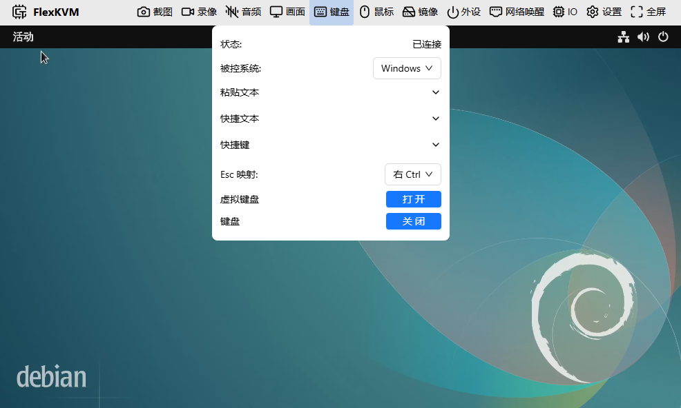

### Status

| Status | Description |
|--------|-------------|
| Connected | Normal input |
| Not connected | Connection lost — re-plug USB or refresh the page |
| Disabled | Manually turned off — click Enable to restore |

### Target OS

Tell FlexKVM what OS the target host is running — shortcut keys and virtual keyboard layout adjust accordingly. Default: **Windows**. Also available: Linux, macOS.

### Paste Text

Expand to type or paste text, then click send to the target host. You can click cancel while sending is in progress.

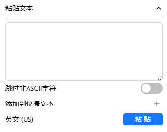

> ASCII characters only (letters, numbers, symbols). Chinese characters are not supported. Max 4096 characters. Paste speed is ~20 chars/sec.

- **Skip non-ASCII**: When enabled, auto-filters Chinese and other non-ASCII characters. When disabled, encountering them triggers an error.
- **Add to Quick Text**: Save the current text for one-click sending later.

### Quick Text

Store frequently used text (passwords, commands, templates) and send with one click.

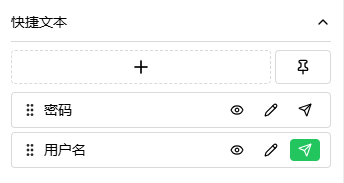

**Add**: Click **+** → enter a name (max 32 chars) and content (max 4096 chars). Maximum 10 entries.

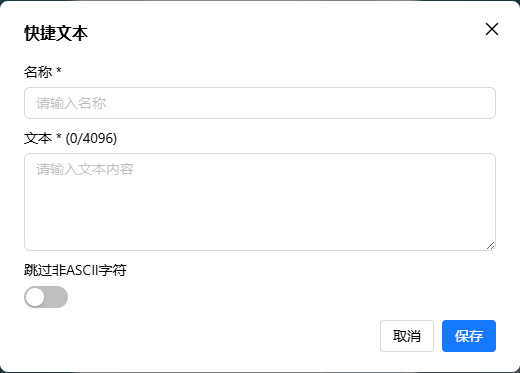

**Use**: Each entry supports preview (eye icon), edit (pencil), send, and cancel. Drag to reorder. Click the pin button to make it a floating window — drag it wherever convenient.

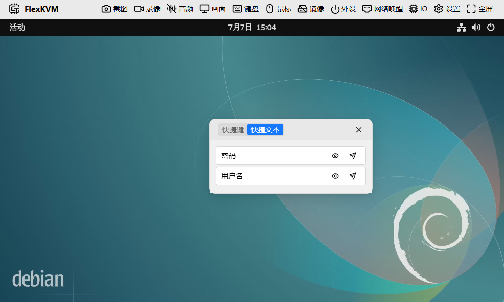

### Shortcuts

Common shortcuts sent with one click. Layout auto-adjusts based on the "Target OS" setting.

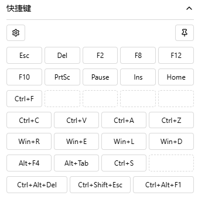

- **Gear icon**: Customize shortcuts
- **Pin icon**: Open/close floating window

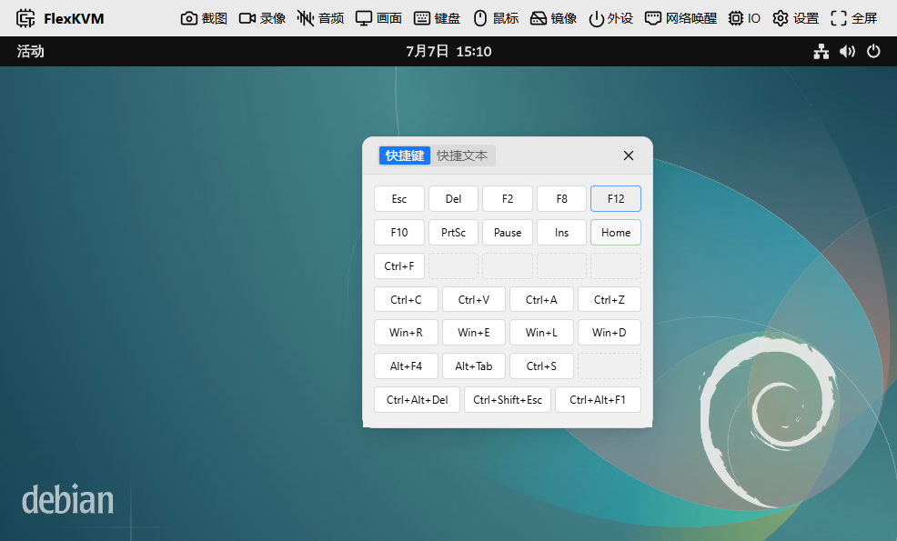

**Custom shortcuts**: Click gear → dialog has three sections — top: select OS, middle: shortcut list (click **+** to add), bottom: Import / Export / Reset.

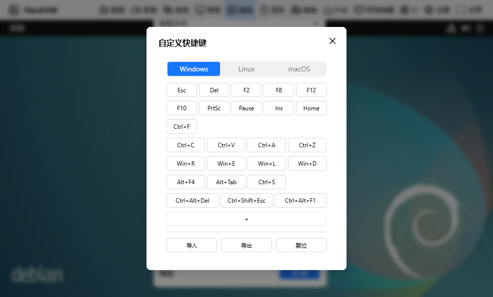

Click a shortcut in the list to modify it:

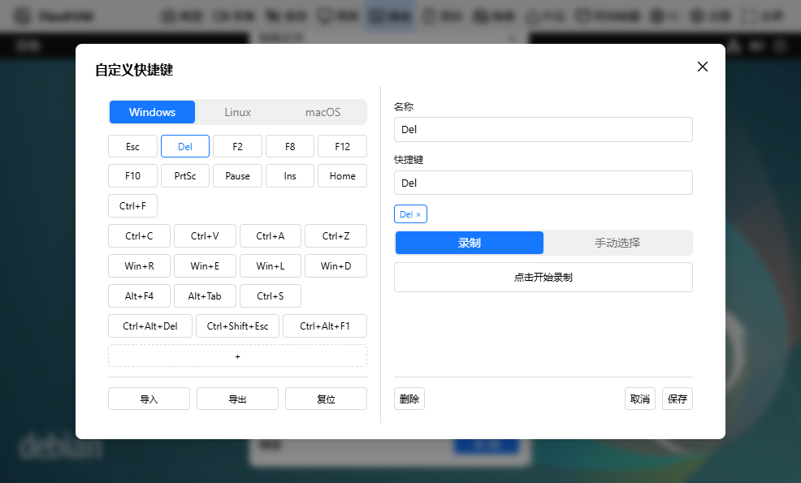

- **Name**: if blank, the shortcut content is displayed
- **Shortcut**: Two ways to add: **Record** (click Start Recording, then press keys) or **Manual** (pick keys by category to add/remove)

### Macros

A macro is a **sequence** of key presses: one macro is made of several steps and sends them in order with one click. Useful for fixed action sequences such as "press Ctrl+Shift+Esc, wait, then press Enter".

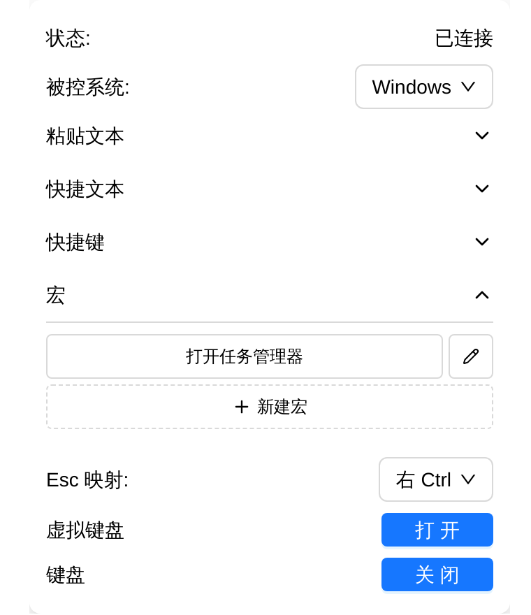

> Macros and **shortcuts** are two entries, not two layers of one feature: a shortcut is "press once", a macro is "press a sequence". Macros have their own list and editor dialog; identically named entries do not overwrite each other.

**Create**: Click **+ New macro** to open the editor.

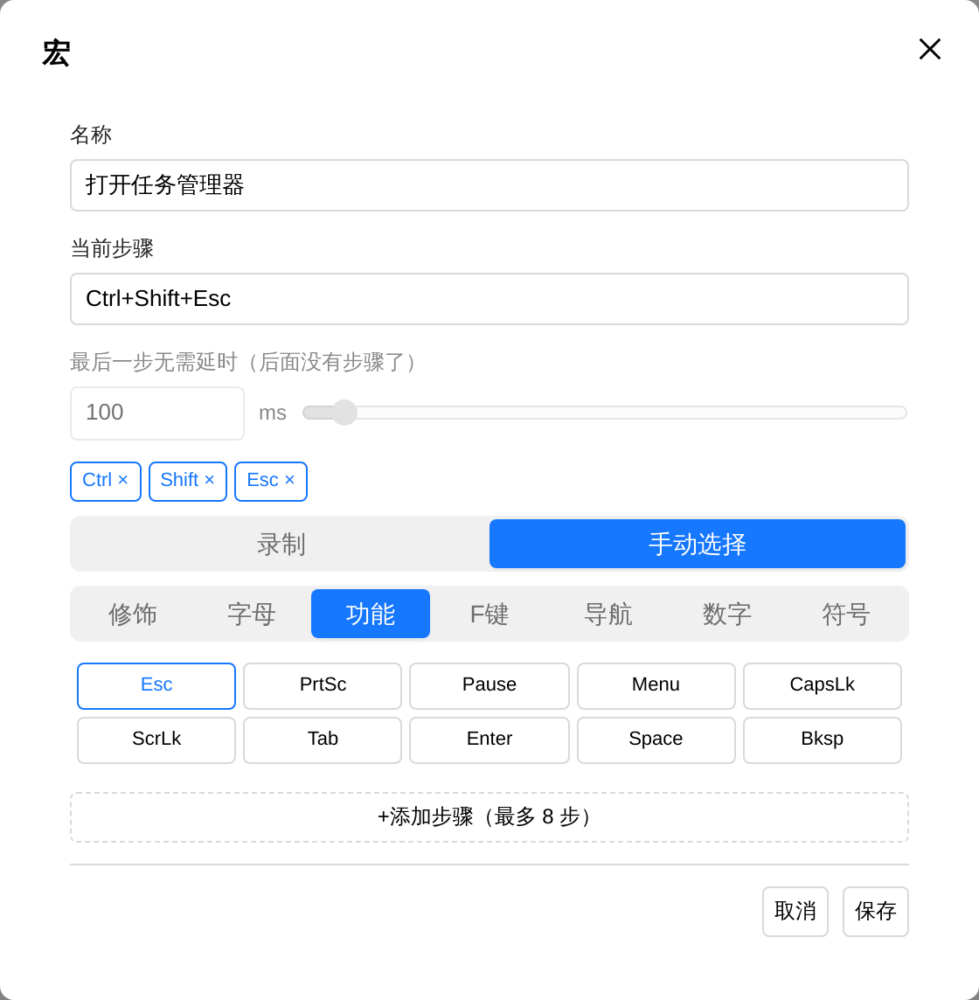

| Field | Description |
|-------|-------------|
| Name | Shown in the list; left blank, the current key combination is used |
| Step bar | Appears with two or more steps; click a segment to edit that step |
| Current step | The combination for this step; with two or more steps a **Remove step** button appears on the right |
| Delay after this step | 0–2000 ms, default 100 ms. **The last step executes no delay**, and its input is greyed out |
| Key selection | **Record** (click Start recording, then press keys) or **Manual** (pick by category — same picker as the shortcut editor) |
| + Add step | Up to 8 steps; the button disappears at the limit |

**Run**: Click a macro's button in the list to send the whole sequence. In progress / success / failure are reported as a toast at the top of the page.

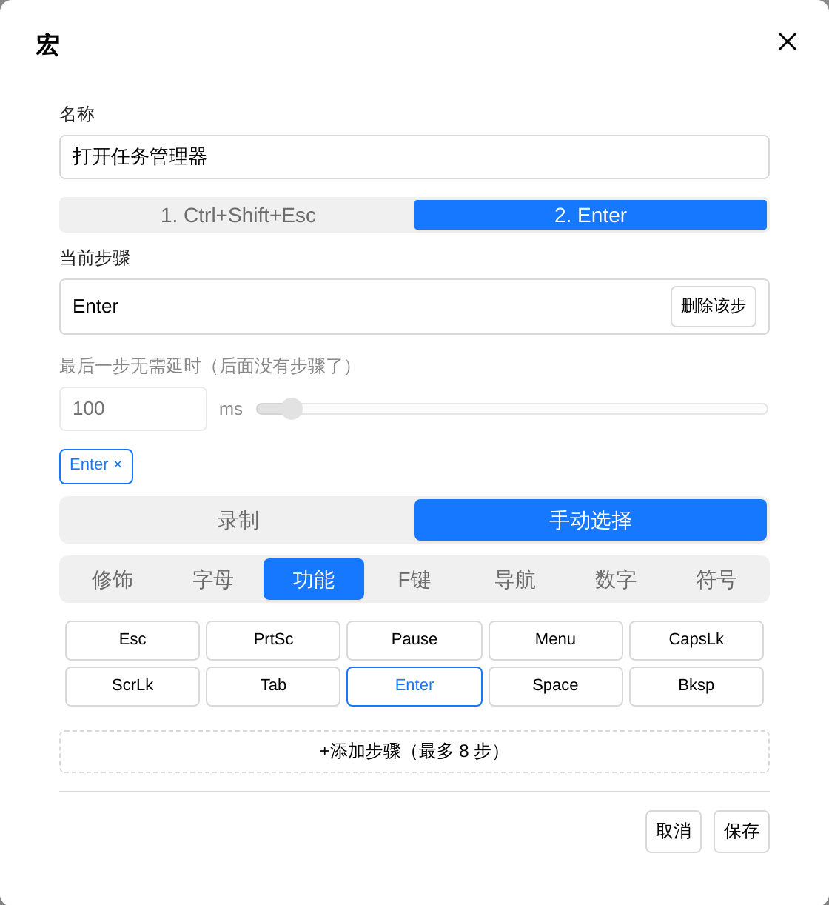

> **The delay is a wait *after* that step**. In a two-step macro, the 100 ms on step one means "press this step, wait 100 ms, then press the next"; the last step's delay has no effect.

> **A macro never runs half-way**: if any step has no key selected, the whole macro is skipped and the target receives nothing. Before saving, check the step bar for `(no keys)`.

> Macros live in browser storage; switching browsers or clearing site data means rebuilding them.

### Virtual Keyboard

Opens a virtual keyboard overlay on the display — click with your mouse to type. Layout auto-adjusts based on the "Target OS" setting. Compact layout when the window is narrow. Drag the title bar to move.

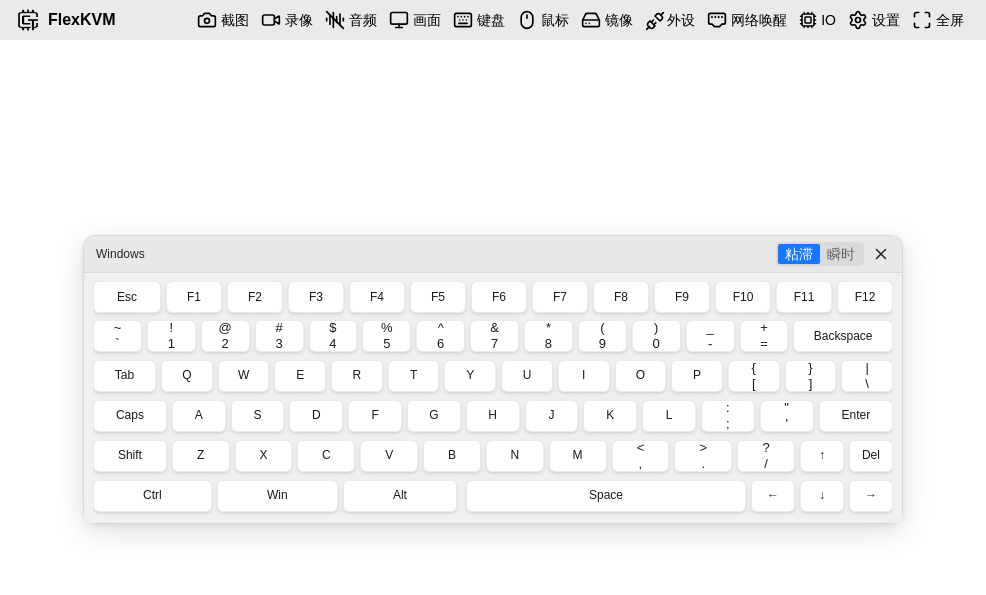

**Modifier keys** (Ctrl, Alt, Shift, Win) have two press modes, switched at the right of the title bar:

| Mode | Behavior | Best for |
|------|----------|----------|
| Sticky (default) | Click once to hold (turns dark), click again to release (turns light) | Touch screens; combos like Ctrl then C |
| Momentary | Held while pressed, released on key-up like ordinary keys | Users used to a physical keyboard |

Sticky mode holds multiple modifiers at once. Example: Click **Ctrl** (dark) → click **A** → sends Ctrl+A → Ctrl stays held for more combos → click **Ctrl** again (light, released).

In Momentary mode, hold a modifier and click other keys; releasing the modifier releases it.

**Regular keys**: Press to hold, release to let go.

> Switching modes releases any held modifiers, so a latched Ctrl cannot leak into the other mode.

> When closing the virtual keyboard or switching pages, all held keys are automatically released — no stuck keys.

> The mode is stored in the browser, so it resets to Sticky in another browser or after clearing site data.

### Esc Mapping

In fullscreen or relative mouse mode, `Esc` is captured by the browser. Esc mapping lets you use another key instead:

| Your OS | Mapped to |
|---------|-----------|
| Windows / Linux | Right Ctrl |
| macOS | Right Option |

Options: Right Ctrl, Right Option, Scroll Lock, Pause, or Disabled.

### Disable / Enable

When status is "Connected", click "Disable" → changes to "Disabled". Click "Enable" to restore.

> Toggling keyboard causes a brief USB disconnect/reconnect — mouse, disk mount, and audio will also briefly drop and recover.

---

## FAQ

**Paste text does nothing?** → Check if it contains Chinese characters. Paste text supports ASCII only.

**Shortcuts not working?** → Verify the "Target OS" setting is correct.

---

[:octicons-arrow-left-24: Back to User Guide](../index.md)
