# 键盘

向被控设备输入文字、快捷键和组合键。FlexKVM 模拟标准 USB 键盘，兼容所有操作系统。

> 入口：菜单栏中的**键盘**

## 键盘状态

菜单栏中的键盘图标反映状态：

| 图标 | 含义 |
|------|------|
|  | 已连接 |
|  | 未连接或被关闭 |

## 键盘菜单

点键盘图标弹出菜单。

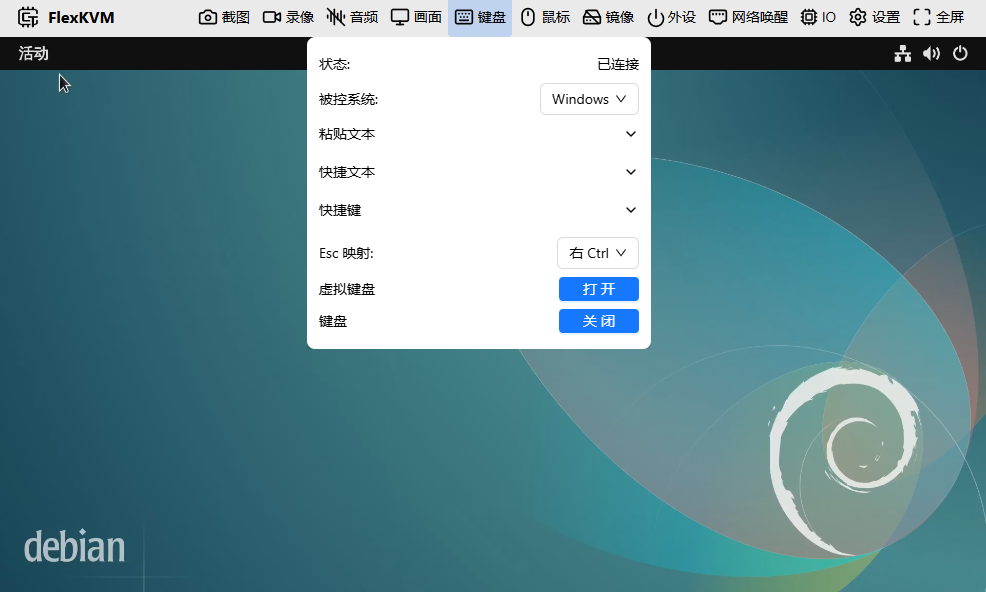

### 状态

| 状态 | 说明 |
|------|------|
| 已连接 | 正常输入 |
| 未连接 | 没连上，重新插拔 USB 或刷新页面 |
| 未使能 | 手动关了，点开启恢复 |

### 被控系统

告诉 FlexKVM 被控设备是什么系统——快捷键和虚拟键盘布局相应调整。默认 **Windows**，可选 Linux 或 macOS。

### 粘贴文本

展开后输入或粘贴文字，点发送到被控设备。正在发送时可以再点取消。

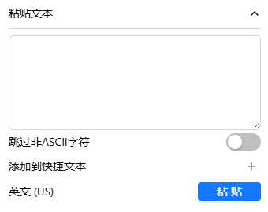

> 只支持英文字符（字母、数字、符号），不支持中文。最长 4096 字符。粘贴速度约 20 字符/秒。

- **跳过非ASCII字符**：开启后自动过滤中文等非 ASCII 字符。关闭则遇到时报错。
- **添加到快捷文本**：把当前文字存起来，下次一键发送。

### 快捷文本

把常用文字（密码、命令、模板）存起来，一键发送。

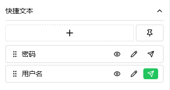

**添加**：点 **+** → 填名称（最长 32 字符）和内容（最长 4096 字符）。最多 10 条。

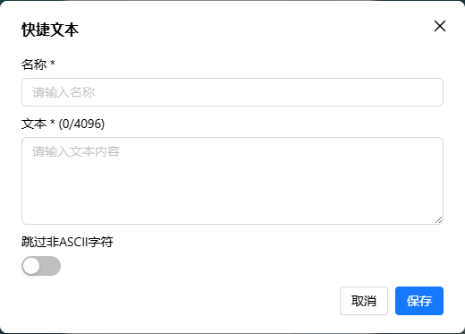

**使用**：每条可预览（眼睛图标）、编辑（铅笔）、发送、取消。拖拽排序。点图钉按钮变悬浮窗，可以拖到顺手位置。

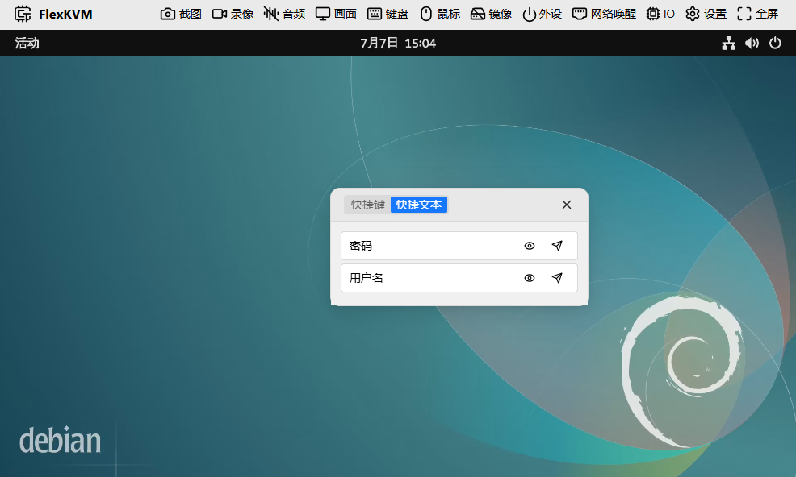

### 快捷键

常用快捷键一键发送，布局跟"被控系统"设置自动切换。

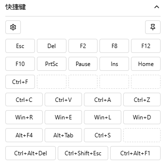

- **齿轮图标**：自定义快捷键
- **图钉图标**：开/关悬浮窗

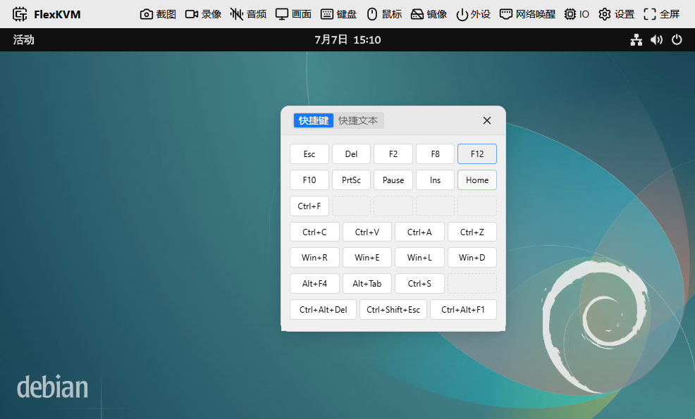

**自定义快捷键**：点齿轮 → 弹窗分三部分——顶部选系统、中部快捷键列表（点 **+** 添加）、底部导入 / 导出 / 复位。

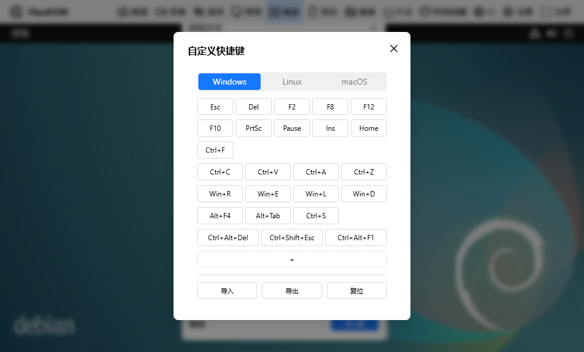

点列表中某条快捷键可修改：

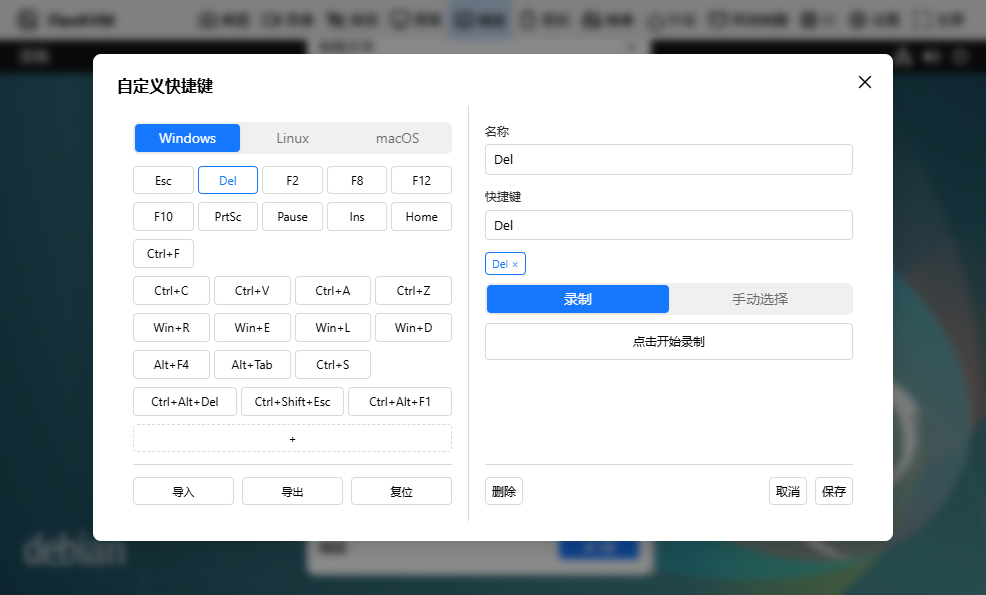

- **名称**：不填时显示快捷键内容
- **快捷键**：两种添加方式——**录制**（点开始录制，按键盘）或**手动选择**（按分类选按键添加/删除）

### 宏

宏是**一串**按键：一条宏由多个步骤组成，点一下按顺序发出去。适合「先按 Ctrl+Shift+Esc，等一下，再按 Enter」这种固定动作序列。

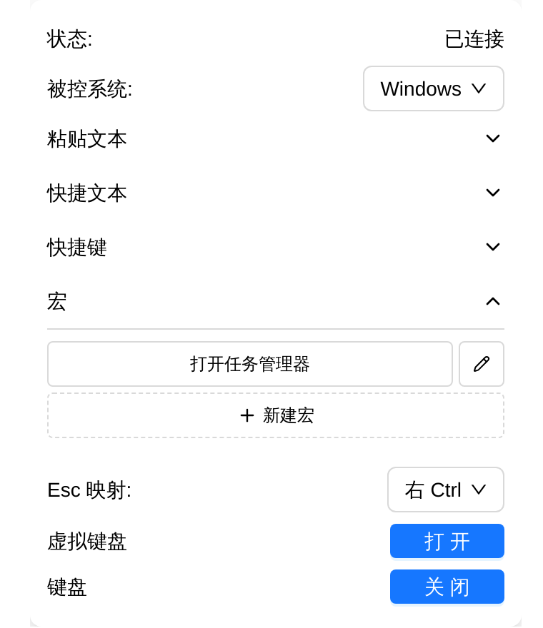

> 宏与**快捷键**是两个入口，不是一个功能的两层：快捷键是"按一下"，宏是"按一串"。宏有自己的列表和编辑弹窗，重名也不会互相覆盖。

**新建**：点 **+ 新建宏** 打开编辑弹窗。

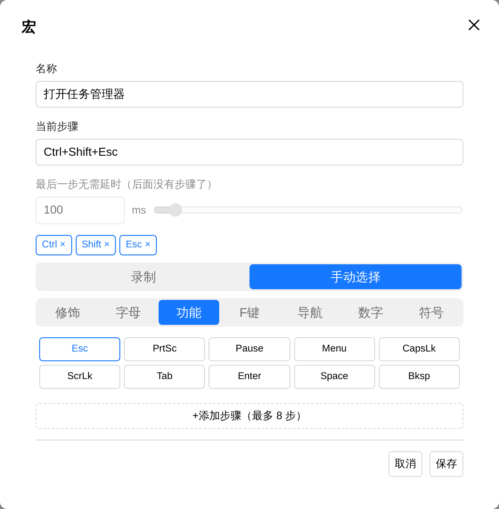

| 字段 | 说明 |
|------|------|
| 名称 | 列表里显示的名字；留空则用当前按键组合当名字 |
| 步骤条 | 两步以上时出现，点某一段切到那一步编辑 |
| 当前步骤 | 这一步的组合键；两步以上时右侧出现**删除该步** |
| 本步之后延时 | 0 ~ 2000 ms，默认 100 ms。**最后一步不执行延时**，输入框同时置灰 |
| 键位选择 | **录制**（点开始录制后在键盘上按）或**手动选择**（按分类点选，与快捷键编辑器同一套） |
| + 添加步骤 | 最多 8 步，到上限后按钮消失 |

**执行**：列表里点宏的按钮即整条发送，发送中/成功/失败都在页面顶部提示。

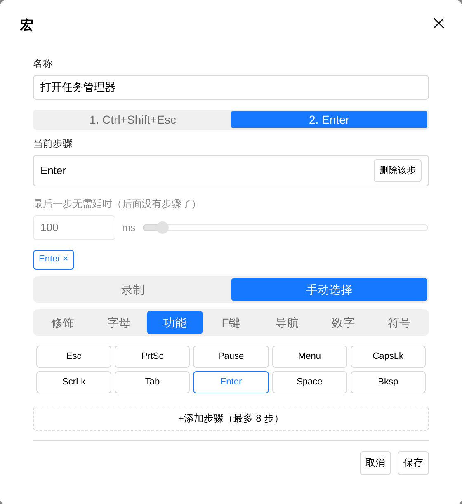

> **延时是"这一步之后"的等待**。两步宏里，第一步的 100 ms 表示"按完这一步等 100 ms 再按下一步"；最后一步的延时不会生效。

> **一条宏不会只执行一半**：任一步没有选键时整条不执行，被控设备不会收到半串按键。保存前先看步骤条上有没有 `（未选按键）`。

> 宏存在浏览器本地，换浏览器或清除站点数据后需要重建。

### 虚拟键盘

点开后画面中弹出虚拟键盘，用鼠标点击输入。布局跟"被控系统"自动切换，窗口窄时换紧凑布局。拖标题栏移动。

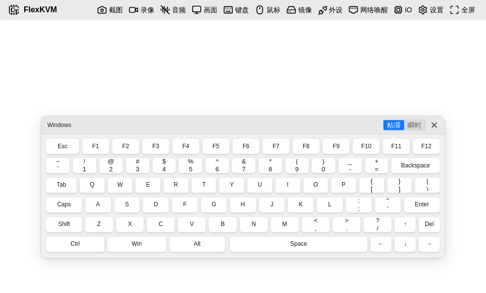

**修饰键**（Ctrl、Alt、Shift、Win）的按下方式在标题栏右侧切换，共两种：

| 模式 | 行为 | 适用场景 |
|------|------|----------|
| 粘滞（默认） | 点一下按住（变深色），再点一下松开（变浅色） | 触屏；先点 Ctrl 再点 C 的组合 |
| 瞬时 | 按住生效，松手释放，与普通键一致 | 习惯物理键盘手感 |

粘滞模式可同时按住多个修饰键。例如：点 **Ctrl**（深色）→ 点 **A** → 发送 Ctrl+A → Ctrl 仍然按住，可继续组合 → 再点 **Ctrl**（浅色，松开）。

瞬时模式下按住修饰键再点其他键，松开修饰键即释放。

**普通键**：按下持续按住，松手释放。

> 切换模式时已按住的修饰键自动释放，粘住的 Ctrl 不会被带进另一种模式。

> 关虚拟键盘或切页面时所有按键自动释放，不会卡键。

> 模式偏好保存在浏览器本地，换浏览器或清除站点数据后回到粘滞。

### Esc 映射

全屏或鼠标相对模式下，`Esc` 被浏览器占用。Esc 映射让你用另一个键代替：

| 你的系统 | 映射到 |
|----------|--------|
| Windows / Linux | 右 Ctrl |
| macOS | 右 Option |

可选：右 Ctrl、右 Option、Scroll Lock、Pause，或禁用。

### 关闭与开启

状态为已连接时点"关闭"→ 变为未使能。点"开启"恢复。

> 开关键盘时 USB 短暂断开重连，鼠标、磁盘挂载和音频也会短暂失效后恢复。

---

## 常见问题

**粘贴文字没反应？** → 检查是否包含中文。粘贴文本只支持英文。

**快捷键没效果？** → 检查"被控系统"选对了吗。

---

[:octicons-arrow-left-24: 返回用户指南](../index.md)
