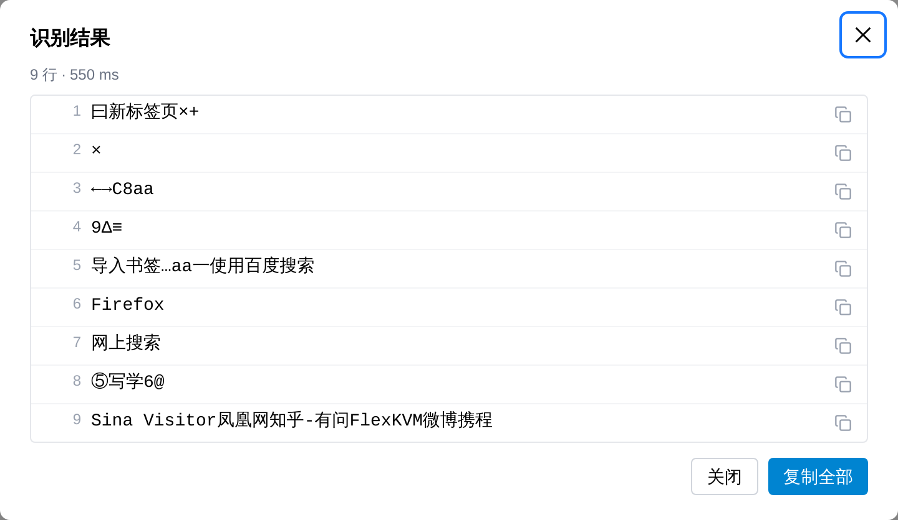

# Text Recognition (OCR)

No more copying text off the remote display by eye — drag a box over an area and FlexKVM recognizes the text locally on the device, ready to copy. Typical uses: an error code on a blue screen, the model and serial number in BIOS, a message that stalled an OS install, or a chunk of log lines in a terminal.

> Where: **OCR** in the menu bar

> Recognition runs on the device. Neither the picture nor the recognized text leaves it, and no online service is involved.

## Run a recognition

1. Click **OCR** in the menu bar — the display dims and a "Drag to select an area, Esc to cancel" hint appears
2. Press and drag a rectangle over the display, then release to start recognizing
3. A spinner reads **Recognizing…**; when it finishes, the results dialog lists the text line by line

| Want to | How |
|---------|-----|
| Copy one line | Click the copy icon on that row |
| Copy everything | Click **Copy all** — lines are joined in order |
| Leave selection mode | Press `Esc`, or click **OCR** in the menu bar again |

> **Verify**: the dialog subtitle reads "N lines · milliseconds" — how many lines this run produced and how long it took.

## What it can read

- Chinese and English, digits and common symbols; mixed layouts are split into lines
- Plain text and light text on dark backgrounds both work; results are ordered **top to bottom**
- If the selection has no text, the list is empty and a "No text found in the selection" notice appears

## Speed

Recognition is **synchronous**: the UI waits for the device between releasing the selection and getting the result. There is no percentage progress.

| Case | Approximate time |
|------|------------------|
| A typical selection (one error line, one dialog) | 0.1 – 0.4 s |
| Full 1080p frame | 0.5 – 1.2 s |

> One image at a time: selecting another region while a recognition is still running is rejected. Wait for the result and try again.

## Permissions and privacy

- Requires **login**
- Operation records hold only line count and duration — **never the recognized text**
- Recognition runs on the device; neither the picture nor the text leaves it

## FAQ

**No OCR in the menu bar?** → The entry is hidden when the device does not support it. Flash the latest firmware to restore it.

**"Recognition failed"?** → Usually happens when the remote display just dropped. Confirm it is back, then select again.

**"No text found in the selection"?** → The box is too small or covers a flat area. Widen it to include a whole line or paragraph.

**Garbled characters?** → Very small or blurry text gets confused with similar glyphs. Increase the display scale on the target and select again.

---

[:octicons-arrow-left-24: Back to User Guide](../index.md)
