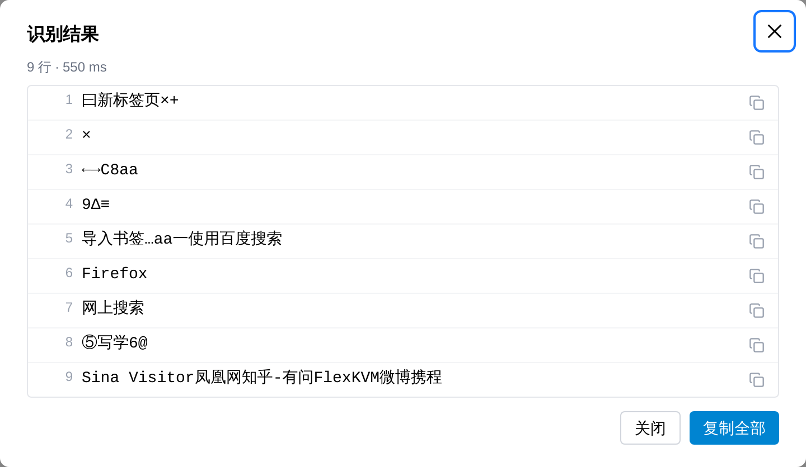

# 文字识别（OCR）

远程画面里的文字不用再靠眼睛抄——框选一块区域，FlexKVM 在设备本地把里面的文字识别成可复制的文本。典型用途：蓝屏或报错界面里的错误码、BIOS 里的型号与序列号、装系统卡住时的提示、网页或终端里成段的日志。

> 入口：菜单栏中的 **OCR**

> 识别在设备上完成，画面与识别结果都不出设备，不依赖任何在线服务。

## 识别一次

1. 点菜单栏 **OCR**，画面变暗并出现「拖动框选要识别的区域，Esc 取消」提示
2. 在画面上按住鼠标拖出矩形，松手即开始识别
3. 识别期间画面中央显示**识别中…**，完成后弹出识别结果，逐行列出文字

| 想要 | 怎么做 |
|------|--------|
| 复制某一行 | 点该行右侧的复制图标 |
| 复制全部 | 点**复制全部**，按行拼接后一次性复制 |
| 退出框选 | 按 `Esc`，或再点一次菜单栏 **OCR** |

> **验证**：结果弹窗标题下方显示「N 行 · 毫秒数」，说明这次识别出几行、用了多久。

## 能识别什么

- 中英文、数字与常见符号，混合排版也能按行切开
- 纯文字与深色背景上的浅色文字都可以；识别结果按**从上到下**排序
- 选区内没有文字时列表为空，并提示「选区内没有识别到文字」

## 速度

识别是**同步**的：拖完选区到出结果之间界面在等设备，没有进度百分比。

| 场景 | 大约耗时 |
|------|----------|
| 框选常见区域（一行报错、一个对话框） | 0.1 ~ 0.4 秒 |
| 整屏 1080p | 0.5 ~ 1.2 秒 |

> 一次识别一张：上一张还没出结果时再框会被拒绝。等结果出来再框。

## 权限与隐私

- 需要**登录**才能使用
- 操作记录里只有识别行数与耗时，**不记录识别到的文字**
- 识别在设备本地完成，画面与文字都不会外传

## 常见问题

**菜单栏没有 OCR？** → 设备不支持该功能时入口不显示。刷一次最新固件即可恢复。

**提示「识别失败」？** → 常见于远程画面刚好断流。确认画面正常后重新框选。

**提示「选区内没有识别到文字」？** → 框太小或框到了纯色区域。把选区放宽一些，包含完整的一行或一段。

**识别出乱码？** → 字号过小或画面模糊时会认错相近字形。放大被控设备上的显示比例后重新框选。

---

[:octicons-arrow-left-24: 返回用户指南](../index.md)
