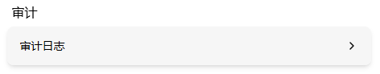
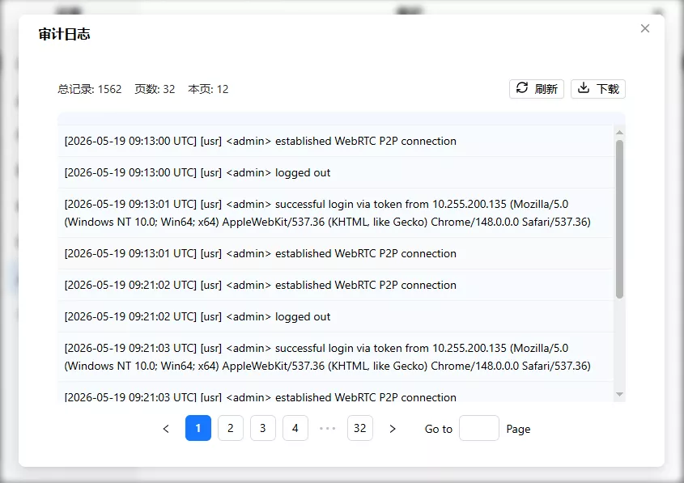
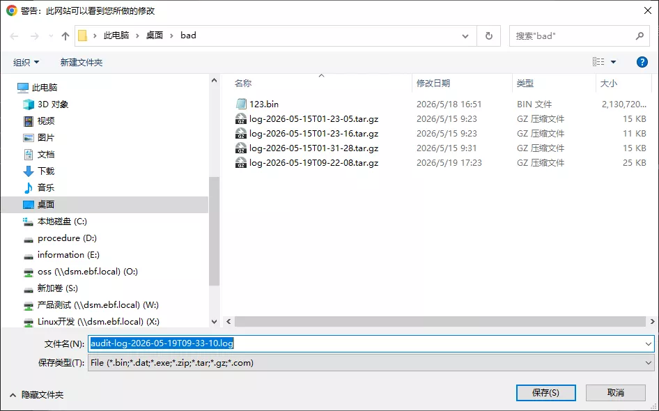
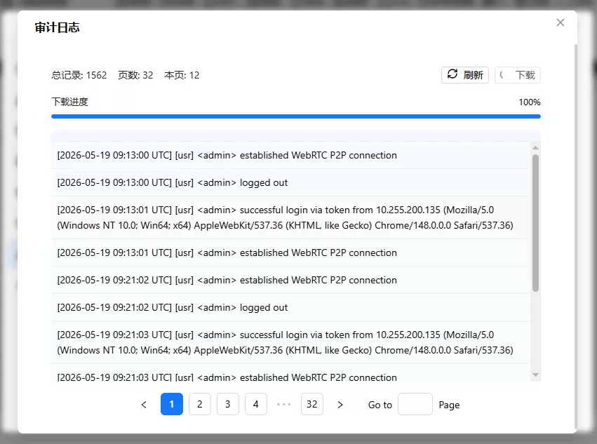

# 操作审计

审计日志记录系统中的重要操作——谁在什么时候做了什么。分为系统事件和用户操作事件，用于追溯操作历史和排查问题。

> 入口：设置 → 维护 → 审计

点"审计日志"弹出窗口：

## 日志内容

每条记录标注 UTC 时间和操作者（系统事件没有操作者，只有时间）：

- **用户操作**：`[YYYY-MM-DD HH:MM:SS UTC] [用户名] 日志内容`，如登录/登出、账号管理、USB 控制、视频设置、网络配置、系统重启等
- **系统事件**：`[YYYY-MM-DD HH:MM:SS UTC] 日志内容`，如网络配置变更、固件升级、恢复出厂、SSH 认证失败等

> 最多保留 10000 条，超出后自动淘汰最旧的记录（窗口顶部的「已淘汰」即累计淘汰条数）。

## 查看日志

每页 50 条，支持翻页。窗口顶部显示总记录数、淘汰数和总页数。点刷新获取最新。

## 下载日志

点下载 → 选保存目录 → 进度条到 100% 且校验通过 → 保存到所选目录。

文件名：`audit-log-{ISO时间戳}.log`，如 `audit-log-2026-05-19T09-33-10.log`

---

[:octicons-arrow-left-24: 返回用户指南](../index.md)
