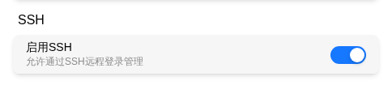

# SSH Remote Access

FlexKVM has a built-in SSH server for remote command-line device management — Out-of-Band Management (OOB). Uses password authentication; only one session at a time.

> Where: Settings → Security → SSH

> After 3 consecutive failed attempts the connection is automatically disconnected, with increasing backoff — this prevents brute force attacks.

## Before You Begin

- Admin account created in the Web interface (→ [Login](./account/login.md))
- SSH service enabled (enabled by default)
- Device has network access

## Enable / Disable



Toggle the switch. Listens on port 22 by default. Disabling disconnects all active sessions.

## Connect

```bash
ssh <username>@<device-IP>
```

Port 22 (default). Windows includes OpenSSH — works directly in PowerShell or CMD.

- **Username**: FlexKVM account name
- **Password**: FlexKVM account password
- **Key-based login not supported**

Once a new connection authenticates, it takes over the current session: the previous session is disconnected after printing `Session taken over by another admin.`, and the new connection continues.

**2FA enabled?** Login is two-step: enter password first → after password is verified, enter the 6-digit TOTP code (or 8-digit backup code) → access granted. Without 2FA, only password is needed.

After connecting, you'll see the management interface:

```
flexkvm-6jzdd SSH OOB Management
Version: 1.1
Type 'help' for available commands.

admin@flexkvm-6jzdd#
```

## Available Commands

Type `help` for the full list. Quick reference:

### ATX Power Control

| Command | Description |
|---------|-------------|
| `atx power short|long` | Short/long press power button |
| `atx reset` | Short press reset button |
| `atx status` | View ATX and power status |

### GPIO Control

| Command | Description |
|---------|-------------|
| `gpio status [a|b]` | View pin status (all pins if omitted) |
| `gpio enable <a|b>` | Enable the given pin |
| `gpio disable <a|b>` | Disable the given pin |
| `gpio direction <a|b> <in|out>` | Set pin direction |
| `gpio level <a|b> <0|1>` | Set output level |

### Network Tools

| Command | Description |
|---------|-------------|
| `network show` | View network interface info |
| `ping` | Connectivity test |
| `mdns status` | View mDNS discovery status |
| `mdns enable|disable` | Enable/disable mDNS discovery |

### System Management

| Command | Description |
|---------|-------------|
| `system info` | View firmware version |
| `reset` | Factory reset (keep logs) |
| `reset all` | Full reset (clear all) |
| `exit` | Exit session |

> ⚠️ `reset` / `reset all` are irreversible. Execution requires three confirmations:
>
> 1. A warning listing what will be cleared is printed
> 2. Enter your account password (up to 3 attempts)
> 3. If 2FA is enabled, enter the TOTP code or a backup code
> 4. A 3-second countdown runs; press `Ctrl+C` to cancel
>
> Failing any step (wrong password/code, `Ctrl+C`, session ended) cancels the reset without clearing anything.

## Terminal Shortcuts

| Shortcut | Function |
|:--------:|----------|
| `Tab` | Command completion |
| `↑` / `↓` | Command history (max 32 entries) |
| `Ctrl+A` / `Ctrl+E` | Beginning/end of line |
| `Ctrl+K` / `Ctrl+U` | Delete to end/beginning of line |
| `Ctrl+C` | Clear current input |
| `Ctrl+D` | Exit when line is empty |

---

## Troubleshooting

| Symptom | Likely cause | Try this first |
|---------|-------------|----------------|
| `Connection refused` | SSH service not enabled | Check the SSH toggle |
| `Connection timed out` | Wrong IP or network unreachable | Verify IP matches OLED, try pinging |
| `Permission denied` | Wrong username or password | Use the same credentials as the Web interface; check case |
| Disconnected immediately after login | Session was taken over by a newer SSH connection | Reconnect; avoid using multiple clients at once |
| Disconnected after wrong password | 3 consecutive failed attempts | Reconnect — the limit resets |

---

[:octicons-arrow-left-24: Back to User Guide](../index.md)
