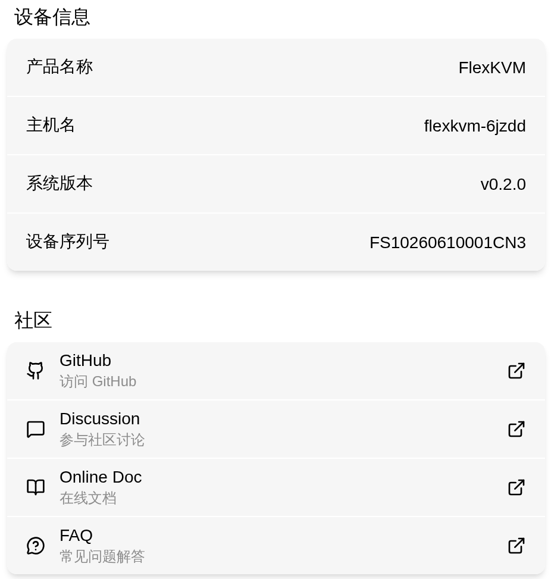

# 关于设备

查看设备信息、固件版本和社区资源。

> 入口：设置 → 关于

## 设备信息

| 信息项 | 说明 |
|:-----|------|
| 产品名称 | 固定为 `FlexKVM` |
| 主机名 | 由设备序列号生成，形如 `flexkvm-6jzdd`；也是 [mDNS 服务发现](../network/mdns.md)里访问用的名字 |
| 系统版本 | 当前固件版本，如 `v0.2.0`。升级 → [在线升级](../maintenance/upgrade-online.md) |
| 设备序列号 | 唯一标识，联系技术支持时需提供 |

> 序列号可在包装盒或设置 → 关于页面查看。也可在 OLED 主界面**短按两次按键 A** 切到系统信息子页面（第一次短按先进 HDMI 信息）。

## 社区

| 入口 | 说明 | 链接 |
|:----|------|:----:|
| GitHub | 访问 GitHub | [github.com/chutuotek/flexkvm](https://github.com/chutuotek/flexkvm) |
| Discussion | 参与社区讨论 | [github.com/chutuotek/flexkvm/discussions](https://github.com/chutuotek/flexkvm/discussions) |
| Online Doc | 在线文档 | [flexkvm.com/latest/](https://flexkvm.com/latest/) |
| FAQ | 常见问题解答 | [flexkvm.com/latest/support/](https://flexkvm.com/latest/support/) |

> 设备**不再内置本地文档**——旧版本「关于」里的 Local Doc（`/docs/`）入口已随新固件移除，文档统一走在线站。
>
> 遇到问题先看[常见问题](../../support/index.md)或在线文档，没解决再联系技术支持并提供序列号。

---

[:octicons-arrow-left-24: 返回用户指南](../index.md)
