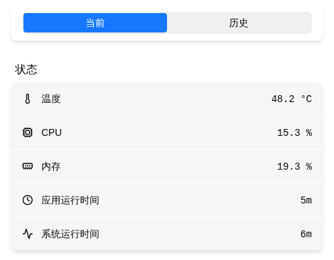

# Status Monitor

Watch the device run in real time — temperature, CPU, memory, network rate, and uptime — with history curves by date and CSV export. Use it to diagnose slowdowns, network bottlenecks, or unexpected reboots.

> Where: Settings → Status

## Metrics

| Metric | Description |
|------|------|
| Temperature | SoC temperature (°C) |
| CPU | CPU usage (%) |
| Memory | Memory usage (%) |
| Network rate | Downlink / uplink rate (auto-scaled B/s to MB/s) |
| App uptime | How long the FlexKVM app has been running |
| System uptime | How long the device has been powered on |

## Current and History

Switch between **Current** and **History** at the top of the page:

- **Current**: latest values plus a 10-minute curve, refreshed every 5 seconds.
- **History**: pick a date and a time range to review that day's temperature / CPU / memory curves (history is recorded per minute and kept for 30 days). Network rate has no history curve — it appears only in the **Current** view.

!!! tip

    "App uptime" resets to zero after a reboot, but history data is kept — check the timeline to find out when the device rebooted and whether temperature/CPU looked abnormal at the time.

## Export Data

In the **History** view, click **Download Day** or **Download All**:

| Option | Description |
|------|------|
| Download Day | Export the selected date (`sys_monitor_<date>.csv`) |
| Download All | Download all history packed into one archive (`sys_monitor_all.tar.gz`, containing per-day CSV files) |

The per-day CSV is a plain text table that opens directly in Excel / WPS, with columns: timestamp, temperature (temp_c), memory total/available (mem_total_mb / mem_avail_mb), and CPU usage (cpu_pct). Network rate appears only in the on-page curves — it is not written to the CSV.

---

[:octicons-arrow-left-24: Back to User Guide](../index.md)
