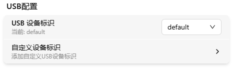
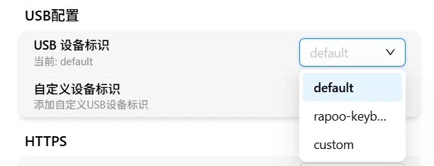
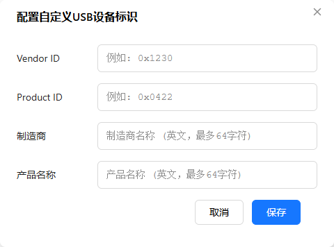

# USB Configuration

FlexKVM emulates a keyboard, mouse, and storage device via USB. You can customize the device identity — what name and vendor info appears in the target host's Device Manager.

> Where: Settings → System → USB Config

## Switch Device Identity

The dropdown lists built-in identities and any custom ones you've created. The built-in identities are:

| Name | Manufacturer | Product | VID / PID |
|------|--------------|---------|-----------|
| default | ChuTuo Electronics Technology Co., Ltd. | FlexKVM | `0x1250` / `0x04E2` |
| logitech-k120 | Logitech, Inc. | Keyboard K120 | `0x046d` / `0xc31c` |
| logitech-m100 | Logitech, Inc. | M100 Optical Mouse | `0x046d` / `0xc05a` |
| rapoo-keyboard | SIGMACHIP | USB Keyboard | `0x1c4f` / `0x0002` |

After selecting, USB auto-restarts to apply the new configuration.

> ⚠️ Switching identity re-enumerates USB: keyboard, mouse, audio and mass storage (any mounted image) drop briefly and then recover. **Do not do this while installing an OS** — the installation will be interrupted.

> Host BIOS or OS having compatibility issues with a specific USB device? Try switching to a different preset identity.

## Custom Device Identity

Click "Custom Device Identity":

| Field | Format | Description |
|-------|--------|-------------|
| Vendor ID | 4 hex digits (`0x046d`) | USB Vendor ID |
| Product ID | 4 hex digits (`0xc52b`) | USB Product ID |
| Manufacturer | English, max 63 characters | Vendor name |
| Product Name | English, max 63 characters | Product name |

> All fields are required. VID/PID must start with `0x`; Manufacturer and Product Name allow only English letters, numbers, spaces, hyphens and underscores. After submitting, a **custom** option appears in the list — select it to apply.

## USB Device Functions

FlexKVM's USB connection includes:

| Function | Protocol |
|----------|----------|
| Keyboard | HID Keyboard |
| Mouse (absolute mode) | HID Absolute Coordinates |
| Mouse (relative mode) | HID Relative Coordinates |
| Audio | UAC (USB Audio Class) |
| Mass storage | USB Mass Storage |

> Changing the device identity affects all of the above functions.

---

[:octicons-arrow-left-24: Back to User Guide](../index.md)
