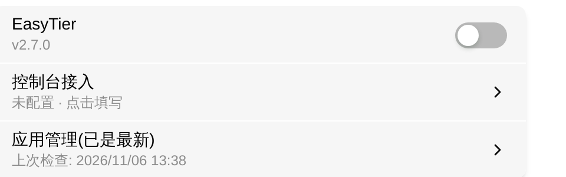
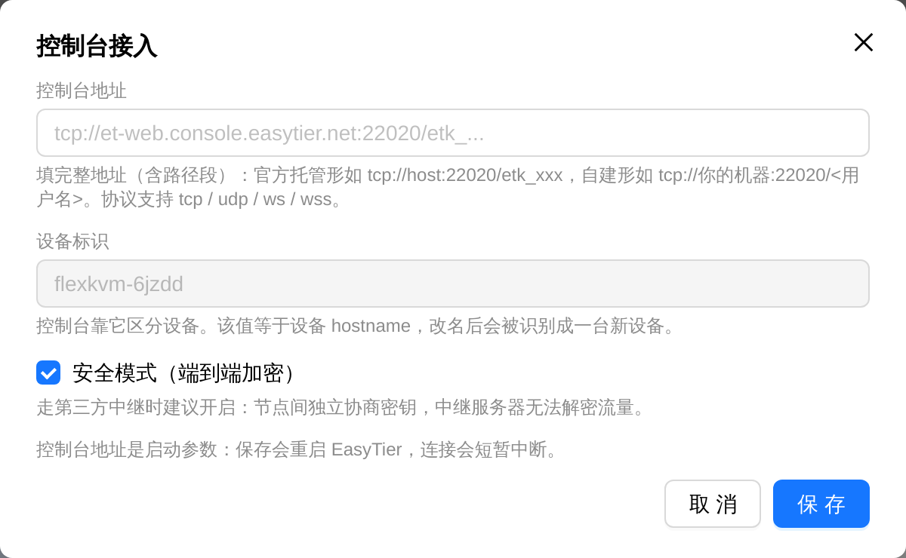

# EasyTier

EasyTier is a decentralized networking tool on FlexKVM. Once the device connects to a **web console**, the network name, password and virtual IP all come from the console — nothing of the sort is stored on the device. With a virtual IP, devices in the same network reach each other as if on one LAN.

> Where: Settings → App → EasyTier

> **A console is mandatory**: the free public nodes EasyTier used to run (`public.easytier.cn` / `public.easytier.top`) have shut down. Without an entry node the two ends cannot discover each other, so this device supports console mode only — official hosting, or your own `easytier-web-embed`.

## Install

EasyTier ships as an app. Until it is installed the card shows only **App not installed**, with no switch and no console entry. Install it from the card's **App Management** row: **Check for updates** → **Download** → **Install now**.

> The full flow and failure reasons are in [App Management](../maintenance/upgrade-app.md).

## Connect to a console

Click **Console Access** to open the dialog:

| Field | Description |
|-------|-------------|
| Console URL | The **whole string**, including the path segment. Official hosting looks like `tcp://host:22020/etk_xxx`; self-hosted like `tcp://your-server:22020/<username>` |
| Device ID | Read-only; equals the device hostname. The console tells devices apart by it |
| Secure mode | On by default. Keep it on when traffic crosses third-party relays: keys are negotiated per pair, so relays cannot decrypt it |

Click **Save**.

> **URL shape**: the scheme must be one of `tcp` / `udp` / `ws` / `wss`, a `host:port` is required, and a third segment (tenant key or console username) is required. Anything missing is rejected in the dialog and never reaches the device.

> **The third segment means two things**: a tenant key (prefixed `etk_`) for official hosting, a username for a self-hosted console. Both are accepted, so the prefix does not matter.

> **Saving restarts EasyTier**: the connection briefly drops. If the service was off, only the configuration is saved and nothing is started.

> **Do not rename the device**: the device ID equals the hostname. After a rename the console treats the same device as two (the old one offline, the new one unknown).

## Enable the service

The switch only takes effect after a console is connected. Without one it will not turn on — there is no network configuration to run, and nothing would be reachable.

Once enabled, the version shows under the switch (e.g. `v2.7.0`), with `(update available)` appended when there is a newer build.

> **Verify**: the switch turns on and a **Details** row appears (it is hidden while disabled).

## Connection details

Click **Details** to see the runtime state:

| Field | Description |
|-------|-------------|
| Virtual IPv4 | This device's address from the console (with prefix) |
| Hostname | This device's hostname |
| Instance ID | This device's instance identifier |
| Public IP | Public address discovered via STUN |
| NAT type | UDP / TCP NAT type, see below |
| Peers | Connected peers with tunnel type, bytes in/out and latency |
| Routes | Routing table with next hop, proxied subnets and path cost |

NAT types:

| Shown as | Meaning |
|----------|---------|
| Open Internet | Directly reachable, no NAT |
| No PAT | NAT without port translation |
| Full cone | The easiest kind to traverse |
| Restricted | Must initiate outbound first |
| Port restricted | A stricter restricted cone |
| Symmetric | Hardest to traverse; usually needs a relay |
| Unknown | Probe not finished, or the control plane returned nothing |

The subtitle has three shapes:

| State | Subtitle |
|-------|----------|
| No virtual IP yet | Waiting for the console to push a network configuration |
| IP, 0 peers | `<IP> · no other devices yet` |
| IP, N peers | `<IP> · N peers` |

> "No other devices yet" is not a fault: the device is in the network with an address, there is just no second device. Peers appear once another device joins the same network in the console.

> State refreshes every few seconds rather than in real time. Click the **refresh** icon next to the card title to update immediately.

## Remote access

Once you have a virtual IP, **install EasyTier on the device you will connect from and join the same network in the console**, then:

- **Web UI**: `https://<virtual IP>`
- **SSH**: `ssh <username>@<virtual IP>`

## Disconnect the console

Open **Console Access**, clear the URL and save. The device stops the EasyTier core and returns to the unconfigured state.

> **Verify**: the card shows **Not configured - tap to set up**, the **Details** row disappears, and the switch will not turn on.

## App Management

The card's **App Management** row is the online update entry for the EasyTier app package (independent for Tailscale, ZeroTier, frp, NetBird and EasyTier). It supports switching the download source, checking for updates, downloading, installing and uninstalling.

> Upgrading does not lose the console configuration: the URL and secure-mode flag live in the global config, outside the install directory.

> Uninstalling turns the service switch off; reinstall and reconnect the console afterwards.

The full flow is in [App Management](../maintenance/upgrade-app.md).

---

## Troubleshooting

| Symptom | Likely cause | Try this first |
|---------|--------------|----------------|
| Card shows **App not installed** | The EasyTier package is missing | Install it from **App Management** after checking for updates |
| Invalid URL message | Missing scheme, port or third segment | Enter the whole string as `proto://host:port/<key>` |
| The switch will not turn on | No console connected yet | Click **Console Access**, enter the URL and save |
| Stuck at "Waiting for the console to push a network configuration" | The console has not pushed a network | Confirm the device joined a network in the console, wait, then click **refresh** |
| Has an IP but **no other devices yet** | The network really has only this device | Join another device to the same network in the console |
| Switch is on but it says **Service not running** | The service exited | Toggle the switch off and on; if it persists, check the console URL and connectivity, or reinstall |
| Connection drops right after saving the URL | Saving restarts the core — expected | Wait a few seconds; the state recovers on its own |
| The console sees two devices | The hostname changed, so the device ID changed | Remove the stale device in the console, or restore the hostname |
| State changes slowly | State comes from a 3-second poll | Click **refresh** |
| Cannot connect remotely | The client has no EasyTier, or is not in the same network | Join the same network on the client and confirm the virtual IP is reachable |

---

[:octicons-arrow-left-24: Back to User Guide](../index.md)
