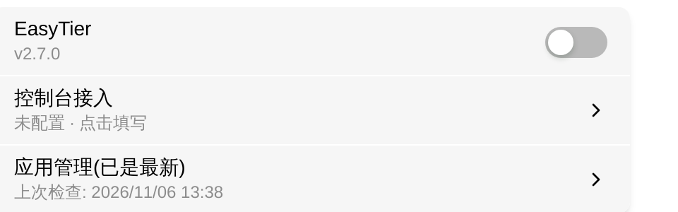
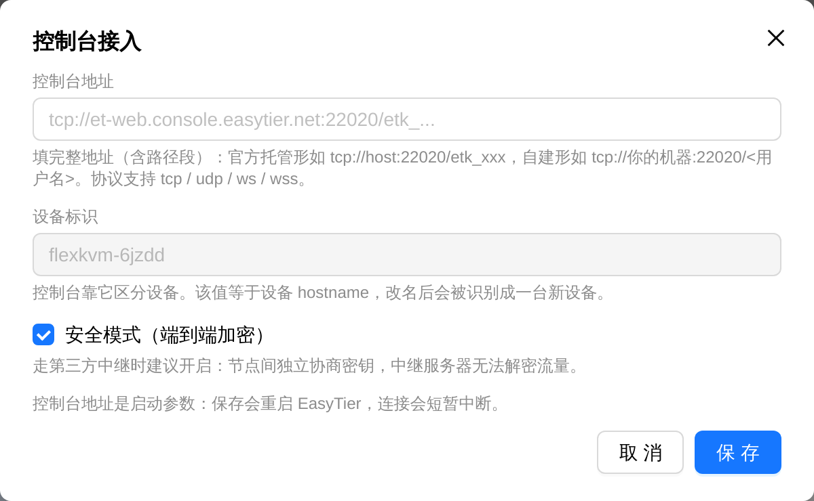

# EasyTier

EasyTier 是 FlexKVM 上的去中心化组网工具。设备接入一个 **Web 控制台**后，网络名、密码与虚拟 IP 全部由控制台下发，设备侧不保存这些凭据；拿到虚拟 IP 后，同一网络里的设备之间就像在同一局域网里互通。

> 入口：设置 → 应用 → EasyTier

> **必须先有控制台**：EasyTier 官方曾经提供的免费公共节点（`public.easytier.cn` / `public.easytier.top`）已停止服务。没有入口节点，两端无法互相发现，因此本设备只支持控制台模式——用官方托管，或自己搭一个 `easytier-web-embed`。

## 安装

EasyTier 以应用形式提供。设备上还没装时，卡片只显示**应用未安装**，开关与控制台入口都不出现。在卡片的**应用管理**行里装一次：**检查更新** → **下载** → **立即安装**。

> 完整流程与失败原因见[应用管理](../maintenance/upgrade-app.md)。

## 接入控制台

点**控制台接入**打开弹窗：

| 字段 | 说明 |
|------|------|
| 控制台地址 | **整串**填写，含路径段。官方托管形如 `tcp://host:22020/etk_xxx`；自建形如 `tcp://你的机器:22020/<用户名>` |
| 设备标识 | 只读，等于设备 hostname。控制台靠它区分设备 |
| 安全模式 | 默认开启。走第三方中继时保持开启：节点间独立协商密钥，中继服务器无法解密流量 |

点**保存**。

> **地址形状**：协议必须是 `tcp` / `udp` / `ws` / `wss` 之一，必须带 `host:port`，必须有第三段（租户 key 或控制台用户名）。缺一项会在入口就被拦下，不会发到设备。

> **第三段两种含义**：官方托管是租户 key（`etk_` 开头），自建控制台是用户名。两种都合法，不需要管开头是什么。

> **保存会重启 EasyTier**：连接会短暂中断。若服务本来是关的，只保存配置，不会自动启动。

> **设备标识不要改名**：它等于 hostname。设备改名后控制台会把同一台设备认成两台（旧的变离线、新的变陌生设备）。

## 启用服务

接入控制台之后，点开关才会生效。未接控制台时开关拨不动——没有控制台就没有网络配置，起来了谁也连不上。

启用后开关下方显示版本号（如 `v2.7.0`）；有新版时追加 `（有更新）`。

> **验证**：开关打开，卡片出现**详细信息**入口（未启用时不显示）。

## 连接详情

点**详细信息**查看运行态：

| 字段 | 说明 |
|------|------|
| 虚拟 IPv4 | 控制台下发的本机地址（带掩码） |
| 主机名 | 本机 hostname |
| 实例 ID | 本机实例标识 |
| 公网 IP | STUN 探测到的公网地址 |
| NAT 类型 | UDP / TCP 的 NAT 类型，见下表 |
| 对端 | 已连接对端列表，含隧道类型、收发字节与延迟 |
| 路由 | 路由表，含下一跳、代理子网与路径开销 |

NAT 类型：

| 显示 | 含义 |
|------|------|
| 开放互联网 | 直接可达，无 NAT |
| 无 PAT | 有 NAT 但不做端口转换 |
| 完全锥形 | 最容易打通的类型 |
| 受限锥形 | 需要先向外发起 |
| 端口受限锥形 | 更严格的受限锥形 |
| 对称型 | 最难穿透，通常需要中继 |
| 未知 | 探测未完成或控制面未返回 |

副标题三种形态：

| 状态 | 副标题 |
|------|--------|
| 未获得虚拟 IP | 等待控制台下发网络配置（还没进网络） |
| 有 IP、0 个对端 | `<IP> · 暂无其他设备` |
| 有 IP、N 个对端 | `<IP> · N 个对端` |

> 「暂无其他设备」不是故障：本机已经在网络里并拿到地址，只是网络里还没有第二台设备。把另一台设备加入控制台上的同一网络后，对端才会出现。

> 状态每隔几秒自动更新一次，不是实时的。点卡片标题右侧的**刷新**图标可以立即查一次。

## 远程访问

拿到虚拟 IP 后，**在你要访问 FlexKVM 的设备上也装 EasyTier 并加入控制台上的同一网络**，然后：

- **Web 界面**：`https://<虚拟 IP>`
- **SSH**：`ssh <用户名>@<虚拟 IP>`

## 断开控制台

打开**控制台接入**，把地址清空后保存。设备会停掉 EasyTier core 并回到未接入形态。

> **验证**：卡片显示**未配置 · 点击填写**，**详细信息**入口消失，开关无法打开。

## 应用管理

卡片上的**应用管理**行是 EasyTier 应用包的在线更新入口（与 Tailscale、ZeroTier、frp、NetBird 各自独立），支持下载源切换、检查更新、下载、立即安装与卸载。

> 升级不会丢控制台配置：地址与安全模式存在全局配置里，不在安装目录内。

> 卸载会把服务开关置回关闭；重新安装后需要重新接入控制台。

完整流程见[应用管理](../maintenance/upgrade-app.md)。

---

## 故障排查

| 现象 | 可能原因 | 先试这个 |
|------|----------|---------|
| 卡片显示**应用未安装** | 设备上没有 EasyTier 应用包 | 在**应用管理**里检查更新后安装 |
| 提示地址格式不正确 | 缺协议头、缺端口或缺第三段 | 按 `proto://host:port/<key>` 整串填写 |
| 开关拨不动 | 还没接控制台 | 点**控制台接入**填地址并保存 |
| 一直「等待控制台下发网络配置」 | 控制台还没给本机下发网络 | 确认控制台里该设备已加入某个网络；稍等后再点**刷新** |
| 有 IP 但**暂无其他设备** | 网络里确实只有本机 | 把另一台设备加入控制台上的同一网络 |
| 开关已开，描述显示**服务未运行** | 服务异常退出 | 关掉开关再打开；仍不行就检查控制台地址与网络连通性，或重装应用 |
| 保存地址后连接中断 | 保存会重启 core，属预期 | 等几秒，状态会自行恢复 |
| 控制台把设备认成两台 | 设备改过 hostname，设备标识跟着变了 | 把旧设备从控制台移除，或把 hostname 改回去 |
| 状态变化很慢 | 状态来自 3 秒一轮的轮询 | 点**刷新** |
| 远程连不上 | 控制端没装 EasyTier、没加入同一网络 | 在控制端加入同一网络，确认能访问虚拟 IP |

---

[:octicons-arrow-left-24: 返回用户指南](../index.md)
