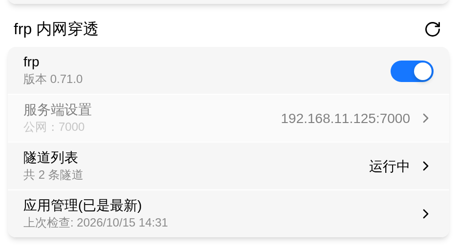
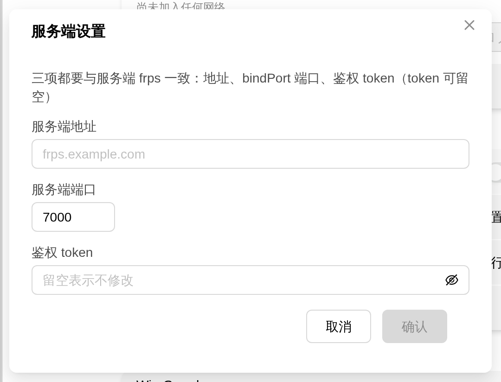
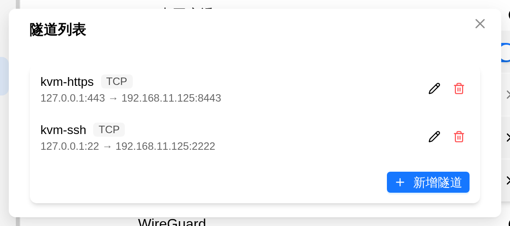
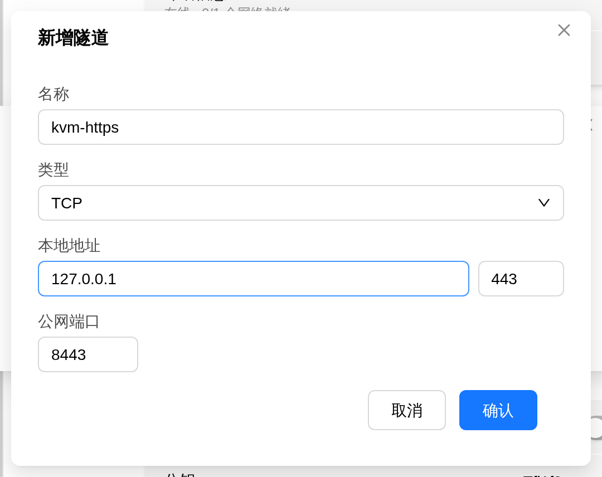

# frp Tunneling

frp is a **port-mapping** tool: the frpc client on your device connects out to a server you own with a public IP (frps) and maps a port on FlexKVM to a public port on that server. From anywhere that can reach the server you can then open the device's web interface or SSH — the device itself needs no public IP and no router port forwarding.

> Where: Settings → App → frp Tunnel

## Prerequisites

FlexKVM only runs the frpc client — **the frps server is yours to prepare**: a server with a public IP, with frp installed and frps running. See the [frp documentation](https://github.com/fatedier/frp) for installing and configuring the server; this page doesn't cover it.

Write down three things on the server side; they must match frps:

| What you need | Description |
|---------------|-------------|
| Server address | Domain name or public IP of the server |
| Server port | frps `bindPort` (default `7000`) |
| Auth token | Must match if frps has a token configured; may be left empty otherwise |

The server firewall (plus the security group on cloud hosts) must allow frps' `bindPort` and the **public port** of every tunnel you create.

> frp does port mapping, not mesh networking: the device gets no virtual IP, and the server only forwards a single port to it. For two-way connectivity with your computer (mutual ping, reaching the whole subnet), use [Tailscale](tailscale.md).

## Install

The app may not be on the device yet — the card then shows a yellow **App not installed** notice, with all service controls (toggle, server settings, tunnels) collapsed and only the **App Management** entry left.

1. Click **App Management** on the card
2. Click **Check for Updates**
3. Click **Download** (you can cancel at any time); the package is verified automatically when the download finishes
4. Once verified the button becomes **Install Now** — click it to install

> **Verify**: After installation the "App not installed" notice is gone, the toggle's subtitle shows the version (e.g. `Version 0.71.0`), and all service controls appear.

Download source, failure reasons and firmware requirements are covered in [App Management](../maintenance/upgrade-app.md).

## Enable the Service

Enabling requires the **server address to be set** (the auth token is optional): with an empty address the toggle is grayed out and the row says "Fill in the server address before enabling frp". Once the address is set, turn the toggle on — the backend generates `frpc.toml` and starts the frpc process.

> **Verify**: With the toggle on, the **Tunnels** row shows **Running** on the right.

Runtime state is pushed after backend polling (tunnel start/stop, server reconnects), so no manual refresh is needed; click the refresh icon at the top right of the card (**Refresh Status**) to query frpc's admin API immediately.

> If writing the config or starting the process fails, the toggle falls back to its previous position — you won't be left with a switch that says "on" while nothing runs.

## Server Settings

Click **Server Settings** to open the form; all three fields must match frps:

| Field | Description |
|-------|-------------|
| Server Address | Domain name or IP of frps, e.g. `frps.example.com` |
| Server Port | frps `bindPort`, default `7000` |
| Auth Token | Must match frps; **leave empty to keep unchanged** (the token is never shown back) |

The **Server Settings** row shows `address:port` on the right, or **Not set** if it was never filled in.

**No edits while running**: this row is grayed out while frpc is running, because changing connection parameters forces a reconnect that tears down every tunnel. Stop the service first, then edit — saving writes to disk and the next enable connects with the new parameters. While running, the row's subtitle reads `Public: <port>`; when stopped it goes back to "frps address and auth token (optional); applies on next enable".

> **Verify**: After saving, that row shows `frps.example.com:7000`; turn the toggle back on and the **Tunnels** row shows **Running** with your tunnels coming back.

## Add, Edit and Delete Tunnels

Click **Tunnels** to open the list; the **Add Tunnel** button sits at the bottom right (an empty list says "No tunnels yet — add one below").

A tunnel has just 5 fields:

| Field | Description |
|-------|-------------|
| Name | Unique identifier of the tunnel; **saving under an existing name overwrites it**; letters, digits, `-` and `_` only |
| Type | Only `TCP` / `UDP` |
| Local Address | The local address to expose, defaults to `127.0.0.1` |
| Local Port | The port actually serving on the device |
| Public Port | The port on frps (its address is decided by frps and is not entered here) |

To expose the device web interface, for example: Local Address `127.0.0.1`, Local Port `443`, Public Port an unused port on the server (e.g. `8443`) — then browse to `https://<frps address>:8443`.

> Ports must be 1–65535 and names are limited to 63 characters; at most 16 tunnels — saving beyond that reports "Tunnel limit reached (16)".
> The form exposes only these 5 fields; frpc's advanced options (encryption, bandwidth limit, custom domains) are not part of it.

Click **Confirm** to save — it takes effect **hot, without dropping existing connections** (unlike changing the server parameters).

### Edit

Click the pencil icon in the list → the **Edit Tunnel** dialog opens with the same fields; click **Confirm** when done. **Renaming adds a new tunnel**: only a matching name overwrites, so the old tunnel stays in the list and has to be deleted separately.

### Delete

Click the trash icon in the list → the deletion is sent **immediately, with no confirmation prompt**.

> **Verify**: The saved tunnel appears in the list — type badge next to the name, and `127.0.0.1:443 → frps.example.com:8443` on the second line. A healthy tunnel shows no extra status text.

## Tunnel List and Runtime State

- The **Tunnels** row shows the overall state on the right: **Running** / **Stopped** / **Admin API unreachable**; the subtitle reads "N tunnel(s)"
- Each entry shows name, type and `local address → public address`. A healthy tunnel carries no status text; `wait` and `error` appear next to the name, and hovering over the status text reveals the reason for an error
- **Add Tunnel** and the per-row edit/delete buttons are only clickable when the app is installed, the service is enabled, the process is running and the admin API is reachable — otherwise they are grayed out
- The list reflects the **runtime state** reported by frpc: with the service stopped the list is empty. **Your configuration is not lost** — the tunnels come back after you re-enable it

> **Verify**: Turn the toggle off and open the tunnel list — it is empty and says "No tunnels yet — add one below". Turn the toggle back on and click **Refresh Status** — every tunnel returns. That's the runtime state, not the configuration stored on the device.

## App Management

The **App Management** entry on the card handles downloading, installing and uninstalling this app:

| Action | Description |
|--------|-------------|
| Download Source | Choose whether packages come from Gitee or GitHub |
| Check for Updates | Fetch the latest version info; the last check time is shown afterwards |
| Download / Install Now | Download and verify the package, then install; a download can be cancelled |
| Uninstall | Stop frpc and delete the app files (with a confirmation prompt) |

- Upgrades are "stop → swap directory → start"; `frpc.toml` and the tunnel configuration live outside the install directory, so **upgrading never loses your configuration**
- Uninstalling turns the toggle back off and likewise **keeps the tunnel configuration** — the tunnel table is still there after a reinstall

> Version states and failure reason categories are covered in [App Management](../maintenance/upgrade-app.md).

---

## Troubleshooting

| Symptom | Likely cause | Try this first |
|---------|-------------|----------------|
| Card shows "App not installed" | The app is not on the device yet | Click **App Management** → Check for Updates → Download → Install Now |
| Toggle grayed out | App not installed, or server address not filled in | Read the hint under the toggle row and set the server address |
| **Server Settings** row won't open | frpc is running (no edits while running) | Stop the service, edit, then enable again |
| Tunnel list is empty | Service is stopped (the list shows runtime state), or no tunnels configured yet | Enable the service; if nothing is configured, click **Add Tunnel** |
| A tunnel stays in `wait` | Its public port is blocked or taken on the frps side | Open that public port in the server firewall and security group, or pick another port |
| A tunnel shows `error` | frps rejected the tunnel | Hover the status text for the reason and retry with another public port |
| Shows "Admin API unreachable" | frpc is alive but its local admin API (default `7400`) doesn't answer | Click **Refresh Status**; if it persists, toggle the service off and on |
| Can't reach the device from the internet | The server doesn't allow `bindPort` or the public port | Check the server firewall and cloud security group, and make sure that tunnel reports no error |
| Saving a tunnel is rejected | Illegal name, port out of range, or the 16-tunnel limit | Fix it according to the red error text in the dialog |
| Toggle flips back after enabling | Writing the config or starting the process failed | Read the error message and install the app or set the server address as it says |
| Can't reach frps after changing the token | Token doesn't match frps | Stop the service, re-enter the **Auth Token**, then enable again |

---

[:octicons-arrow-left-24: Back to User Guide](../index.md)
