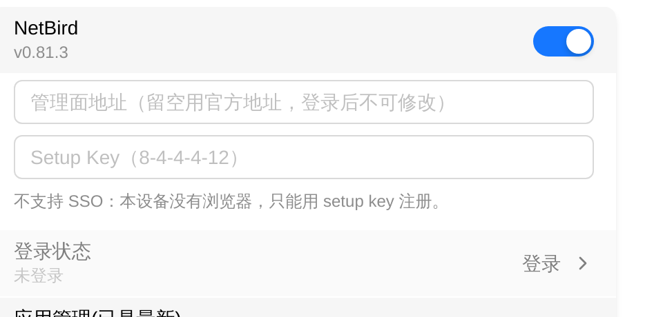

# NetBird

NetBird is a zero-trust networking tool on FlexKVM — the device registers with a management server (NetBird's official one or your own self-hosted control plane) using a **Setup Key**, gets a virtual IP, and then reaches other devices in the same network as if they were on one LAN. No public IP, no port forwarding.

> Where: Settings → App → NetBird

> Before you start, create a network at [NetBird](https://netbird.io) and generate a **Setup Key** in the console (shape `8-4-4-4-12`, e.g. `A1B2C3D4-1234-5678-9ABC-DEF012345678`).

## Compared with Tailscale / ZeroTier

All three are network joins. They coexist on one device — enable one, or several. Three things decide the choice:

| Aspect | Tailscale | ZeroTier | NetBird |
|--------|-----------|----------|---------|
| Credential | Account login / auth key | 16-digit Network ID | **Setup Key** |
| Control plane | Official or self-hosted headscale | Official or self-hosted controller | Official or **self-hosted management** |
| Typical fit | Personal and home networks | Virtual Layer 2 (broadcast, LAN discovery) | Zero-trust policy, per-identity authorization |

## Install

NetBird ships as an app. Until it is installed the card shows only **App not installed**, with no switch and no input fields. Install it from the card's **App Management** row: **Check for updates** → **Download** → **Install now**. Installation cannot be cancelled and needs no reboot.

> The full flow and failure reasons are in [App Management](../maintenance/upgrade-app.md).

> **Verify**: the "App not installed" notice disappears and the switch plus the login inputs appear.

## Enable the service

Click the switch to enable it. Once enabled, the version shows under the switch (e.g. `v0.81.3`), with `(update available)` appended when there is a newer build.

> The version still shows while the service is not running. An empty version means "installed but unreadable", not "not installed" — check for the "App not installed" notice instead.

## Sign in

Once enabled, two inputs appear. Fill in **both and submit together**:

| Field | Description |
|-------|-------------|
| Management URL | Leave blank for NetBird's official server; for a self-hosted control plane enter `https://your-console` |
| Setup Key | The one-time registration credential from the console, shape `8-4-4-4-12` |

Then click **Login**.

> **A self-hosted management server must be entered here**: the Setup Key is issued by one specific control plane. Supplying only the key makes the device register against the official server, which is always rejected. That is also why the URL can only be entered before login — requiring a successful login before the URL can be changed would make a wrong URL impossible to fix.

> **The URL locks after login**: the management URL is bound to the peer identity, so the input block disappears once login succeeds and the management row becomes read-only. To switch control planes, **log out** and register again.

> The Setup Key is used from memory only and is **never written to disk**; it is cleared on success and on failure.

> **SSO is not supported**: it needs browser interaction and this device has no browser. Setup Key only.

> **Verify**: a toast reports the login request was sent; the inputs collapse into a **Details** row whose subtitle reads "Connected · N peers".

## Connection details

Click **Details** to see the connection facts:

| Field | Description |
|-------|-------------|
| Virtual IPv4 / IPv6 | This device's address in the NetBird network |
| FQDN | This device's FQDN (use it inside the network) |
| Management | The management URL currently in effect |
| Signal | Connection state to the signalling service |
| WireGuard port | The port this device listens on |
| Management error | The reason for a failed login or renewal |
| Peers | Connected peers with state, latency and whether they are relayed |

> At most 16 peers are shown (limited device memory). The total is on the **Peers** row, with a "showing first N of M" hint when truncated.

State words:

| State | Meaning |
|-------|---------|
| Connected | Tunnel ready; reachable by virtual IP |
| Idle | Logged in but no active connection |
| Connecting | Establishing the tunnel |
| Needs login | Not registered yet, or the credential expired |
| Disconnected | Service down or link lost |
| Login failed | Registration rejected; see **Management error** |
| Session expired | The credential expired on the management server; re-register |

> State refreshes every few seconds rather than in real time. Click the **refresh** icon next to the card title to update immediately.

## Remote access

Once registered and holding a virtual IP, **install NetBird on the device you will connect from and join the same network**, then:

- **Web UI**: `https://<virtual IP>`
- **SSH**: `ssh <username>@<virtual IP>`

## DNS is not managed by NetBird

NetBird on FlexKVM **never changes the device's DNS settings**: its DNS takeover is forced off before startup, and if that cannot be done the service will not start.

The reason: this device may also run Tailscale and ZeroTier. Several VPNs rewriting `resolv.conf` make name resolution fail intermittently, and such failures are very hard to attribute. FlexKVM is reached by **IP**, so it does not need network-provided DNS.

> There is deliberately **no** DNS switch in Settings.

## Log out

Click **Log out** next to the login state and confirm. Logging out removes the device from the management server and is **irreversible** — reusing it requires a fresh Setup Key.

> **Verify**: the card returns to the signed-out layout, the inputs reappear and the **Details** row disappears.

## App Management

The card's **App Management** row is the online update entry for the NetBird app package (independent for Tailscale, ZeroTier, frp, EasyTier and NetBird). It supports switching the download source, checking for updates, downloading, installing and uninstalling.

> Uninstalling turns the service switch off; reinstall and enable it again by hand.

The full flow is in [App Management](../maintenance/upgrade-app.md).

---

## Troubleshooting

| Symptom | Likely cause | Try this first |
|---------|--------------|----------------|
| Card shows **App not installed**, no switch | The NetBird package is missing | Install it from **App Management** after checking for updates |
| "Setup Key must be in 8-4-4-4-12 form" | The key is incomplete or malformed | Copy the full Setup Key from the console again |
| "Address must start with http:// or https://" | The management URL has no scheme | Add `https://` |
| Login returns **login failed** | The management server rejected registration | Check **Management error** under **Details**; `-EACCES` usually means a bad key or a wrong URL |
| Immediately back to **Needs login** after logging in | The service did not start | Toggle the switch off and on; reinstall the app if it persists |
| Signed in but no **Details** row | State has not refreshed yet | Click the **refresh** icon next to the card title |
| State changes slowly | State comes from a 3-second poll | Click **refresh** |
| Cannot connect remotely | The client has no NetBird, or is not in the same network | Join the same network on the client and confirm the virtual IP is reachable |
| The URL inputs vanished but the URL is wrong | The URL locks after login | **Log out**, then register again with the right URL |

---

[:octicons-arrow-left-24: Back to User Guide](../index.md)
