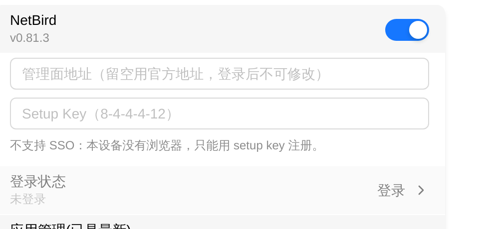

# NetBird

NetBird 是 FlexKVM 上的零信任组网工具——设备用一枚 **Setup Key** 注册到管理面（NetBird 官方或你自己的自建控制面），之后拿到一个虚拟 IP，与同一网络里的其它设备像在同一局域网里一样互通，不需要公网 IP、不用配端口转发。

> 入口：设置 → 应用 → NetBird

> 使用前先在 [NetBird](https://netbird.io) 创建一个网络，并在控制台生成 **Setup Key**（形状 `8-4-4-4-12`，例如 `A1B2C3D4-1234-5678-9ABC-DEF012345678`）。

## 与 Tailscale / ZeroTier 的区别

三者都是组网，装在同一台设备上互不排斥，可以只开一个也可以同时开。选型时看三点：

| 维度 | Tailscale | ZeroTier | NetBird |
|------|-----------|----------|---------|
| 接入凭据 | 账号登录 / Auth Key | 16 位 Network ID | **Setup Key** |
| 控制面 | 官方或自建 headscale | 官方或自建控制器 | 官方或**自建管理面** |
| 典型场景 | 个人与家庭组网 | 需要虚拟二层（广播、内网发现） | 零信任策略、按身份授权 |

## 安装

NetBird 以应用形式提供。设备上还没装时，卡片只显示**应用未安装**，开关与输入框都不出现。在卡片的**应用管理**行里装一次：**检查更新** → **下载** → **立即安装**。安装不可取消，完成后不需要重启设备。

> 完整流程与失败原因见[应用管理](../maintenance/upgrade-app.md)。

> **验证**：卡片上的**应用未安装**消失，开关与登录输入区出现。

## 启用服务

点开关即可启用。启用后开关下方显示版本号（如 `v0.81.3`）；有新版时追加 `(可更新)`。

> 服务没在运行时版本号照样显示。空版本表示"装上了但取不到"，不等于没装——是否已装看**应用未安装**那句提示在不在。

## 登录

启用后卡片出现两个输入框，**一起填、一起提交**：

| 字段 | 说明 |
|------|------|
| 管理面地址 | 留空用 NetBird 官方地址；自建控制面填 `https://你的控制台` |
| Setup Key | 控制台生成的一次性注册凭据，形状 `8-4-4-4-12` |

填好后点**登录**。

> **自建管理面必须在这里填地址**：Setup Key 由某个具体控制面签发，只给 key 不给地址会拿官方地址去注册，必然被拒。这也是地址只能在登录前录入的原因——先要求登录成功才能改地址，而地址不对就登不进去。

> **登录后地址就锁定了**：管理面地址与设备身份绑定，登录成功后整块输入区收掉，管理面那一行变成只读展示。要换管理面，先**注销**再重新注册。

> Setup Key 只在内存里用一次，**不落盘**，成功失败都会清掉。

> **不支持 SSO**：那需要浏览器交互，而本设备没有浏览器。只能用 Setup Key。

> **验证**：提示登录指令已发送；卡片收起输入区、出现**详细信息**入口，副标题显示「已连接 · N 个对端」。

## 连接详情

点**详细信息**弹出连接事实：

| 字段 | 说明 |
|------|------|
| 虚拟 IPv4 / IPv6 | 本机在 NetBird 网络里的地址 |
| 域名 | 本机 FQDN（网络里用它访问） |
| 管理面 | 当前生效的管理面地址 |
| 信令 | 与信令服务的连接状态 |
| WireGuard 端口 | 本机监听端口 |
| 管理面错误 | 登录或续期失败的原因写在这里 |
| 对端 | 已连接的对端列表，含状态、延迟与是否走中继 |

> 对端最多显示 16 条（设备内存有限）；总数在**对端**一行显示，被截断时提示「仅显示前 N 个，共 M 个」。

状态词：

| 状态 | 含义 |
|------|------|
| 已连接 | 隧道就绪，可以按虚拟 IP 访问 |
| 空闲 | 已登录但当前没有活动连接 |
| 正在连接 | 建立隧道中 |
| 需要登录 | 还没注册，或凭据已失效 |
| 已断开 | 服务掉线或链路中断 |
| 登录失败 | 注册被管理面拒绝，原因见**管理面错误** |
| 会话已过期 | 管理面上的凭据过期，需要重新注册 |

> 状态每隔几秒自动更新一次，不是实时的。点卡片标题右侧的**刷新**图标可以立即查一次。

## 远程访问

注册成功并拿到虚拟 IP 后，**在你要访问 FlexKVM 的设备上也装 NetBird 并加入同一网络**，然后：

- **Web 界面**：`https://<虚拟 IP>`
- **SSH**：`ssh <用户名>@<虚拟 IP>`

## DNS 不由 NetBird 管理

FlexKVM 上的 NetBird **永远不修改设备的 DNS 设置**：启动前会强制关闭它的 DNS 接管能力，关不掉就不启动。

原因：本机同时可能跑着 Tailscale 与 ZeroTier，多方争抢 `resolv.conf` 会让整机域名解析间歇性失效；而本产品是 IP-KVM，用户按 **IP** 访问，不需要网络内域名。

> 设置页**没有** DNS 开关，这是有意的。

## 注销

点**登录状态**右侧的**注销**，二次确认后执行。注销会把设备从管理面摘掉，**不可撤销**——再用需要重新生成 Setup Key 注册。

> **验证**：卡片回到未登录形态，输入区重新出现，**详细信息**入口消失。

## 应用管理

卡片上的**应用管理**行是 NetBird 应用包的在线更新入口（与 Tailscale、ZeroTier、frp、EasyTier 各自独立），支持下载源切换、检查更新、下载、立即安装与卸载。

> 卸载会把服务开关置回关闭；重新安装后需要手动再打开开关。

完整流程见[应用管理](../maintenance/upgrade-app.md)。

---

## 故障排查

| 现象 | 可能原因 | 先试这个 |
|------|----------|---------|
| 卡片显示**应用未安装**，开关不出现 | 设备上没有 NetBird 应用包 | 在**应用管理**里检查更新后安装 |
| 提示「Setup Key 必须是 8-4-4-4-12 形式」 | key 抄漏或形状不对 | 回到控制台重新复制完整的 Setup Key |
| 提示「地址必须以 http:// 或 https:// 开头」 | 管理面地址没带协议头 | 补上 `https://` |
| 登录返回**登录失败** | 管理面拒绝注册 | 看**详细信息**里的**管理面错误**：`-EACCES` 多为 key 无效或地址填错 |
| 登录后立刻变**需要登录** | 服务没跑起来 | 关掉开关再打开；仍不行就重新安装应用 |
| 已登录但看不到**详细信息** | 状态还没刷新 | 点卡片标题右侧的**刷新**图标立即查询 |
| 状态变化很慢 | 状态来自 3 秒一轮的轮询 | 点**刷新** |
| 远程连不上 | 控制端没装 NetBird、没加入同一网络 | 在控制端加入同一网络，确认能访问虚拟 IP |
| 想改管理面地址但输入框不见了 | 登录后地址锁定 | 先**注销**，重新注册时再填地址 |

---

[:octicons-arrow-left-24: 返回用户指南](../index.md)
