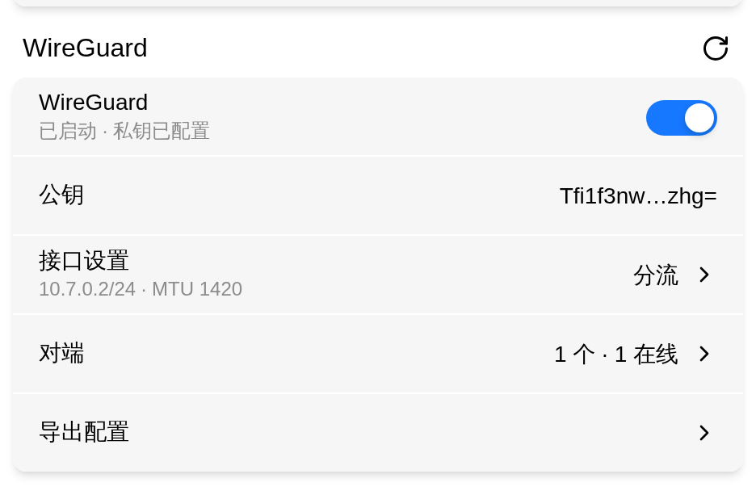
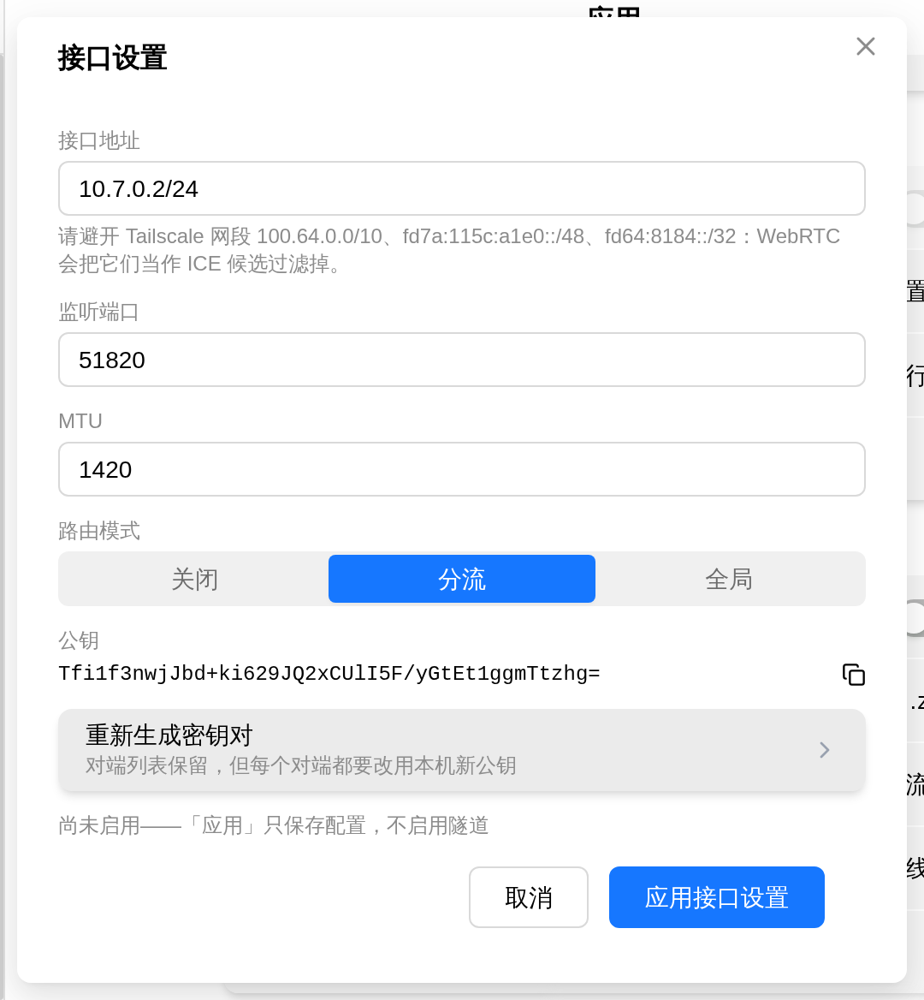
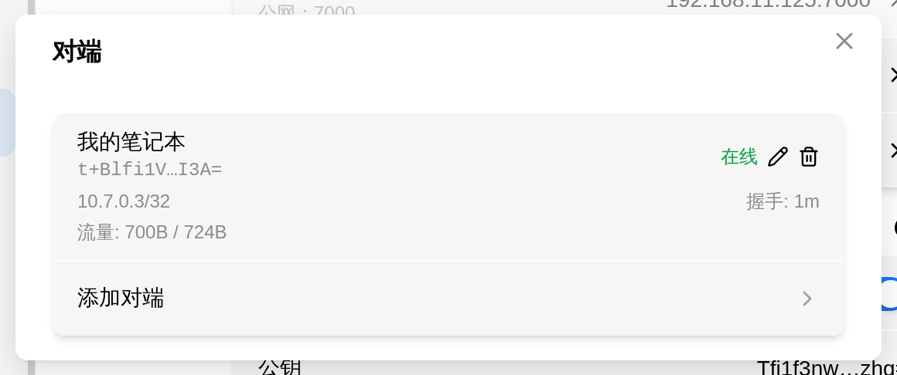
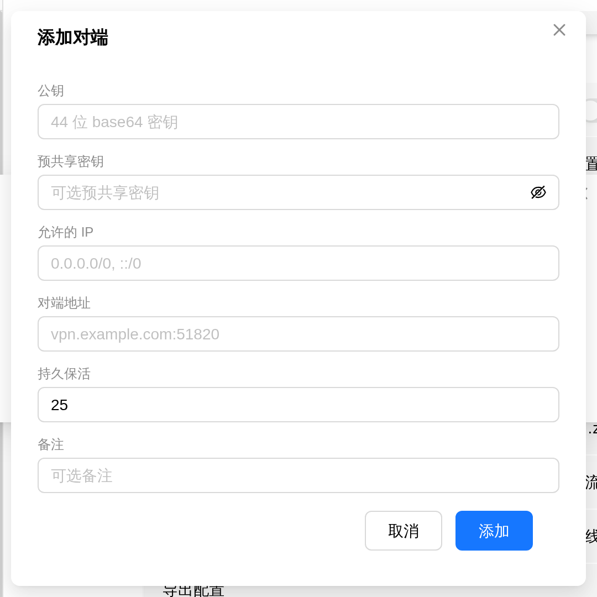
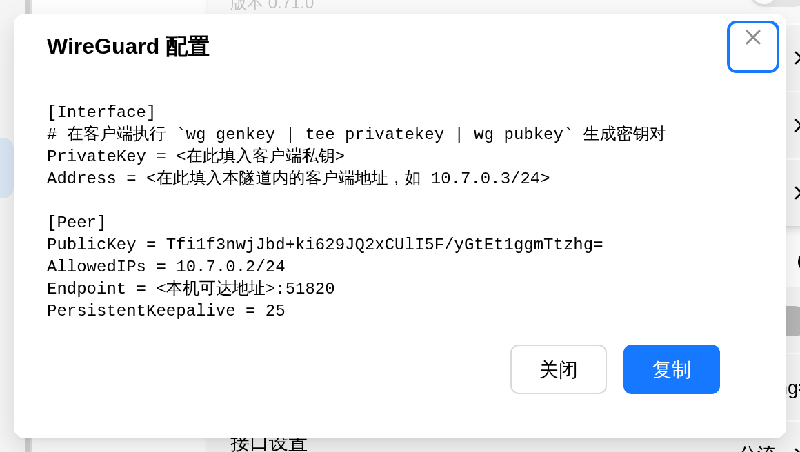

# WireGuard

WireGuard 是一条点对点的加密隧道：把 FlexKVM 和你自己的对端（自建服务器、云主机、另一台设备）连起来，之后就能像在同一个局域网里一样访问设备。它不经过第三方控制面，隧道两端各自持有对方的公钥即可通信。

> 入口：设置 → 应用 → WireGuard

> **和 Tailscale / ZeroTier 不一样**：WireGuard 的实现**在内核里**，随固件固化，**没有守护进程、也没有需要安装的应用包**——它不会显示版本号，卡片里没有「应用在线更新」入口行，也没有"服务是否已安装"这一说。FlexKVM 的面板只做配置编排：把配置经 netlink 交给内核，再把内核里的运行态读回来，既不调用 `wg` / `ip` 命令，也不起任何子进程。

卡片上只有五行：启用开关（副标题就是接口与私钥状态）、公钥、接口设置、对端、导出配置。**推荐顺序是：先生成密钥 → 再配接口 → 加对端 → 最后打开开关**——缺密钥或缺对端时开关是置灰的，点不动。

## 生成密钥

打开「接口设置」→ 点「重新生成密钥对」→ 在确认框里点「确认」。

- 密钥对由设备生成，**私钥只落在设备本地**（`/userdata/network/wireguard/secrets`，权限 0600），**不会回传给浏览器**；面板上只能看到公钥，以及开关副标题里的「私钥已配置 / 未配置」。预共享密钥同理，也是只写不读的。
- **重新生成会让所有对端失效**：对端列表不会被清空，但每个对端都要改用本机新公钥，否则无法握手。确认框里写明了这一点。
- 隧道开着时，新私钥会**立刻**下发给内核并重建接口；关着时只落盘，下次启用才生效。
- 卡片「公钥」一行在没生成时显示「未生成」；生成后显示一段首尾缩写的公钥，**点这一行即可复制完整公钥**——把它发给对端。

> **验证**：提示「密钥对已重新生成」，「公钥」一行从「未生成」变成形如 `xTIBA5rb…p8Dg` 的缩写，副标题里的私钥状态变为「私钥已配置」。

## 接口设置

点卡片「接口设置」一行打开弹窗。除了公钥展示与「重新生成密钥对」，可提交的字段一共四个：

| 字段 | 说明 |
|------|------|
| 接口地址 | 隧道内本机的地址，CIDR 写法，逗号或空格分隔，**至少 1 条、最多 8 条**。不允许前缀 0（`10.0.0.1/0` 这种默认路由会被拒）。设备还没配过时弹窗给的建议初值是 `10.7.0.2/24`，按你的网段改掉即可 |
| 监听端口 | `0`~`65535`，**留空等于 0**：不监听、由内核随机分配端口（纯客户端场景推荐）。要让对端主动连进来（本机做服务端），必须固定一个端口 |
| MTU | `576`~`1500`，初值 `1420` |
| 路由模式 | 「关闭」/「分流」/「全局」，见下 |

接口地址请避开 Tailscale 用的 `100.64.0.0/10`、`fd7a:115c:a1e0::/48`、`fd64:8184::/32`——浏览器端会把它们当作 WebRTC ICE 候选过滤掉。

### 路由模式

| 模式 | 行为 |
|------|------|
| 关闭 | 不接管任何路由，只建接口、配地址 |
| 分流 | 按各对端的「允许的 IP」加明细路由（默认档；`0.0.0.0/0` 与 `::/0` 会被跳过） |
| 全局 | 默认路由进隧道（IPv4 流量；IPv6 仍走主表） |

> **「全局」有硬前置条件**：至少要有一个对端的「允许的 IP」覆盖 `0.0.0.0/0`，否则面板会提示「全局模式需要至少一个对端的「允许的 IP」包含 0.0.0.0/0，否则除隧道网段外的出站流量会被全部丢弃」。内核按各对端的「允许的 IP」决定谁能加密一个包——没有对端覆盖默认路由时，除隧道网段外的出站包会被全部丢弃，**连回给你浏览器的包也一样**，当前管理会话会直接卡死，而设备上没有本地入口能恢复。后端把这条当不变量：任何「把已经成立的全局配置弄坏」的改动都会被拒绝并整体回滚。
>
> 「全局」用的是策略路由：物理默认路由完全不动，所以进程退出、设备重启都不会丢掉设备原本的上网路由。

点「应用接口设置」提交。

- **还没启用时提交照样会保存**（弹窗底部会提示「尚未启用——「应用」只保存配置，不启用隧道」）。所以可以先配好地址/端口/MTU/路由模式，再打开开关，一次到位、只重建一次接口。
- 内核相关字段**一个都没变**时后端不会重建接口——重复点「应用」或只改对端备注都不会中断隧道；值真的变了才会重建，期间隧道短暂中断。

> **验证**：提示「接口设置已应用」，「接口设置」一行的摘要从「未配置 · MTU 1420」变成你的地址与 MTU（如 `10.7.0.2/24 · MTU 1420`），右侧显示当前路由模式（如「分流」）。

## 对端

点卡片「对端」一行打开列表。每条对端显示：备注（没填则显示「未命名对端」）、公钥缩写、在线 / 离线、允许的 IP、握手（距上次握手多久，从未握手显示 `-`）与流量（收 / 发）；行右侧是编辑与删除按钮，列表底部是「添加对端」。**对端最多 32 条**，满了之后「添加对端」入口会给出上限提示。

### 添加对端

需要从对端那一侧拿到三样东西：

| 要什么 | 说明 |
|--------|------|
| 对端公钥 | 对端自己的公钥，44 位 base64（以 `=` 结尾），必填。**这是对端的身份**，粘错就连不上 |
| 对端地址 | 对端的 `host:port`，如 `vpn.example.com:51820`；IPv6 要写成 `[::1]:51820`。**留空表示不固定对端地址**——等对端主动连进来（本机做服务端、对端做客户端的场景） |
| 允许的 IP | 走这条隧道要访问的对端网段（CIDR，1~16 条）。它同时决定路由与入站过滤：**分流模式下没写进这里的网段不会有路由** |

表单里其余几项：

- **预共享密钥**：可选；不填就是不给这个对端设 PSK（编辑时留空表示保持原密钥）。如果对端那边配了，这里要填同一个值。
- **持久保活**：默认 `25` 秒，留空即 `0`（关闭）。**对端在 NAT 后面时建议保持 25**——WireGuard 的首包在握手完成前会被直接丢弃（协议行为，不排队），保活能显著缓解这个问题。
- **备注**：仅本地保存、不下发内核，上限 63 字节（中文约 21 字）。

点「添加」提交，提示「对端已添加」。

> **验证**：卡片「对端」一行从「暂无对端」变为「1 个 · 0 在线」；点进列表能看到这条对端，握手显示 `-`（还没握过手）。

### 修改对端

点对端行右侧的铅笔按钮，弹窗标题是「编辑对端」，底部按钮是「保存」。

- **公钥不能改**：它是这条对端的身份，编辑态下只读（会提示「公钥即对端身份，不支持修改」）。要换对端公钥，只能删除后重加。
- **预共享密钥留空表示保持原密钥**；要删掉已配的密钥，勾选「清除预共享密钥」。
- 对端漫游后，内核看到的实时地址与配置里的「对端地址」可能不同，此时表单下方会提示「内核实时地址：…（对端漫游后的值，仅显示，不会写回配置）」。这个值只供参考，写回配置在重启后会失效。

只改备注不会重建接口，隧道不会因此中断。

> **验证**：提示「对端已更新」；列表里该对端的备注/允许的 IP 已刷新。

### 删除对端

点对端行右侧的垃圾桶按钮 → 在确认框里点「确认」。删除后隧道**立刻**失去这个对端，它的预共享密钥也会一并清掉，且没有撤销——删错了只能重配。

> 路由模式是「全局」时，删掉最后一个「允许的 IP」覆盖 `0.0.0.0/0` 的对端会被拒（原因同上一节）。已经坏掉的配置例外，一律放行。

> **验证**：提示「对端已删除」，列表与卡片摘要里的数量同步减少。

## 启用 / 禁用

打开卡片上的开关即启用。启用会**全量重建接口**：删掉旧接口 → 建 `wg0` → 下发配置 → 配地址与 MTU → 拉起接口 → 按路由模式加路由，比其他操作慢，期间隧道短暂中断；禁用则把接口拆掉。

开关副标题就是当前状态：

| 副标题 | 含义 |
|--------|------|
| 请先生成密钥并至少添加一个 Peer | 还没生成密钥或没有对端，开关置灰 |
| 请稍等... | 启用/禁用正在进行，开关也暂时点不动 |
| 已启动 · 私钥已配置 | 内核里的接口已经起来了 |
| 未启动 · 私钥已配置 | 配置就绪，但接口没起来 |

- 启用失败会**回滚开关**，并直接显示后端返回的原因（缺密钥/对端、全局模式缺默认路由对端、配置不合法、内核侧失败各有区分）。
- 开关和内核实际状态一致时不会重建接口；**已经开着的状态一律放行**——配置被删空也不会出现"关不掉的开关"。
- 隧道开着时面板每 5 秒自动读一次内核运行态（标签页切到后台时暂停），对端的「在线 / 握手 / 流量」就是这么来的；也可以点卡片右上角的刷新按钮立刻读一次。
- 「在线」的判定是**握手距今不到 180 秒**，所以刚加上的对端要等首次握手才会显示「在线」。

> **验证**：提示「设置成功」，副标题变为「已启动 · 私钥已配置」。如果还是「未启动」，等一两秒——开关回包里的运行态来自上一次内核读数，设备随后会推一条最新状态；等首次握手后，对端列表里会出现「在线」与握手时间。

## 导出配置（给对端用）

点卡片「导出配置」，弹窗里是**给对端（客户端）用的配置模板**，包含 `[Interface]` / `[Peer]` 两段、本机公钥、隧道网段与 `PersistentKeepalive`。点「复制」拿走，在客户端存成 `.conf` 导入即可。

- **这不是本机配置的备份**：本机配置里有私钥，导出到浏览器等于把私钥送出设备。模板里的客户端私钥与地址都是占位符（`PrivateKey = <在此填入客户端私钥>`、`Address = <在此填入本隧道内的客户端地址，如 10.7.0.3/24>`），模板第一行注释写了怎么在客户端生成密钥对，照做后填进去。
- `Endpoint` 一行按监听端口分两种：端口固定时给的是 `<本机可达地址>:<你的监听端口>`，把「本机可达地址」换成对端能访问到的本机地址即可；**端口为 0（内核随机）时不会吐出 `:0`**，而是给占位符并在上方加一条注释，要求先在设备上设一个固定端口——想让对端主动连进来，这一步是必须的。
- 还没生成密钥时导出会失败（提示「导出失败」）。

> **验证**：弹窗里出现完整的 `.conf` 文本，含刚才复制的本机公钥与你的监听端口；点「复制」提示「已复制到剪贴板」。

> 对端侧的公钥、Endpoint、AllowedIPs 填反了是最常见的连不上原因：**本机导出模板里的 `Endpoint` 填到对端的 `Peer.Endpoint`，本机公钥填到对端的 `Peer.PublicKey`**，而本机这边「对端」列表里填的则是对端的公钥与地址。

---

## 故障排查

| 现象 | 可能原因 | 先试这个 |
|------|----------|---------|
| 卡片显示「WireGuard 不可用: 内核未启用 WireGuard 支持」 | 固件内核没有编入 WireGuard 支持 | 联系技术支持确认固件版本 |
| 开关置灰，副标题「请先生成密钥并至少添加一个 Peer」 | 还没生成密钥，或对端列表为空 | 在「接口设置」里生成密钥对，并至少添加一个对端 |
| 打开开关弹出 `Generate a keypair and add at least one peer first` | 缺私钥或缺对端（后端在碰内核之前就拒绝，配置不会被改动） | 看「公钥」一行是否「未生成」、对端列表是否为空 |
| 打开开关弹出 `Global mode needs at least one peer whose AllowedIPs include 0.0.0.0/0` | 路由模式是「全局」，但没有对端的「允许的 IP」覆盖 `0.0.0.0/0` | 给某个对端的「允许的 IP」加上 `0.0.0.0/0`，或把路由模式改回「分流」 |
| 副标题一直停在「未启动」 | 接口没建起来（配置不合法或内核侧失败） | 等一两秒看有没有新状态推送；仍不行就看面板弹出的后端原文，核对公钥、对端地址与允许的 IP |
| 对端一直「离线」 | 还没握过手（「在线」= 握手距今不到 180 秒）；对端没配上本机公钥；地址不可达 | 先在对端侧把本机公钥配上，再配「持久保活」；确认对端地址能被访问到 |
| 副标题已显示「已启动」，但访问不到对端网段 | 路由模式是「关闭」，或该网段没写进「允许的 IP」 | 把要访问的网段写进对端的「允许的 IP」，或把路由模式改成「分流」 |
| 导出配置里 `Endpoint` 是占位符，还带一条要先固定端口的注释 | 监听端口是 0（内核随机分配，对端无法预知） | 在「接口设置」里固定一个监听端口后重新导出 |
| 点「导出配置」提示「导出失败」 | 还没生成密钥，没有可导出的公钥 | 先生成密钥对再导出 |
| 点「公钥」一行提示「复制失败」 | 页面不是安全上下文（明文 HTTP 下浏览器不提供剪贴板接口） | 改用 HTTPS 访问管理界面后重试 |

---

[:octicons-arrow-left-24: 返回用户指南](../index.md)
