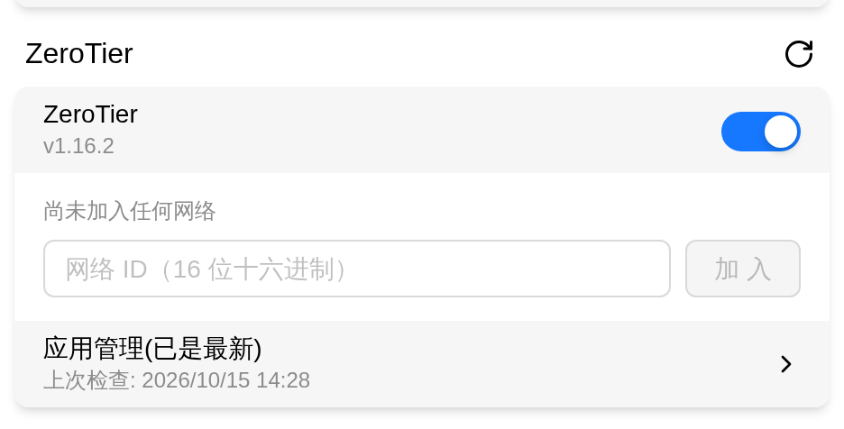
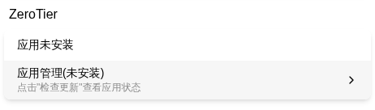
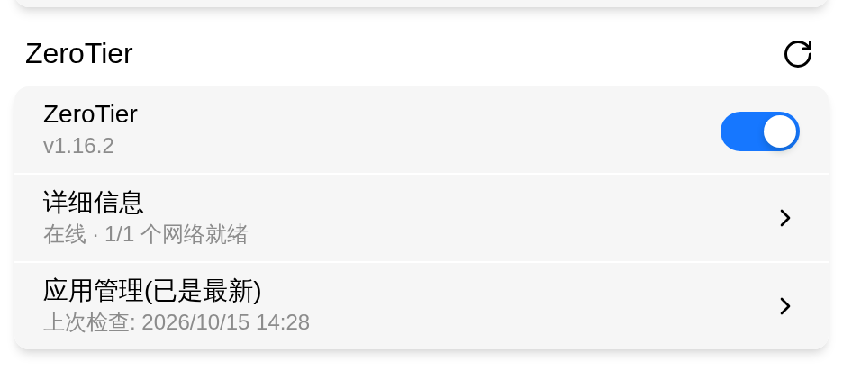
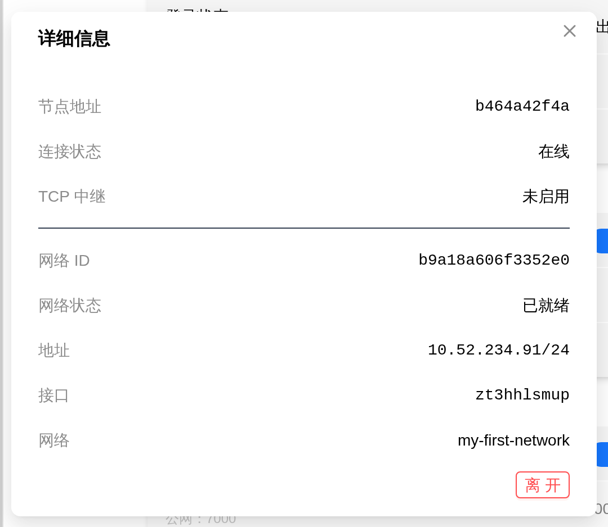

# ZeroTier

ZeroTier is a virtual networking tool on FlexKVM — it puts your device into a virtual Layer 2 network, so you can reach it at the member address assigned inside that network (e.g. `10.52.234.173`) no matter what network it actually sits behind. No public IP, no router port forwarding. Unlike Tailscale, there is no login step: the device holds its own identity file locally and becomes a member as soon as it joins the network.

> Where: Settings → App → ZeroTier

> First create (or join) a network in [ZeroTier Central](https://central.zerotier.com) and copy its 16-digit **Network ID** (e.g. `b9a18a606f3352e0`). Adding a device requires admin rights on that network; for a **private** network you must also authorize this node in the network console, otherwise the network status stays at **Access denied**.

## Install

ZeroTier ships as an app on FlexKVM. If the device doesn't have it yet, the card shows **App not installed** — neither the service toggle nor the network input is available:

Install it from the **App Management** row on the same card:

1. Click **App Management** to open the update panel
2. Click **Check for Updates** (one successful check is required before the download entry appears)
3. With the app not installed the button reads **Download**; once the package is downloaded and verified it turns into **Install Now** — click it to install
4. Installation **cannot be cancelled**, and no device reboot is needed afterwards

> Download sources, the full check/download flow and failure reasons: [App Management](../maintenance/upgrade-app.md).

> **Verify**: the **App not installed** notice disappears and the service toggle plus the Network ID input appear.

## Enable the Service

Toggle the switch to enable — it takes effect immediately: the backend starts the zerotier-one daemon on the device. If the app isn't installed the toggle isn't shown at all, so install it first.

Once enabled, the description under the toggle shows the **version** (e.g. `v1.16.0`); when a newer version is found it appends `(update available)`, and you can update it from **App Management**.

> **Verify**: the toggle is on and a **refresh** icon appears next to the card title (it's absent while the service is disabled).

## Join a Network

Enter the 16-digit hexadecimal Network ID in the **Network ID** field and click **Join** (pressing Enter in the field works too):

1. Copy the Network ID from your network page in ZeroTier Central (16 hex digits, e.g. `b9a18a606f3352e0`)
2. Paste it into the field and click **Join**
3. The join is **acknowledged synchronously**: the local control plane accepts it right away, and the member configuration is pushed afterwards

The network first shows **Requesting configuration**, then **Ready** once the address arrives:

> **Verify**: a `Join Command sent` toast appears; the input row collapses into a **Detail Info** entry whose subtitle reads `Online · 1/1 networks ready`.

> Anything that isn't 16 hex digits is rejected on the spot with **Network ID must be 16 hex digits** — nothing is sent to the device.

> For a **private** network, the network administrator must authorize this node in ZeroTier Central after it joins; until then the network status stays at **Access denied** and no member address is assigned.

> **Only one network is allowed**: while nothing is joined the card offers the input field; once joined the field is gone and only the **Detail Info** entry remains, and the backend rejects a second join as well. To switch networks, **Leave** the current one first from **Detail Info**.

## Network Options

A ZeroTier network has several member-level options: whether to accept addresses and routes from the control plane, whether to allow a default route, whether to allow global addresses, and so on. **The settings page exposes none of these switches** — FlexKVM fixes them when the device joins:

| Option | Value at join | Why |
|--------|---------------|-----|
| Accept managed addresses and routes | Left at its default (on) | The member address and the interface route for that subnet come from it; turning it off leaves the network with no IP |
| Default route | Forced off | A default route inside the tunnel would cut off the management path |
| Global addresses | Forced off | Global addresses never enter the tunnel |

Other options (such as control-plane DNS) are not rewritten at join and keep ZeroTier's default behaviour. These values are written into the device's local configuration for that network and **survive a daemon restart**.

> In short: **no route takeover** — neither a default route nor global addresses enter the tunnel; but **addresses still arrive** — the member address and the interface route for that subnet work normally.
>
> If you ever need to change these options (troubleshooting or secondary development), the control endpoint is still there, it just isn't exposed in the settings page.

## Detail Info

The **Detail Info** entry on the card collects this node's connection facts and the joined network. It only appears when the service is enabled and a network has been joined (its subtitle reads `Online/Offline · x/y networks ready`):

| Field | Description |
|-------|-------------|
| Node Address | This node's 10-digit hexadecimal ZeroTier address; empty while the service is disabled |
| Connection status | **Online** = connected to at least one root or peer; **Offline** = none reachable |
| TCP Relay | **Enabled** = UDP is completely blocked, so ZeroTier's TCP relay fallback is in use (it works, but with higher latency); normally **Disabled** |
| Network ID | The network's 16-digit number |
| Network status | Member status, see the table below |
| Address | Member address assigned by the control plane (with mask, e.g. `10.52.234.173/24`); shows **No address assigned yet** until it arrives |
| Interface | The TAP interface name on this device (e.g. `zt3hhlsmup`) |
| Network | Network name (sent by the control plane; the row is hidden when there is no name) |

Network status values:

| Status | Meaning |
|--------|---------|
| Ready | Member configuration delivered — reachable at the address |
| Requesting configuration | Just joined, waiting for addresses and routes |
| Access denied | Private network; this node hasn't been authorized in the console yet |
| Network not found | The Network ID doesn't exist (usually a typo) |
| Interface error | Creating the TAP interface on this device failed |
| Client too old | The control plane requires a newer zerotier-one |
| Authentication required | The control plane asks for authentication |
| Unknown status | The control plane returned a word the UI doesn't know; shown as-is |

> Status isn't pushed in real time: the backend polls the local control plane every 3 seconds (sped up to 500ms for 30 seconds after a join or leave), so address assignment and the switch to **Ready** can lag a few seconds. Click the **refresh** icon next to the card title to query immediately.

## Peer List

ZeroTier is a peer-to-peer network: which nodes this device is connected to and over which path (direct UDP or a relay) is described by its **peers** — address, role, version, latency and path list.

> **The settings page has no peer list.** Peer data comes from the WS endpoint (`event_type` `zerotier`, `type` `peers`, login required); it is the raw array returned by the local control plane, and its fields vary with the zerotier-one version. For day-to-day remote access you only need the **Address** from **Detail Info**, not the peer list.

## Remote Access

Once the device has joined a network and has a member address, **install ZeroTier on the device you want to access FlexKVM from and join the same network** (private networks need authorization there too). Then:

- **Web interface**: `https://<member address>` (e.g. `https://10.52.234.173`)
- **SSH**: `ssh <username>@<member address>`

Traffic goes over that network's TAP interface on the device and has nothing to do with the settings web UI — with both ends on the same network, access feels like being on the same cable, through NAT and firewalls.

## Leave a Network

Open **Detail Info** and click **Leave** under that network:

The device tears down the network's TAP interface and address and removes the network from its member table.

> **Verify**: a `Leave Command sent` toast appears; the card returns to its unjoined shape — **Not joined to any network yet** and the Network ID input come back, and the **Detail Info** entry disappears. To switch networks, just enter the new Network ID now.

## App Management

The **App Management** row on the card is the online update entry for the ZeroTier package (independent from Tailscale and frp). It offers:

| Action | Description |
|--------|-------------|
| Download Source | **GitHub** / **Gitee**; switching sources clears the downloaded package and the online info, so you must check for updates again |
| Check for Updates | Pulls the latest version info from the current source; the row shows the last check time |
| Download | Downloads the package and verifies its integrity (progress, speed and remaining time shown; can be cancelled) |
| Install Now | Appears after verification passes; installation cannot be cancelled and rolls back on failure |
| Uninstall | Only shown when installed; stops the service and deletes the app files (including the install-time backup) |

> Uninstalling sets the service toggle back to off; after reinstalling you must turn it on again manually.
>
> Each app has a single task slot: only one of check/download/install/uninstall can run at a time, and any further click reports **Another update task is running, try again later**.

Full flow (every status and failure reason): [App Management](../maintenance/upgrade-app.md).

---

## Troubleshooting

| Symptom | Likely cause | Try this first |
|---------|--------------|----------------|
| Card shows **App not installed**, no toggle | The ZeroTier package isn't on the device (not installed, or signature check failed) | Install it from **App Management** on the card after checking for updates |
| **Network ID must be 16 hex digits** | Wrong network number: bad length or non-hex characters | Copy the full 16-digit Network ID from ZeroTier Central |
| Network status stays at **Requesting configuration** | Member configuration hasn't been pushed yet (normally a few seconds) | Wait a few seconds; click the **refresh** icon next to the card title |
| Network status **Access denied** | Private network, node not authorized in the console | Authorize the node in the ZeroTier Central member list |
| Network status **Network not found** | The Network ID doesn't exist | Double-check the Network ID you entered |
| Join fails saying another network is already joined | Only one network is allowed | **Leave** the current network from **Detail Info**, then join the new one |
| Join fails saying the service isn't enabled | The daemon isn't running (toggle off) | Turn the service toggle on and retry |
| Toggle is on but the description says **Service is not running** | The zerotier-one process died | Toggle the switch off and on to restart it; if it still won't run, reinstall the app |
| **TCP Relay** shows **Enabled** | UDP is completely blocked, so the TCP fallback is used | Check whether your network blocks outbound UDP; the relay works but adds latency |
| Status changes very slowly | Status comes from a 3-second poll, not a push | Click the **refresh** icon next to the card title |
| Service is enabled but there's no **Detail Info** entry | No network has been joined yet | Enter a Network ID and click **Join** |
| Can't connect remotely | Control device has no ZeroTier, joined a different network, or the private network isn't authorized | Join the same network on the control device and confirm the member address is reachable |

---

[:octicons-arrow-left-24: Back to User Guide](../index.md)
